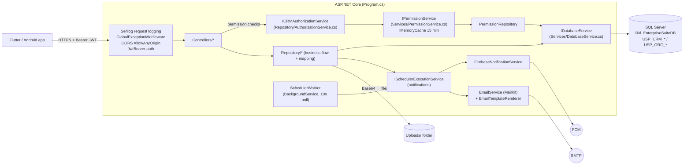
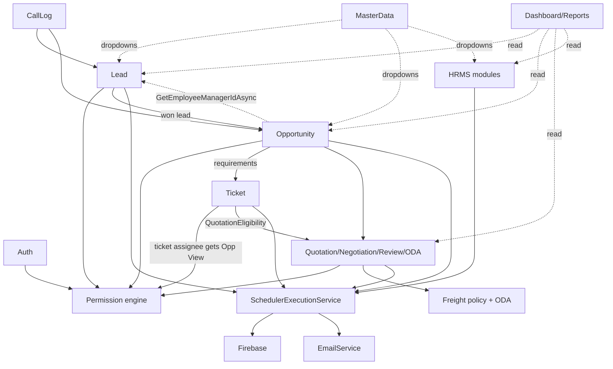
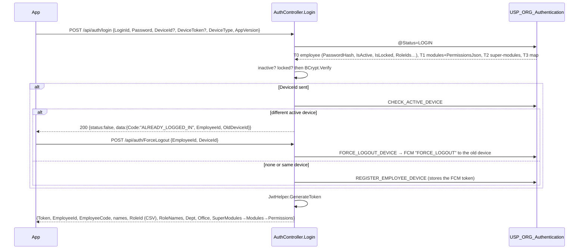
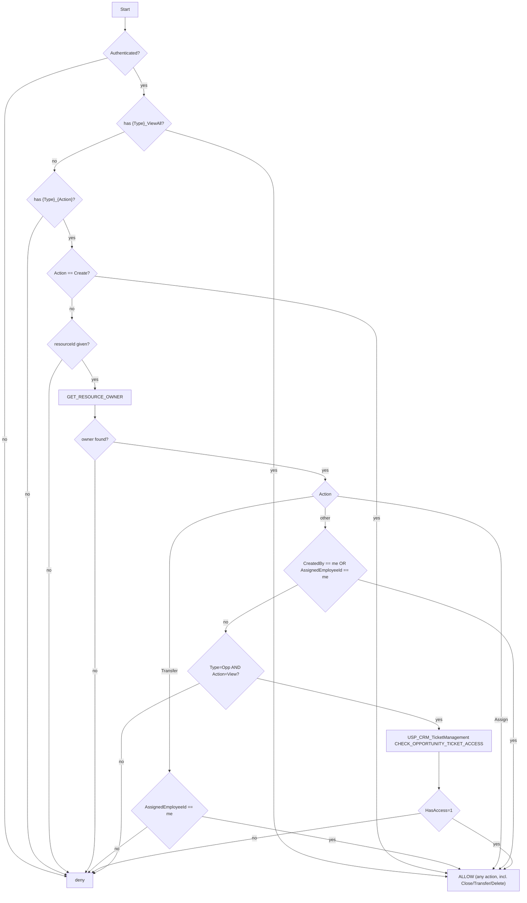
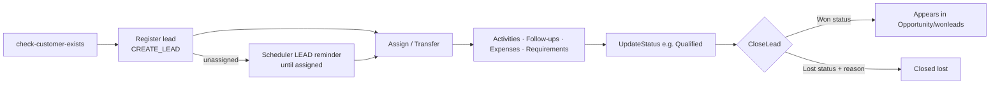
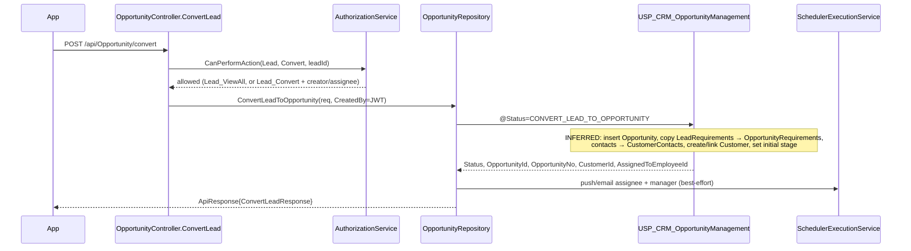
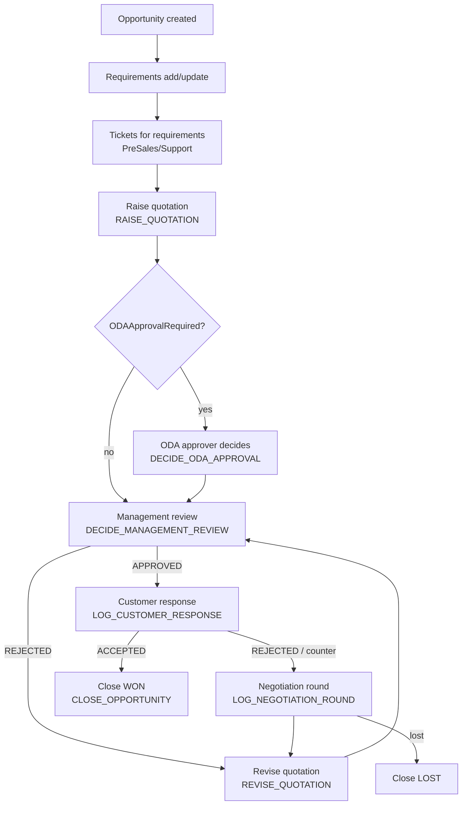
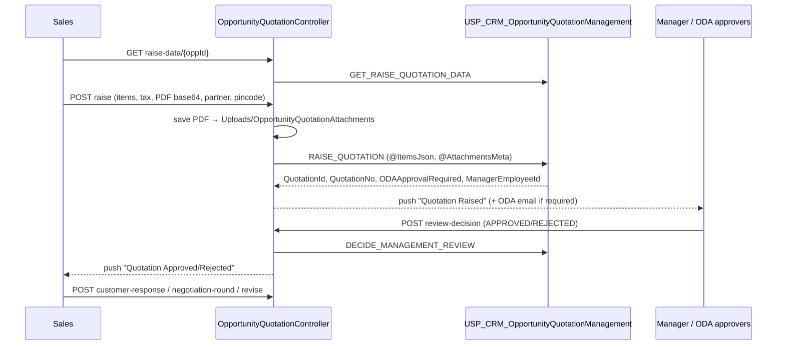
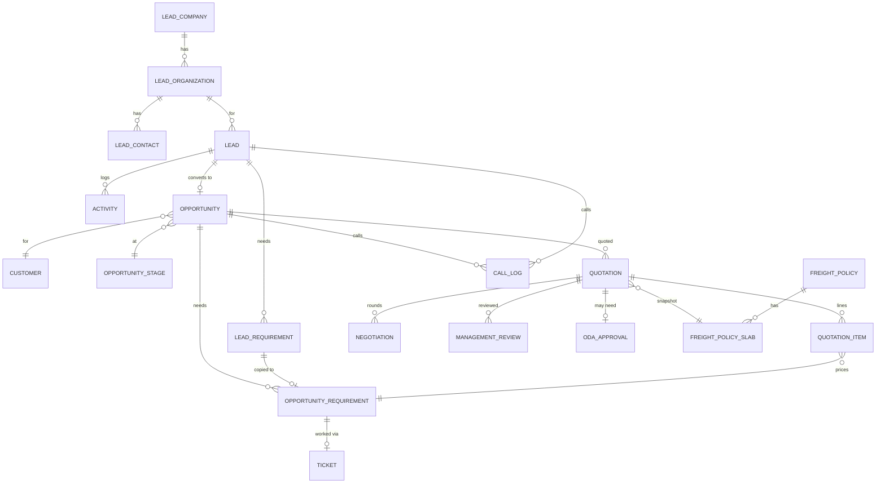

# BRAIN.md — CRMWebServices (Rajkamal Business Management Platform) Knowledge Base

> **Read this first.** Future AI agents: start here, find your module in §3, and open only the files listed for it. See §14 for working rules and [AGENTS.md](AGENTS.md).
>
> **Analysis date:** 2026-11-03 · **Branch:** `feature/newFeature` (includes uncommitted Payslip/Resignation/Regularization work) · **Progress log:** [BRAIN_PROGRESS.md](BRAIN_PROGRESS.md)

## Labels

| Label | Meaning |
|---|---|
| **VERIFIED** | Confirmed in source code in this repo (file:line given) |
| **INFERRED** | Strongly suggested by parameters/columns/comments, not proven |
| **NOT VERIFIED** | Could not be confirmed (usually: logic lives in a stored procedure body that is not in the repo) |
| **NEEDS INVESTIGATION** | Requires DB access or the client app to confirm |

> ⚠️ **Most important caveat.** This repository contains **no stored procedure bodies or table DDL** for the CRM. The only SQL file is [Database/AttendanceRegularization.sql](Database/AttendanceRegularization.sql). Almost all business rules (stage transitions, requirement transfer on conversion, quotation totals, list visibility) live **inside SQL Server stored procedures**. Read-only DB catalog access was attempted during analysis and was not permitted. Everything about DB internals below is INFERRED from C# parameters and the result columns C# reads, unless marked otherwise.

---

## Table of contents

1. [System overview](#1-system-overview)
2. [Architecture and code conventions](#2-architecture-and-code-conventions)
3. [Module index (where to look)](#3-module-index-where-to-look)
4. [Authentication and authorization](#4-authentication-and-authorization)
5. [CRM modules](#5-crm-modules)
6. [Complete CRM workflows](#6-complete-crm-workflows)
7. [HRMS and platform modules](#7-hrms-and-platform-modules)
8. [Database architecture](#8-database-architecture)
9. [API catalogue](#9-api-catalogue)
10. [Dashboards and reports](#10-dashboards-and-reports)
11. [Business rules register](#11-business-rules-register)
12. [Technical risks and known issues](#12-technical-risks-and-known-issues)
13. [Frontend / UI](#13-frontend--ui)
14. [Instructions for future AI agents](#14-instructions-for-future-ai-agents)

---

## 1. System overview

| Item | Value | Status |
|---|---|---|
| Project | `CRMWebServices` ([CRMWebServices.csproj](CRMWebServices.csproj)), solution [CRMWebServices.slnx](CRMWebServices.slnx) | VERIFIED |
| Type | ASP.NET Core Web API, **.NET 8** (`net8.0`, `Nullable=disable`, `ImplicitUsings=enable`) | VERIFIED |
| Purpose | Backend for a **CRM** (Lead → Opportunity → Quotation → Ticket) plus an **HRMS** (Employee, Attendance, Leave, Probation, Payslip, Resignation, Announcements) | VERIFIED ([README.md](README.md)) |
| Clients | Android/Flutter mobile apps and Flutter web (CORS policy is named `AllowFlutterWeb`). **No frontend code is in this repo.** | VERIFIED / INFERRED |
| Database | SQL Server, database `Rkl_EnterpriseSuiteDB` (a `_Live` variant exists in commented config). Accessed via ADO.NET and stored procedures. | VERIFIED ([appsettings.json](appsettings.json)) |
| Data access | `Microsoft.Data.SqlClient` through [Services/DatabaseService.cs](Services/DatabaseService.cs). EF Core packages are referenced, but **no DbContext exists**. | VERIFIED |
| Auth | JWT Bearer (HS256), BCrypt password hashes | VERIFIED |
| Push / Email | FirebaseAdmin (FCM); MailKit with SMTP settings stored in the DB | VERIFIED |
| Logging | Serilog to console and `Logs/crm-log-.txt` (daily, 30 files kept) | VERIFIED ([Program.cs:18-32](Program.cs#L18-L32)) |
| API docs | Swagger, enabled in the Development, InternalNetwork and OutsideNetwork environments | VERIFIED ([Program.cs:143-147](Program.cs#L143-L147)) |

### NuGet dependencies ([CRMWebServices.csproj](CRMWebServices.csproj))
AutoMapper 16.2 (no usage found, INFERRED unused), BCrypt.Net-Next 3.1, FirebaseAdmin 3.6, Google.Apis.Auth 1.75, MailKit 4.17, JwtBearer 8.0, Microsoft.Data.SqlClient 7.0.2, EF Core SqlServer/Tools 9.0 (unused), Newtonsoft.Json 13, Serilog.* , Swashbuckle 6.6.2.

### Environments and config
| File | Purpose |
|---|---|
| [appsettings.json](appsettings.json) | Base config: `ConnectionStrings:DefaultConnection` (**the key appears 4 times in one object; the last one wins**), `Jwt:{Key,Issuer=CRMAPI,Audience=CRMUsers,ExpiryMinutes=1440}`, `EmailSettings:CompanyLogoPath` |
| `appsettings.Development.json` / `.InternalNetwork.json` / `.OutsideNetwork.json` | Per-environment connection strings |
| [Properties/launchSettings.json](Properties/launchSettings.json) | Profiles `https` (7022), `http` (5163), `Internal Network`, `Outside Network`, `IIS Express` |
| `Properties/PublishProfiles/FolderProfile*.pubxml` | Folder publish |
| `Firebase/firebase-service-account.json` | FCM credentials. Git-ignored, but **required at startup**: the FirebaseNotificationService constructor throws without it. |
| `Templates/Email/*.html` | Email templates, copied to output |
| `Uploads/` | Runtime file storage, served statically at `/Uploads` **without authentication** |

> Never copy secret values from these files into docs, code or logs. Credentials are present in tracked config files (see §12).

---

## 2. Architecture and code conventions



### Request pipeline ([Program.cs](Program.cs)) — VERIFIED
`UseSerilogRequestLogging` → `GlobalExceptionMiddleware` (returns a generic 500 `ApiResponse`) → Swagger (in non-prod environments) → `UseHttpsRedirection` → `UseStaticFiles` (wwwroot) → `UseStaticFiles` (`/Uploads` → `ContentRoot/Uploads`) → `UseCors("AllowFlutterWeb")` → `UseAuthentication` → `UseAuthorization` → `MapControllers`.

### Layering pattern — VERIFIED
```
Controller  → token → EmployeeId, permission check, input sanity
  → I<Module>Repository (Interfaces/)  → builds SqlParameters, maps DataTable/DataSet → models, sends notifications
    → IDatabaseService                 → ExecuteDataTableAsync / ExecuteDataSetAsync / ExecuteScalarAsync / ExecuteNonQueryAsync
      → ONE stored procedure per module, switched by @Status ('CREATE_LEAD', 'GET_LEAD_LIST_FULL', …)
```
- Each SP mutation returns a row with **`Status` (1/0 or bit) and `Message`**, plus ids. Repositories map it to `ApiResponse`.
- **Response envelope** ([Helpers/ApiResponse.cs](Helpers/ApiResponse.cs)): `{ "status": bool, "message": string, "data": object }`.
- JSON collections (contacts, requirements, items, attachment metadata, slabs) go to SPs as **JSON string parameters**, which are INFERRED to be parsed with `OPENJSON`.
- **There is no service layer.** Repositories contain the business orchestration. "Services" are infrastructure only.
- **There are no C# transactions anywhere.** Atomicity is per SP call.
- **Exception:** the Resignation module uses its own `SqlConnection`, a different SP (`dbo.usp_Resignation_Manage` with `@Action`) and inline SQL ([Repository/ResignationRepository.cs](Repository/ResignationRepository.cs)).

### Dependency injection ([Program.cs:65-103](Program.cs#L65-L103)) — VERIFIED
All repositories are `Scoped`. `EmployeeRepository` is registered as a concrete class. `FirebaseNotificationService`, `EmailTemplateRenderer`, `SchedulerEmailComposer` and `JwtHelper` are `Singleton`. `SchedulerWorker` is a hosted service. `ICRMAuthorizationService` is registered **twice** (lines 71 and 75; harmless).

### Shared helpers
| File | Purpose |
|---|---|
| [Helpers/JwtHelper.cs](Helpers/JwtHelper.cs) | `GenerateToken(employeeId, loginId, employeeCode, roleIds)` |
| [Helpers/ClaimsPrincipalExtension.cs](Helpers/ClaimsPrincipalExtension.cs) | `User.EmployeeId()` (uses `int.Parse` and throws if the claim is missing); `User.HasRole(params int[])` (**no callers**) |
| [Helpers/RoleCodes.cs](Helpers/RoleCodes.cs) | `RoleIds` constants: Admin=1, Sales=2, PreSales=3, Support=4, Manager=5 |
| [Helpers/GlobalExceptionMiddleware.cs](Helpers/GlobalExceptionMiddleware.cs) | Catches unhandled exceptions and returns a generic 500 |
| [Helpers/DataTableExtensions.cs](Helpers/DataTableExtensions.cs) | `DataTable.ToList()` → list of dictionaries (used by dashboards) |
| [Helpers/UserContext.cs](Helpers/UserContext.cs) | **New and untracked.** Namespace `ResignationApi.Helpers`. `GetEmployeeId()` reads claim `"employeeId"` (wrong case, and has no callers). `IsHr()` uses `IsInRole`, which is **always false** with this JWT. |
| [Data/DBConnection.cs](Data/DBConnection.cs) | `new SqlConnection(DefaultConnection)` |

### File uploads — VERIFIED
Clients send **Base64** strings. They are saved under `Uploads/<Folder>/` and the metadata JSON `[{FileName,FilePath,FileType,FileSize}]` is passed to the SP.

| Folder | Written by |
|---|---|
| `LeadAttachments`, `LeadActivityAttachments` | LeadRepository `SaveBase64Attachment` (extension allow-list `.pdf .doc .docx .xls .xlsx .jpg .jpeg .png`, 10 MB limit, sanitised name) |
| `OpportunityActivityAttachments`, `OpportunityActivityExpenseAttachments` | OpportunityRepository (**no allow-list or size limit; name not sanitised**) |
| `OpportunityQuotationAttachments` | OpportunityQuotationRepository (`{Guid}_{fileName}`, **not sanitised**) |
| `EmployeeDocuments` | EmployeeRepository / EmployeeProbationRepository |

---

## 3. Module index (where to look)

| Module | Controller | Repository | Interface | Models | Stored procedure |
|---|---|---|---|---|---|
| Auth | [AuthController](Controllers/AuthController.cs) | [AuthRepository](Repository/AuthRepository.cs) | IAuthRepository | LoginRequest, LogoutModels | `USP_ORG_Authentication` |
| Permission engine | — | [PermissionRepository](Repository/PermissionRepository.cs), [AuthorizationService](Repository/AuthorizationService.cs) | IPermissionRepository, ICRMAuthorizationService | PermissionModels | `USP_CRM_PermissionManagement` |
| Permission admin | [PermissionManagerController](Controllers/PermissionManagerController.cs) | [PermissionManagerRepository](Repository/PermissionManagerRepository.cs) | IPermissionManagerRepository | PermissionModels | `USP_CRM_PermissionManagement` |
| **Lead** | [LeadController](Controllers/LeadController.cs) | [LeadRepository](Repository/LeadRepository.cs) (2140 lines) | ILeadRepository | LeadRegisterRequest | `USP_CRM_LeadManagement` |
| **Opportunity** | [OpportunityController](Controllers/OpportunityController.cs) | [OpportunityRepository](Repository/OpportunityRepository.cs) (2187 lines) | IOpportunityRepository | OpportunityModels | `USP_CRM_OpportunityManagement` |
| **Quotation / Negotiation / Mgmt Review / ODA** | [OpportunityQuotationController](Controllers/OpportunityQuotationController.cs) | [OpportunityQuotationRepository](Repository/OpportunityQuotationRepository.cs) | IOpportunityQuotationRepository | OpportunityQuotationModels | `USP_CRM_OpportunityQuotationManagement` |
| Freight policy | [FreightPolicyController](Controllers/FreightPolicyController.cs) | [FreightPolicyRepository](Repository/FreightPolicyRepository.cs) | IFreightPolicyRepository | FreightPolicyModels | `USP_CRM_FreightPolicyManagement` |
| Ticket | [TicketController](Controllers/TicketController.cs) | [TicketRepository](Repository/TicketRepository.cs) | ITicketRepository | TicketModels | `USP_CRM_TicketManagement` |
| Support ticket (field service) | [TicketSupportController](Controllers/TicketSupportController.cs) | [TicketSupportRepository](Repository/TicketSupportRepository.cs) | ITicketSupportRepository | TicketSupportModels | `USP_TKT_TicketManagement` (script [Database/TicketSupport.sql](Database/TicketSupport.sql)) |
| Call log | [CallLogController](Controllers/CallLogController.cs) | [CallLogRepository](Repository/CallLogRepository.cs) | ICallLogRepository | Models/Call Log | `USP_CRM_CallLogManagement` |
| CRM dashboard | [DashboardController](Controllers/DashboardController.cs) | [DashboardRepository](Repository/DashboardRepository.cs) | IDashboardRepository | — | `USP_CRM_DashboardManagement` |
| Reports | [ReportsController](Controllers/ReportsController.cs) | [ReportsRepository](Repository/ReportsRepository.cs) | IReportsRepository | ReportModels | `USP_CRM_Reports` |
| Master data | [MasterDataController](Controllers/MasterDataController.cs) | [MasterDataRepository](Repository/MasterDataRepository.cs) | IMasterDataRepository | DropdownItem | `USP_ORG_EmployeeManagement`, `USP_ORG_NewEmployeeManagement`, `USP_CRM_LeadManagement` |
| Employee | [EmployeeController](Controllers/EmployeeController.cs) | [EmployeeRepository](Repository/EmployeeRepository.cs) | (concrete) | EmployeeRegisterRequest, UpdateEmployeeRequest | `USP_ORG_EmployeeManagement`, `USP_ORG_NewEmployeeManagement`, `USP_ORG_UpdateEmployee` |
| Probation | [EmployeeProbationController](Controllers/EmployeeProbationController.cs) | [EmployeeProbationRepository](Repository/EmployeeProbationRepository.cs) | IEmployeeProbationRepository | Models/Employee Probation | `USP_ORG_EmployeeProbationManagement` |
| Attendance (+ Regularization) | [AttendanceController](Controllers/AttendanceController.cs) | [AttendanceRepository](Repository/AttendanceRepository.cs) | IAttendanceRepository | Models/Attendance | `USP_ORG_Attendance`, `USP_ORG_AttendanceRegularization` |
| Leave | [LeaveController](Controllers/LeaveController.cs) | [LeaveRepository](Repository/LeaveRepository.cs) | ILeaveRepository | LeaveBalanceModel | `USP_ORG_LeaveManagement` |
| Leave policy | [LeavePolicyController](Controllers/LeavePolicyController.cs) | [LeavePolicyRepository](Repository/LeavePolicyRepository.cs) | ILeavePolicyRepository | Models/Leave Policy | `USP_ORG_LeavePolicyManagement` |
| Shift | [ShiftController](Controllers/ShiftController.cs) | [ShiftRepository](Repository/ShiftRepository.cs) | IShiftRepository | Models/Shift | `USP_ORG_SHIFTMANAGEMENT` |
| Holiday | [HolidayController](Controllers/HolidayController.cs) | [HolidayRepository](Repository/HolidayRepository.cs) | IHolidayRepository | Models/holiday | `USP_ORG_HolidayManagement` |
| Resignation (new) | [ResignationController](Controllers/ResignationController.cs) | [ResignationRepository](Repository/ResignationRepository.cs) | IResignationRepository | ResignationModels | `dbo.usp_Resignation_Manage` (`@Action`), `dbo.vw_ResignationEmployee` |
| Payslip (new) | [PayslipController](Controllers/PayslipController.cs) | [PayslipRepository](Repository/PayslipRepository.cs) | IPayslipRepository | PayslipLineModel | `USP_ORG_Payslip` |
| Announcement | [AnnouncementController](Controllers/AnnouncementController.cs) | [AnnouncementRepository](Repository/AnnouncementRepository.cs) | IAnnouncementRepository | Models/AnnouncementModels | `USP_ORG_AnnouncementManagement` |
| Scheduler / notifications | [SchedulerController](Controllers/SchedulerController.cs) | [SchedulerRepository](Repository/SchedulerRepository.cs), [Services/SchedulerExecutionService.cs](Services/SchedulerExecutionService.cs), [Services/SchedulerWorker.cs](Services/SchedulerWorker.cs) | ISchedulerRepository, ISchedulerExecutionService | SchedulerModels | `USP_CRM_SchedulerManagement` |
| Email | [EmailTestController](Controllers/EmailTestController.cs) | [EmailConfigurationRepository](Repository/EmailConfigurationRepository.cs), [Services/EmailService.cs](Services/EmailService.cs), [EmailTemplateRenderer](Services/EmailTemplateRenderer.cs), [SchedulerEmailComposer](Services/SchedulerEmailComposer.cs) | IEmailService | EmailModels | `USP_CRM_EmailConfiguration` |

### Modules from the requested list that do NOT exist as separate modules
- **Customer management:** no Customer controller. A customer is created or linked inside `CONVERT_LEAD_TO_OPPORTUNITY` (it returns `CustomerId`) and looked up via Lead `check-customer-exists` / `search-customer`. INFERRED.
- **Contact management:** handled only as part of Lead (LeadContact) and Opportunity details (CustomerContact).
- **Product / service management:** read-only master data (`categories → offerings → products`, `units`). There are no CRUD endpoints.
- **Organization management:** read-only masters (companies → regions → states → offices → departments).
- **Role / permission management:** PermissionManager (admin only).
- **Notifications:** scheduler plus event-driven push and email. There is no user-facing inbox API.
- **ILeadAccessService, CanAccessLead, CanAccessOpportunity, HasAnyRole, GetEmployeeId on Lead/Opp:** **do not exist** (VERIFIED by grep). The real equivalents are `ICRMAuthorizationService.CanPerformAction` and `User.EmployeeId()`.



---

## 4. Authentication and authorization

### 4.1 Login flow — VERIFIED ([Controllers/AuthController.cs](Controllers/AuthController.cs), [Repository/AuthRepository.cs](Repository/AuthRepository.cs))
`AuthController` has **no `[Authorize]`**, so every auth endpoint is anonymous. The SP is `USP_ORG_Authentication`.



- **Password reset:** `forgot_password` (6-digit OTP from `RandomNumberGenerator`, BCrypt-hashed, `GENERATE_RESET_OTP`, emailed, valid 10 min) → `verify_otp` (`GET_RESET_OTP`, max 5 attempts, `INCREMENT_OTP_ATTEMPT`, `VERIFY_RESET_OTP` returns a Guid `ResetToken`) → `Reset_password` (policy: at least 8 characters with upper, lower, digit and special; `GET_RESET_EMPLOYEE`, `RESET_PASSWORD` with a BCrypt hash).
- **Logout:** `LOGOUT_DEVICE`. The JWT is **not revoked**; there is no deny-list.

### 4.2 JWT — VERIFIED ([Helpers/JwtHelper.cs](Helpers/JwtHelper.cs), [Program.cs:110-124](Program.cs#L110-L124))
| Claim | Value |
|---|---|
| `EmployeeId` | int as string. **This is the identity source.** Read with `User.EmployeeId()`. |
| `LoginId` | string |
| `EmployeeCode` | string |
| `RoleIds` | CSV of numeric role ids, e.g. `"2,5"` |

HS256, issuer `CRMAPI`, audience `CRMUsers`, expiry `Jwt:ExpiryMinutes` (1440 = 24 h). Validation checks issuer, audience, lifetime and signing key. **There are no `ClaimTypes.Role` or `NameIdentifier` claims**, so `[Authorize(Roles=…)]` and `User.IsInRole` never work.

### 4.3 Roles
| RoleId | Name | Source |
|---|---|---|
| 1 | Admin | [Helpers/RoleCodes.cs](Helpers/RoleCodes.cs), VERIFIED |
| 2 | Sales | RoleCodes.cs |
| 3 | PreSales | RoleCodes.cs |
| 4 | Support | RoleCodes.cs |
| 5 | Manager (the "Sales Manager" role is INFERRED to be this one) | RoleCodes.cs |
| 6 | Super Admin | comment in [AttendanceController.cs:29-37](Controllers/AttendanceController.cs#L29-L37), INFERRED |
| 8 | HR Manager | Attendance comment + PayslipController `IsHr()` (`RoleIds` contains 8) |
| 9, 11, 15, 18, 20 | Other manager roles (TEAM attendance scope) | Attendance comment, INFERRED |

Role names live in the DB (`GET_ROLES`). **CRM authorization is permission-code based, not role based.** Hard-coded role checks exist only in PermissionManager and Scheduler (Admin = 1), Payslip (HR = 8) and Attendance scope (1/6/8 → ALL; 5/9/11/15/18/20 → TEAM).

### 4.4 Permission engine — VERIFIED ([Services/PermissionService.cs](Services/PermissionService.cs), [Repository/AuthorizationService.cs](Repository/AuthorizationService.cs), [Repository/PermissionRepository.cs](Repository/PermissionRepository.cs))
- **Model:** Super Modules → Modules → Permissions, granted per role (managed via PermissionManager). Permission codes follow the format `{ResourceType}_{Action}`.
- `HasPermission(user, code)`: cache key `Permission_{employeeId}_{code}` (15 min absolute) → `USP_CRM_PermissionManagement @Status=CHECK_PERMISSION` (ExecuteScalar). Errors return false.
- `GetResourceOwner(type, id)`: `GET_RESOURCE_OWNER` (@ResourceType, @ResourceId) returns `CreatedBy, AssignedEmployeeId` ([PermissionRepository.cs:139-164](Repository/PermissionRepository.cs#L139-L164)). Which DB columns map to these is NOT VERIFIED (Opportunity has both `Ref_OwnerEmployeeId` and `Ref_CurrentAssignedEmployeeId`).
- **`InvalidateCache` is never called**, so permission changes take up to 15 minutes to apply on each server instance.

#### `CanPerformAction(user, resourceType, action, resourceId)` — [AuthorizationService.cs:23-82](Repository/AuthorizationService.cs#L23-L82)

- `CanPerformActionWithAssignment(user, type, action, assignedEmployeeId)`: as above, plus `{Type}_Assign` is required when assigning to someone else (used by Lead Register).
- `GetAccessFilter(user, type)` ([PermissionService.cs:186-220](Services/PermissionService.cs#L186-L220)): `ViewAll` → FilterType "All"; `View` + `Create` → "CreatedAndAssigned"; `View` only → "Assigned"; otherwise "None". **The SPs only ever receive `@LoggedInEmployeeId`;** the FilterType and ShowCreatedAndAssigned values are never sent (see §12).

#### How it is decided whether an employee can access a Lead or Opportunity
1. Single record (details/actions): `CanPerformAction` as above. The employee must be the **creator or the assignee**, or hold `{Type}_ViewAll`. For an Opportunity, a ticket assignee can also **View** it.
2. Lists: **decided inside the SP** from `@LoggedInEmployeeId` (NOT VERIFIED). The Lead list makes no permission check at all.
3. Managers: there is **no C# manager-hierarchy access**. Manager visibility is only possible through `ViewAll` or inside SPs (NOT VERIFIED).

#### Permission codes referenced in code (VERIFIED; the codes themselves are stored in the DB)
| Resource | Actions used |
|---|---|
| `Lead` | ViewAll, View, Create, Edit, Activity, FollowUp, FollowUpStatus, Transfer, Assign, Close, Convert |
| `Opp` | ViewAll, View, Edit, Activity, FollowUp, Transfer, Close, Delete, RaiseQuotation, ReviseQuotation, RespondCustomer, LogNegotiation, DecideReview |
| `Dashboard` | ViewAll |
| `HRMSDashboard` | ViewAll |

#### Authorization coverage by controller (VERIFIED)
| Controller | `[Authorize]` | Permission or role checks |
|---|---|---|
| Auth | ❌ (by design) | none; Logout and ForceLogout trust EmployeeId from the body |
| **Announcement** | ❌ **missing** | none |
| Lead | ✅ | CanPerformAction on actions; **list, customer search and masters unchecked** |
| Opportunity | ✅ | CanPerformAction; dropdowns unchecked |
| OpportunityQuotation | ✅ | per action; **`details`, `review-decision` and all ODA endpoints unchecked** |
| FreightPolicy, Ticket, CallLog, Reports, MasterData, Employee, Probation, Leave, LeavePolicy, Shift, Holiday, EmailTest | ✅ | **none** |
| Dashboard | ✅ | `Dashboard_ViewAll` / `HRMSDashboard_ViewAll` |
| PermissionManager, Scheduler | ✅ | private `IsAdmin()` (RoleIds contains 1) |
| Payslip | ✅ | `IsHr()` (RoleIds contains 8) for HR actions |
| Attendance | ✅ | role-based scope; ManualPunch unchecked |
| Resignation | ✅ | `UserContext.IsHr` (always false); identity taken from the request |

---

## 5. CRM modules

### 5.1 Lead Management — [LeadController](Controllers/LeadController.cs), [LeadRepository](Repository/LeadRepository.cs), SP `USP_CRM_LeadManagement`

**Data model (INFERRED from columns; no table names appear in C#):**
- **LeadCompany** (`Ref_LeadCompanyId` / `CompanyId`): one company has many
- **LeadOrganization** branches (`LeadOrganizationId`: GST, PAN, address, country/state/city, pincode), which have many
- **LeadContact** rows (`LeadContactId`, ContactPerson, Mobile, Email, Ref_DesignationId; `Ref_LeadOrganizationId`).
- **Lead** (`LeadId`, `LeadNo`, LeadStatusId, LeadSource, ExpectedValue, Priority, LeadRemark, `Ref_CurrentAssignedEmployeeId`, CreatedBy).
- **LeadRequirement** (`LeadRequirementId`, Ref_ProductCategoryId, Ref_OfferingId, Ref_ProductId (long), Quantity, Ref_UnitId, RequirementRemark).
- Lead activities, follow-ups (a follow-up also creates an activity: `CREATE_FOLLOWUP` returns `FollowUpId` and `ActivityId`), activity expenses, attachments, and call logs (`LeadCallLogId`).
- The names `CRM_Lead`, `CRM_LeadOrganization`, `CRM_LeadContact` and `CRM_LeadRequirement` from the task brief **do not appear in C#**. They are plausible physical names but NOT VERIFIED.

**Capabilities (VERIFIED, endpoints listed in §9):**
- **Create** (`Register` → `CREATE_LEAD`): sends `@Contacts`, `@Requirements` and `@Attachments` as JSON. An existing branch is reused via `@LeadOrganizationId`. Blank GST/PAN is sent as NULL. Returns `LeadId, LeadNo, LeadOrganizationId, AssignedToEmployeeId`. Optional assignee at creation, which needs `Lead_Assign` if it is not yourself.
- **Existing customer detection** (`check-customer-exists` → `CHECK_CUSTOMER_EXISTS` with gst/customerName/pan): T0 `IsCustomerExists`, T1 company, T2 branches (`IsExactGstMatch`), T3 contacts. The matching logic is in the SP (NOT VERIFIED). `search-customer` → `SEARCH_CUSTOMER`.
- **CRM + WMS customer search** (`search-customer-all` → `USP_CRM_CustomerManagement` `SEARCH_CUSTOMER_ALL`): CRM rows (same as `SEARCH_CUSTOMER`) `UNION ALL` WMS rows from `Rkl_WMS_Live.dbo.CustomerMaster` (same SQL Server, read only), each tagged `SourceSystem` CRM|WMS; identify by SourceSystem + CustomerId. A WMS customer is copied into `CUS_Customer` (new column `Ref_WmsCustomerMasterId`, unique filtered index) only on first use: `CreateLead` with `WmsCustomerMasterId` calls `ENSURE_WMS_CUSTOMER` after the lead is saved and sets `CUS_Customer.Ref_LeadOrganizationId`, so `CONVERT_LEAD_TO_OPPORTUNITY` reuses it. Script: `Database/CustomerSearch_CRM_WMS.sql`. VERIFIED (build, SQL parse, read-only query); NOT VERIFIED end-to-end until the script is applied.
- **Assignment** (`ASSIGN_LEAD`, `Lead_Assign`) and **transfer** (`TRANSFER_LEAD`, only the current assignee).
- **Status** (`UPDATE_LEAD_STATUS` with numeric `Ref_LeadStatusId`). Status can also change via an activity (`@Ref_NewLeadStatusId`). **No status strings or ids are hard-coded in C#.** Statuses come from master data (`lead-statuses`, `lead-close-statuses`, `dashboard-statuses`).
- **Qualification:** no dedicated endpoint or flag in C#. "QUALIFIED" appears only as a report BusinessState ([ReportModels.cs:545-555](Models/ReportModels.cs#L545-L555)). INFERRED to be a lead status value in the DB. NEEDS INVESTIGATION.
- **Close** (`CLOSE_LEAD` with `@Ref_LeadStatusIdClose` and optional `@Ref_LostReasonId`): won vs lost is determined by the chosen status (SP). A lost reason is **not** required in C#.
- **Requirements** add / update / delete (`ADD/UPDATE/DELETE_LEAD_REQUIREMENT`). Update and delete first resolve the lead via `GET_LEAD_ID_BY_REQUIREMENT` for authorization.
- **Activities, follow-ups, expenses:** GPS (lat/long/address), attachments; expense masters carry `RequiresTransportMode/FromLocation/ToLocation` flags, which are **not enforced** in C#.
- **Details:** `GET_LEAD_FULL_DETAILS` (T0 lead, T1 contacts, T2 requirements, T3 activities, T4 files, T5 follow-ups, T6 timeline). List: `GET_LEAD_LIST_FULL` (T0–T5, joined in memory).
- **Notifications:** create (assignee + their manager, or `NotifyUnassignedLeadAsync` if unassigned), transfer (new assignee, creator, manager), assign (assignee, creator), close (creator, assignee's manager). There are none for status, activity, follow-up or requirement changes.
- **Unassigned-lead reminders:** scheduler entity `LEAD` keeps reminding the creator and manager until the lead is assigned (§7.8).

### 5.2 Opportunity Management — [OpportunityController](Controllers/OpportunityController.cs), [OpportunityRepository](Repository/OpportunityRepository.cs), SP `USP_CRM_OpportunityManagement`

**Data model (INFERRED):**
- **Opportunity:** OpportunityId, OpportunityNo, OpportunityName, `Ref_LeadId`, CustomerId, OpportunityTypeId, OpportunityStageId, PriorityId, ExpectedRevenue, ExpectedCloseDate, Probability, CompetitorName, OpportunityRemark, `Ref_OwnerEmployeeId` / `Ref_CurrentAssignedEmployeeId`, CreatedBy.
- **OpportunityRequirement:** OpportunityRequirementId, `LeadRequirementId` (link back to the lead), `IsOpportunityRequirement`, product fields, and linked ticket fields.
- Customer contacts: CustomerContactId, IsPrimary.
- Masters: opportunity types (1 = `NEW`), stages (`IsClosed`, `IsWon`, `IsLost`), priorities, close stages.

**Capabilities (VERIFIED):** convert a won lead, list, details, transfer, requirement add/update/delete, activity (attachments, GPS, optional stage change, next follow-up), follow-up create/status, expenses, close (won/lost). `update` and `delete` are marked "Currently Not in Use" in the code **but are still routed**.

**Ownership:** `Opp_Transfer` is allowed only for the current assignee. A ticket assignee gets View. A ViewAll holder can do everything.

### 5.3 Opportunity stage management

**Verified facts:**
- Stages are **DB master data** returned by `GET_OPPORTUNITY_STAGES` / `GET_OPPORTUNITY_CLOSE_STAGES` as `{Id, Name, IsClosed, IsWon, IsLost}`.
- **No stage code or transition rule is hard-coded in C#.** The only literals are in comments: `QUAL = 1` ([OpportunityModels.cs:29](Models/OpportunityModels.cs#L29), commented out), and `CWON = 6, CLOST = 7` ([OpportunityModels.cs:461](Models/OpportunityModels.cs#L461)).
- The business-state taxonomy used by reports ([ReportModels.cs:545-555](Models/ReportModels.cs#L545-L555), [ReportsRepository.cs:868](Repository/ReportsRepository.cs#L868)) is: `LEAD → QUALIFIED → OPPORTUNITY → QUOTE → NEGOTIATION → REVIEW → WON / LOST`.
- The flow from the brief (`NEW → QUOTE → PROP → NEGOTIATION → FINAL DECISION`) is **NOT VERIFIED**. There is no `PROP` or `FINAL` literal anywhere. `NEW` is an **opportunity type**, not a stage.

**How the stage changes (VERIFIED call sites; transition logic NOT VERIFIED):**
| Path | Endpoint | Param | Permission |
|---|---|---|---|
| Activity with stage change | `POST api/Opportunity/add_activity` | `@Ref_NewOpportunityStageId` | `Opp_Activity` |
| Generic update ("not in use") | `PUT api/Opportunity/update` | `@Ref_OpportunityStageId` | `Opp_Edit` |
| Close won/lost | `POST api/Opportunity/close` | `@Ref_OpportunityStageIdClose` | `Opp_Close` |
| Quotation raise / customer response / negotiation / management review | OpportunityQuotation endpoints | (implicit in SP) | `Opp_*Quotation` etc. INFERRED: the SP moves the stage |
| Initial stage on conversion | `POST api/Opportunity/convert` | none sent | INFERRED: the SP sets the first stage (QUAL = 1?) |

- **C# validation of transitions: none.** C# does not check that a stage is closed or open, how stages may be ordered, or whether a stage can be re-opened.
- **Stage history:** no dedicated table is visible. The opportunity details include a `Timeline` result set, and `CRM_REPORT_JOURNEY` returns a `StatusHistory` table. INFERRED: history is kept in the DB.

```mermaid
stateDiagram-v2
  direction LR
  [*] --> FirstStage: convert (SP sets stage; QUAL=1 per comment)
  FirstStage --> AnyStage: add_activity Ref_NewOpportunityStageId (no C# validation)
  AnyStage --> QuoteRaised: raise quotation (INFERRED)
  QuoteRaised --> Negotiation: negotiation-round (INFERRED)
  QuoteRaised --> Review: management review (INFERRED)
  Negotiation --> Review
  Review --> AnyStage
  AnyStage --> WON: close (IsWon stage, CWON=6)
  AnyStage --> LOST: close (IsLost stage, CLOST=7)
  note right of AnyStage: Stage codes and transition rules live in USP_CRM_OpportunityManagement / USP_CRM_OpportunityQuotationManagement — NOT VERIFIED
```



### 5.4 Quotation management — [OpportunityQuotationController](Controllers/OpportunityQuotationController.cs), [OpportunityQuotationRepository](Repository/OpportunityQuotationRepository.cs), SP `USP_CRM_OpportunityQuotationManagement`
- **Raise data** (`GET_RAISE_QUOTATION_DATA`): T0 header (opportunity, company, owner, delivery pincode and address), T1 requirement items with `CurrentRate`, T2 freight slabs and ODA settings, T3 (unused), T4 category terms and conditions, T5 raiser office details.
- **Raise** (`RAISE_QUOTATION`):
  - Inputs: `Ref_OpportunityId`, QuotationDate, ValidUntil, TaxAmount/TaxPercent, TermsRemark, `Items[{Ref_OpportunityRequirementId, Quantity, Rate}]` (`@ItemsJson`, PascalCase), PDF (Base64, generated by the client), DeliveryPartnerId, DeliveryPinCode.
  - **The client does not send totals.** The SP computes SubTotal, FreightCharge (slab), ODA, Tax and Total, and snapshots `Ref_FreightPolicyId/SlabId` (INFERRED).
  - Returns `OpportunityQuotationId, QuotationNo, ODAApprovalRequired, ManagerEmployeeId`.
- **Revisions** (`REVISE_QUOTATION`): columns `VersionNumber, RevisionNumber, RootQuotationNo, Ref_PreviousQuotationId, IsCurrent`. INFERRED: a revision inserts a new row and flips `IsCurrent`. Details T3 holds the version history.
- **Customer response** (`LOG_CUSTOMER_RESPONSE`): `CustomerResponseCode` is `ACCEPTED | REJECTED` (per a model comment; no validation).
- **Approval requirements:** management review (§5.6) and ODA approval (§5.7).
- **Status fields:** `OpportunityStageId/Code/Name` are read on the list and history, never written by C#.

### 5.5 Negotiation management
- `POST negotiation-round` → `LOG_NEGOTIATION_ROUND` with `OurOfferAmount, CustomerCounterAmount, Remarks, NextFollowUpDate`. Requires `Opp_LogNegotiation`.
- The model `NegotiationRoundInfo` (OpportunityNegotiationId, RoundNumber, RoundDate, StatusCode) exists, but **no endpoint returns negotiation rounds**. They are visible only in `CRM_REPORT_JOURNEY` (`Negotiations` table).
- No limit on rounds and no amount validation in C#. INFERRED table: `CRM_OpportunityNegotiation` (NOT VERIFIED name).

### 5.6 Management review
- `POST review-decision` → `DECIDE_MANAGEMENT_REVIEW` with `QuotationId, DecisionCode (APPROVED|REJECTED), IncludeODAFreight, Remarks, ReviewedByEmployeeId`.
- **There is no authorization check** (TODO at [OpportunityQuotationController.cs:196-200](Controllers/OpportunityQuotationController.cs#L196-L200)). The intent is that only a holder of `Opp_DecideReview` (Sales Manager) decides. The client can also spoof `ReviewedByEmployeeId`.
- The quotation list switches to a "pending review queue" when `CanPerformAction(User,"Opp","DecideReview",null)` is true. Because there is no resourceId, this is **only true for ViewAll users** (bug, §12).
- Columns: ManagementReviewId, Ref_OpportunityQuotationId, Ref_OpportunityNegotiationId, Margin, DecisionCode, ReviewedByEmployeeId, ReviewedOn.
- Notification to the quotation raiser: "Quotation Approved" or "Quotation Rejected" (any value other than APPROVED is treated as rejected).

### 5.7 ODA (Out of Delivery Area) and freight policy
- `GET check-oda` → `CHECK_ODA(@DeliveryPartnerId, @PinCode)` returns `IsODA, ODACharge, ODAMinOrderValue`.
- On raise, if `ODAApprovalRequired = 1`: `GET_ODA_APPROVAL_EMAIL_DATA` returns the approvers, who are emailed using template `OdaApproval` with deep link `rajkamalcrm://oda-approval?quotationId=…`. Revisions **do not** re-trigger this.
- Approvers use `oda-approvals`, `oda-approval/{id}` and `oda-approval/decision` (`DECIDE_ODA_APPROVAL`; DecisionCode is validated to be `APPROVED|REJECTED`). Approver eligibility is decided only in the SP from `@LoggedInEmployeeId` (NOT VERIFIED).
- **Freight policy** ([FreightPolicyController](Controllers/FreightPolicyController.cs)):
  - A versioned policy holds slabs `{MinOrderValue, MaxOrderValue (null = open-ended), FreightAmount}` plus `ODACharge` and `ODAMinOrderValue`.
  - INFERRED: one active policy at a time.
  - Create, update and deactivate need **only authentication**.

### 5.8 Ticket management — [TicketController](Controllers/TicketController.cs), SP `USP_CRM_TicketManagement`
- A ticket is raised against an **OpportunityRequirement**, typically assigned to PreSales or Support. Inputs: OpportunityId, OpportunityRequirementId, AssignedEmployeeId, ActivityTypeId, ScheduledOn, Description, Priority (default `NORMAL`).
- Statuses come from the `GET_TICKET_STATUSES` master (`StatusCode, IsClosed`).
- Ticket detail returns `QuotationEligibility{IsQuotationEligible…}`. INFERRED: a quotation can be raised only after the requirement's ticket reaches an eligible status. NEEDS INVESTIGATION.
- `UpdateStatus` notifies the assignee, creator and managers. A ticket assignee gains View access to the parent Opportunity.

### 5.9 Call logs — [CallLogController](Controllers/CallLogController.cs), SP `USP_CRM_CallLogManagement`
`CREATE_CALL_LOG` (against a Lead and/or Opportunity, `ExternalCallId`, `CallMatchStatus`, direction/status/duration supplied by the client), `GET_LEAD_CALL_LOGS`, `GET_OPPORTUNITY_CALL_LOGS` (returns summary TotalCalls, MissedCalls and TotalTalkTimeInSeconds). **No permission checks.**

---

### Ticket Support (ModuleCode `Ticket_support`, ModuleId 4013, super module SUPPORT) — NOT VERIFIED end-to-end
- Files: `Controllers/TicketSupportController.cs` (`api/TicketSupport`), `Interfaces/ITicketSupportRepository.cs`, `Repository/TicketSupportRepository.cs`, `Models/TicketSupportModels.cs`. SQL: `Database/TicketSupport.sql` (tables `TKT_Ticket`, `TKT_TicketActivity`, `TKT_TicketExpense`, `TKT_TicketAttachment`, `TKT_TicketStatusLog`; SP `USP_TKT_TicketManagement`). Separate from the Opportunity ticket module (`TicketController`, `USP_CRM_TicketManagement`).
- Roles: Support Manager = ORG_Role 9 (RoleIds claim) → `@IsManager`. Team = `ORG_Employee.Ref_ReportingManagerId = manager`. Approver of a ticket = Support Manager the assignee reports to; access = raiser, assignee or that approver (checked in the SP).
- Flow: manager raises + assigns to mapped employee (no ticket approval) or employee raises own ticket (VISIT → `ApprovalStatus PENDING`). Expenses/travel: BUS/TRAIN/AUTO/PERSONAL_BIKE = AUTO_OK, PERSONAL_CAR/STAY/OTHER = PENDING. Statuses OPEN → APPROVAL_PENDING → IN_PROGRESS (check-in GPS) → COMPLETED; REJECTED, CANCELLED. Complete is blocked while anything is pending and (VISIT) before check-in.
- Company: `search-customer-all` (CRM + WMS); a WMS company is mapped into `CUS_Customer` via `ENSURE_WMS_CUSTOMER` and stored in `TKT_Ticket.Ref_CustomerId`; ticket keeps `CustomerSource` + `SourceCustomerId`.
- Endpoints: POST create, send-for-approval, decide (ticket or one expense), check-in, activity, expense, complete, attachments, cancel; GET list?listType=ASSIGNED|RAISED|TEAM_OPEN|TEAM_CLOSED, counts, details/{id}, manager-dashboard, team, approvals. Files → `Uploads/TicketAttachments`, `Uploads/TicketExpenseReceipts`.

## 6. Complete CRM workflows

### 6.1 Lead lifecycle
| Step | User action | API | Validation / auth (C#) | SP @Status | DB effect (INFERRED) | Next |
|---|---|---|---|---|---|---|
| 1 | Check whether the customer exists | GET `api/Lead/check-customer-exists?gst&customerName&pan` | none | CHECK_CUSTOMER_EXISTS | read | pick an existing branch or create a new one |
| 2 | Create lead (org, contacts, requirements, files) | POST `api/Lead/Register` | `Lead_Create` (+`Lead_Assign` if assigning to another employee) | CREATE_LEAD | inserts Lead (+Company/Organization if new), Contacts, Requirements, Attachments | assign / activity |
| 3 | Assign | POST `api/Lead/Assign` | `Lead_Assign` | ASSIGN_LEAD | sets current assignee | notify |
| 4 | Transfer | POST `api/Lead/Transfer` | `Lead_Transfer`, current assignee only | TRANSFER_LEAD | new assignee, assignment history | notify |
| 5 | Work the lead | `CreateActivity` / `CreateFollowUp` / `UpdateFollowUpStatus` / `AddActivityExpenses` / requirement CRUD | `Lead_Activity` / `Lead_FollowUp` / `Lead_FollowUpStatus` / `Lead_Edit` + ownership | CREATE_ACTIVITY, CREATE_FOLLOWUP, … | activity rows; status may change | qualify |
| 6 | Qualify / change status | POST `api/Lead/UpdateStatus` | `Lead_Edit` | UPDATE_LEAD_STATUS | LeadStatusId | close |
| 7 | Close won/lost | POST `api/Lead/CloseLead` | `Lead_Close` | CLOSE_LEAD, then GET_LEAD_NOTIFICATION_INFO | final status, lost reason | if WON: convert |



### 6.2 Lead → Opportunity conversion
| Step | Detail | Status |
|---|---|---|
| Start | The lead has been closed with a **Won** status | INFERRED (SP message "Lead not found or not in WON status.", [OpportunityRepository.cs:340](Repository/OpportunityRepository.cs#L340)) |
| Pick list | GET `api/Opportunity/wonleads` → `GET_WON_LEADS_LIST_FULL` (6 tables: lead, contacts, requirements, activities, files, follow-ups); `?leadId=` → `GET_WON_LEAD_FULL_DETAILS` (with `Lead_View` check) | VERIFIED |
| Action | POST `api/Opportunity/convert` with `ConvertLeadRequest` | VERIFIED |
| Auth | `CanPerformAction(User,"Lead","Convert",Ref_LeadId)`. **No check for assigning to another employee.** | VERIFIED |
| Params sent | `@Ref_LeadId, @OpportunityName, @Ref_OpportunityTypeId (default 1 = NEW), @ExpectedRevenue, @ExpectedCloseDate, @Probability, @Ref_PriorityId, @OpportunityRemark, @AssignedToEmployeeId, @CreatedBy (JWT)` ([OpportunityRepository.cs:497-513](Repository/OpportunityRepository.cs#L497-L513)) | VERIFIED |
| Not sent | stage, requirements, contacts, attachments | VERIFIED |
| SP `CONVERT_LEAD_TO_OPPORTUNITY` | Creates the Opportunity; **copies lead requirements into opportunity requirements** (the details view shows `LeadRequirementId` next to `OpportunityRequirementId` plus the `IsOpportunityRequirement` flag); converts lead contacts into customer contacts; creates or links a Customer from the LeadOrganization; sets the initial stage; probably prevents a second conversion | **INFERRED / NOT VERIFIED** (SP body not available) |
| Returns | `Status, Message, OpportunityId, OpportunityNo, AssignedToEmployeeId, CustomerId` → `ConvertLeadResponse` | VERIFIED |
| Notify | assignee "Opportunity Assigned" (unless they are the creator); assignee's manager "Opportunity Created" | VERIFIED |



### 6.3 Opportunity → WON/LOST
| Step | API | Auth | SP | Notes |
|---|---|---|---|---|
| Requirement gathering | `add_requirement` / `update_requirement` / `delete-requirement` | `Opp_Edit` | ADD/UPDATE/DELETE_OPPORTUNITY_REQUIREMENT | update can target a lead-copied row by `Ref_LeadRequirementId` |
| Technical work | Ticket `create` / `UpdateStatus` / `UpdateActivity` | none | CREATE_TICKET … | ticket status may gate quotation eligibility (INFERRED) |
| Quotation prep | GET `raise-data/{oppId}` → POST `raise` | `Opp_View` / `Opp_RaiseQuotation` | GET_RAISE_QUOTATION_DATA / RAISE_QUOTATION | ODA approval email if required; manager notified |
| ODA approval | `oda-approvals`, `oda-approval/decision` | none in C# | GET_ODA_APPROVAL_LIST / DECIDE_ODA_APPROVAL | |
| Management review | `review-decision` | **none** | DECIDE_MANAGEMENT_REVIEW | raiser notified |
| Customer review | `customer-response` | `Opp_RespondCustomer` | LOG_CUSTOMER_RESPONSE | ACCEPTED/REJECTED |
| Negotiation | `negotiation-round` | `Opp_LogNegotiation` | LOG_NEGOTIATION_ROUND | repeatable |
| Revision | `revise` | `Opp_ReviseQuotation` | REVISE_QUOTATION | new version; manager notified |
| Final decision | POST `api/Opportunity/close` with a close stage (`closestages`: IsWon/IsLost) | `Opp_Close` | CLOSE_OPPORTUNITY | returns stage and CustomerId; no notification |


> The ordering of management review relative to customer response, and the effect each step has on the stage, are **INFERRED**. C# does not enforce any ordering: every endpoint can be called independently.

### 6.4 Quotation and negotiation sequence


### 6.5 API → DB execution flow (generic)
```mermaid
sequenceDiagram
  participant C as Client
  participant M as Middleware (JWT, exception)
  participant Ctl as Controller
  participant Az as ICRMAuthorizationService
  participant Rp as Repository
  participant Db as DatabaseService
  participant Sp as SQL SP
  C->>M: HTTP + Bearer
  M->>Ctl: ClaimsPrincipal
  Ctl->>Az: CanPerformAction (CRM only)
  Az->>Db: CHECK_PERMISSION / GET_RESOURCE_OWNER (cached 15 min)
  Ctl->>Rp: method(request, User.EmployeeId())
  Rp->>Rp: save Base64 files (if any)
  Rp->>Db: Execute*(SP, SqlParameters incl. @Status)
  Db->>Sp: CommandType.StoredProcedure
  Sp-->>Db: DataTable/DataSet (Status, Message, ids…)
  Db-->>Rp: DataTable
  Rp->>Rp: map → model; send notifications (try/catch)
  Rp-->>Ctl: ApiResponse
  Ctl-->>C: 200/400/403 + {status,message,data}
```

---

## 7. HRMS and platform modules

### 7.1 Employee — `api/Employee`
`Register` (legacy, `USP_ORG_EmployeeManagement/REGISTER`) and `NewRegister` (`USP_ORG_NewEmployeeManagement/REGISTER`, with education, bank, family and document details as Base64 → `Uploads/EmployeeDocuments`). Also `GetEmployeeMaster`, `GetEmployeeDetails/{id}` (DataSet), `UpdateEmployee` (`USP_ORG_UpdateEmployee`), `probation-status`, `hr-managers?officeId`. **No role checks.**

### 7.2 Probation — `api/EmployeeProbation`, SP `USP_ORG_EmployeeProbationManagement`
employees, detail, history, extend, **confirm** (SP → save the client-generated PDF letter → `ADD_EMPLOYEE_DOCUMENT` → email `ProbationConfirmed`; not atomic), fail, cancel. Reminders are sent by the scheduler (`EMPLOYEE_PROBATION`).

### 7.3 Attendance — `api/attendance`, SP `USP_ORG_Attendance`
- `GetAttendance`, `GetPunches`, `ManualPunch` (lat/long, work mode; **EmployeeId taken from the body**), `GetDashboardCount`, `GetReportEmployees`, `GetEmployeeReport`.
- Scope ([AttendanceController.cs:32-60](Controllers/AttendanceController.cs#L32-L60)): RoleIds 1/6/8 → ALL; 5/9/11/15/18/20 → TEAM; otherwise SELF, upgraded to TEAM if `GET_IS_MANAGER` is true. **There is no `MAPPED` scope in C#** (the README mentions one; NOT VERIFIED).
- **Regularization (new, uncommitted):** `GetMyRegularizations`, `GetTeamRegularizations`, `ApplyRegularization`, `CancelRegularization`, `ApproveRegularization`, `RejectRegularization` → `USP_ORG_AttendanceRegularization`. **This is the only module whose SQL is in the repo** (see §8.3). All ids come from the token.
  - Types: MISSED_IN, MISSED_OUT, MISSED_BOTH, WRONG_PUNCH.
  - Statuses: PENDING, APPROVED, REJECTED, CANCELLED.
  - Rules: at most 90 days back, no future dates, one PENDING request per employee per day, and the reviewer must be the employee's mapped reporting manager or HR manager.
  - Approve runs in one transaction that rewrites punches (`PunchSource='REGULARIZATION'`) and recomputes late minutes, early exit, working hours and break hours.

### 7.4 Leave / Leave policy / Shift / Holiday
- Leave (`USP_ORG_LeaveManagement`): balance, my leaves, apply types, apply, cancel, team leaves, approve, reject. **employeeId comes from the query or body** (no token check).
- Leave policy (`USP_ORG_LeavePolicyManagement`): save, update, list, details, leave types.
- Shift (`USP_ORG_SHIFTMANAGEMENT`): get, add, update, delete.
- Holiday (`USP_ORG_HolidayManagement`): save calendar, calendars, holidays.

### 7.5 Resignation (new, uncommitted) — `api/Resignation`
Endpoints: Reasons, NoticePolicy (defaults to 60 days), My, Apply, Withdraw, Team, Details, Approve, Reject, UpdateClearance. Uses a raw `SqlConnection` to `dbo.usp_Resignation_Manage` with `@Action`, and `dbo.vw_ResignationEmployee`. **Broken or insecure as written:** identity comes from the request, `IsHr` is always false, and the config keys `Resignation:HrRoles` and `Resignation:HRManagerEmployeeId` are missing.

### 7.6 Payslip (new, uncommitted) — `api/payslip`, SP `USP_ORG_Payslip`
Employee: `GetMyPayslips`, `GetPayslip` (identity from the token). HR (RoleIds contains 8): `GetHrPayslips`, `SavePayslip` (Draft + `@LinesJson`), `PublishPayslips` (by month and year), `UnpublishPayslip`, `DeletePayslip`.

### 7.7 Announcement — `api/Announcement` (**no `[Authorize]`**)
Create → add targets (company, office or department) → recipients → send. Send loops over the recipients synchronously (push and/or email via SchedulerExecutionService, template `Announcement`) and then sets the status to SENT. The actor is taken from the body or query.

### 7.8 Scheduler and notifications
- [SchedulerWorker](Services/SchedulerWorker.cs): polls every 10 s → `GET_DUE_ITEMS` → `CLAIM_JOB_ITEM` (`IsClaimed`) → dispatch by EntityType:
  - `LEAD`: `CHECK_LEAD_STATUS`, unassigned-lead reminder.
  - `EMPLOYEE_PROBATION`: reminder.
  - `EMPLOYEE_BIRTHDAY`: notices to others plus a wish to the employee.
  - Then `COMPLETE_JOB_ITEM`, `RESCHEDULE_JOB_ITEM` on error, or `EXPIRE_JOB_ITEM` for unknown types. There is no retry cap in C#.
- [SchedulerExecutionService](Services/SchedulerExecutionService.cs): `SendEmployeeNotificationAsync` (FCM to active devices via `GET_EMPLOYEE_DEVICES`; logged with `CREATE_NOTIFICATION` / `MARK_NOTIFICATION_SENT|FAILED`) and `SendEmployeeEmailNotificationAsync` (`GET_EMPLOYEE_EMAIL`, composer, renderer, EmailService). This is the **single notification entry point for all modules**.
- Scheduler admin API (`api/Scheduler`, Admin only): entity-types, scopes, jobsList, jobDetails, job/create, job/update, job/enable, job/disable.
- Email templates ([Templates/Email](Templates/Email)) are wrapped in `_Layout.html`. Syntax: `{{x}}` (encoded), `{{{x}}}` (raw), `{{#if x}}…{{/if}}`. Composer mapping: PROBATION_EXPIRY→ProbationReminder, BIRTHDAY→EmployeeBirthday, UNASSIGNED→UnassignedLead, BIRTHDAY_WISH→BirthdayWish, PROBATION_CONFIRMED→ProbationConfirmed, ANNOUNCEMENT→Announcement, fallback GenericNotification. OdaApproval is used directly by the quotation repository.
- SMTP settings come from the DB (`USP_CRM_EmailConfiguration/GET_ACTIVE`). The service connects and authenticates for every message.

---

## 8. Database architecture

### 8.1 Database and conventions
- Database: `Rkl_EnterpriseSuiteDB` on SQL Server. Schema `dbo` is VERIFIED from the SQL file and the Resignation code.
- Table prefixes: `CRM_*` for CRM (INFERRED from SP names and the task brief), `ORG_*` for org and HR (VERIFIED in the SQL file: `ORG_Employee`, `ORG_Attendance`, …).
- Foreign key columns use the `Ref_` prefix. Primary keys are `<Entity>Id` identity columns. Audit columns are `CreatedOn/CreatedBy/UpdatedOn/UpdatedBy`.
- SPs return `Status` and `Message` for validation results.

### 8.2 Stored procedures (VERIFIED by call sites; bodies NOT in the repo except †)
| Stored procedure | Calls | Module(s) | @Status values used from C# |
|---|---|---|---|
| `USP_CRM_LeadManagement` | 24 | Lead, MasterData | CREATE_LEAD, TRANSFER_LEAD, UPDATE_LEAD_STATUS, CREATE_ACTIVITY, CREATE_FOLLOWUP, UPDATE_FOLLOWUP_STATUS, CLOSE_LEAD, GET_LEAD_NOTIFICATION_INFO, GET_LEAD_LIST_FULL, GET_LEAD_FULL_DETAILS, ASSIGN_LEAD, CHECK_CUSTOMER_EXISTS, SEARCH_CUSTOMER, CREATE_ACTIVITY_EXPENSE, GET_EXPENSE_MASTER_DATA, ADD/UPDATE/DELETE_LEAD_REQUIREMENT, GET_LEAD_ID_BY_REQUIREMENT, GET_ASSIGNED_EMPLOYEE, GET_LEAD_ACCESS_INFO, GET_LEAD_CLOSE_STATUSES, GET_FOLLOWUP_STATUSES, GET_LEAD_STATUSES_FOR_DASHBOARD |
| `USP_CRM_OpportunityManagement` | 22 | Opportunity | GET_WON_LEADS_LIST_FULL, GET_WON_LEAD_FULL_DETAILS, **CONVERT_LEAD_TO_OPPORTUNITY**, GET_OPPORTUNITY_LIST, GET_OPPORTUNITY_DETAILS, TRANSFER_OPPORTUNITY, UPDATE_OPPORTUNITY, DELETE_OPPORTUNITY, GET_OPPORTUNITY_TYPES/STAGES/PRIORITIES/CLOSE_STAGES, ADD/UPDATE/DELETE_OPPORTUNITY_REQUIREMENT, CREATE_OPPORTUNITY_ACTIVITY, CREATE_OPPORTUNITY_FOLLOWUP, UPDATE_OPPORTUNITY_FOLLOWUP_STATUS, CLOSE_OPPORTUNITY, ADD_ACTIVITY_EXPENSE, GET_ASSIGNED_EMPLOYEE, GET_OPPORTUNITY_ACCESS_INFO |
| `USP_CRM_OpportunityQuotationManagement` | 1 (shared) | Quotation | GET_RAISE_QUOTATION_DATA, RAISE_QUOTATION, REVISE_QUOTATION, GET_QUOTATION_LIST, GET_QUOTATION_DETAILS, LOG_CUSTOMER_RESPONSE, LOG_NEGOTIATION_ROUND, DECIDE_MANAGEMENT_REVIEW, CHECK_ODA, GET_ODA_APPROVAL_LIST, GET_ODA_APPROVAL_DETAILS, DECIDE_ODA_APPROVAL, GET_ODA_APPROVAL_EMAIL_DATA |
| `USP_CRM_FreightPolicyManagement` | 1 | Freight | CREATE/UPDATE/DEACTIVATE_FREIGHT_POLICY, GET_FREIGHT_POLICY_LIST, GET_FREIGHT_POLICY_DETAILS, GET_APPLICABLE_FREIGHT, GET_ACTIVE_FREIGHT_POLICY, GET_FREIGHT_DELIVERY_PARTNERS |
| `USP_CRM_TicketManagement` | 7 | Ticket, Authorization | CREATE_TICKET, GET_MY_TICKETS, GET_TICKET_DETAIL, UPDATE_TICKET_STATUS, UPDATE_ACTIVITY, GET_TICKET_STATUSES, CHECK_OPPORTUNITY_TICKET_ACCESS |
| `USP_CRM_CallLogManagement` | 3 | Call log | CREATE_CALL_LOG, GET_LEAD_CALL_LOGS, GET_OPPORTUNITY_CALL_LOGS |
| `USP_CRM_PermissionManagement` | 9 | Permission engine and admin | CHECK_PERMISSION, CHECK_MULTIPLE_PERMISSIONS, GET_USER_PERMISSIONS, GET_RESOURCE_OWNER, GET_USER_ROLES_PERMISSIONS, GET_USER_MODULES, GET_ALL_PERMISSIONS, BATCH_PERMISSION_CHECK, CREATE/UPDATE/DEACTIVATE_MODULE, GET_MODULES, CREATE/UPDATE/DEACTIVATE_PERMISSION, GET_MODULE_PERMISSIONS, GET_ROLE_PERMISSIONS, SAVE_ROLE_ACCESS, GET/SAVE_ROLE_MODULE_ACCESS, GET_SUPER_MODULES, GET_SUPERMODULE_MODULES, SAVE_SUPERMODULE_MAPPING, GET/SAVE_ROLE_SUPERMODULE_ACCESS |
| `USP_CRM_DashboardManagement` | 3 | Dashboard | GET_DASHBOARD_FULL, GET_EMPLOYEE_PERFORMANCE, GET_HRMS_DASHBOARD_FULL |
| `USP_CRM_Reports` | 3 | Reports | CRM_REPORT_DASHBOARD, CRM_REPORT_JOURNEY, REPORT_FILTERS |
| `USP_CRM_SchedulerManagement` | 3 | Scheduler | GET_DUE_ITEMS, CLAIM_JOB_ITEM, COMPLETE/RESCHEDULE/EXPIRE_JOB_ITEM, CHECK_LEAD_STATUS, GET_LEAD_RECIPIENTS, GET_EMPLOYEE_PROBATION_RECIPIENTS, GET_TODAY_EMPLOYEE_BIRTHDAYS, CREATE_NOTIFICATION, MARK_NOTIFICATION_SENT/FAILED, GET_EMPLOYEE_DEVICES, GET_EMPLOYEE_EMAIL, GET_SCHEDULER_ENTITY_TYPES, GET_SCHEDULER_SCOPES, GET_JOBS, GET_JOB, CREATE/UPDATE/ENABLE/DISABLE_JOB |
| `USP_CRM_EmailConfiguration` | 1 | Email | GET_ACTIVE |
| `USP_ORG_Authentication` | 11 | Auth | LOGIN, CHECK_ACTIVE_DEVICE, REGISTER_EMPLOYEE_DEVICE, FORCE_LOGOUT_DEVICE, LOGOUT_DEVICE, GENERATE_RESET_OTP, GET_RESET_OTP, INCREMENT_OTP_ATTEMPT, VERIFY_RESET_OTP, GET_RESET_EMPLOYEE, RESET_PASSWORD |
| `USP_ORG_EmployeeManagement` | 19 | Employee (legacy), MasterData | REGISTER, GET_COMPANIES, GET_REGIONS_BY_COMPANY, GET_STATES_BY_REGION, GET_DESIGNATIONS, GET_ROLES, GET_PERMISSIONS, GET_TEAMS, GET_LEAD_STATUSES, GET_COUNTRIES, GET_STATES_BY_COUNTRY, GET_CITIES_BY_STATE, GET_LEAD_SOURCES, GET_EMPLOYEES_FOR_ASSIGNMENT, GET_CATEGORIES, GET_OFFERINGS, GET_PRODUCTS, GET_UNITS, GET_ACTIVITY_TYPES |
| `USP_ORG_NewEmployeeManagement` | 15 | Employee, MasterData, Lead/Opp (manager lookup) | REGISTER, GET_EMPLOYEE_MASTER, GET_EMPLOYEE_DETAILS, GET_PROBATION_STATUS, GET_HR_EXECUTIVES_BY_OFFICE, GET_EMPLOYEE_MANAGER, GET_OFFICES_BY_STATE, GET_DEPARTMENTS_BY_OFFICE, GET_QUALIFICATIONS, GET_BANKS, GET_ACCOUNT_TYPES, GET_RELATIONSHIPS, GET_DOCUMENT_TYPES, GET_MANAGERS_BY_OFFICE_DEPARTMENT, GET_LEAVE_POLICIES |
| `USP_ORG_UpdateEmployee` | 1 | Employee | (single action) |
| `USP_ORG_EmployeeProbationManagement` | 3 | Probation | GET_EMPLOYEES, GET_EMPLOYEE_PROBATION, GET_PROBATION_HISTORY, EXTEND/CONFIRM/FAIL/CANCEL_PROBATION, ADD_EMPLOYEE_DOCUMENT |
| `USP_ORG_Attendance` | 7 | Attendance | GET, GET_PUNCHES, MANUAL_PUNCH, GET_DASHBOARD_COUNT, GET_REPORT_EMPLOYEES, GET_EMPLOYEE_ATTENDANCE, GET_IS_MANAGER |
| `USP_ORG_AttendanceRegularization` † | 2 | Attendance | GET_MY, GET_TEAM, APPLY, CANCEL, APPROVE, REJECT |
| `USP_ORG_LeaveManagement` | 8 | Leave | GET_LEAVE_BALANCE, GET_MY_LEAVES, GET_APPLY_LEAVE_TYPES, APPLY_LEAVE, CANCEL_LEAVE, GET_TEAM_LEAVES, APPROVE_LEAVE, REJECT_LEAVE |
| `USP_ORG_LeavePolicyManagement` | 5 | Leave policy | SAVE/UPDATE_LEAVE_POLICY, GET_LEAVE_POLICY_LIST, GET_LEAVE_POLICY_DETAILS, GET_LEAVE_TYPES |
| `USP_ORG_SHIFTMANAGEMENT` | 5 | Shift | GET_SHIFT, ADD_SHIFT, UPDATE_SHIFT, DELETE_SHIFT |
| `USP_ORG_HolidayManagement` | 3 | Holiday | SAVE_CALENDAR, GET_CALENDARS, GET_HOLIDAYS |
| `USP_ORG_Payslip` | 1 | Payslip | employee_payslip, hr_payslip, Draft, Published, Deleted |
| `USP_ORG_AnnouncementManagement` | 1 | Announcement | GET_ANNOUNCEMENTS, GET_ANNOUNCEMENT, CREATE/UPDATE_ANNOUNCEMENT, ADD_ANNOUNCEMENT_TARGET, GET_ANNOUNCEMENT_TARGETS, GET_ANNOUNCEMENT_RECIPIENTS, SEND_ANNOUNCEMENT, GET_OFFICES_BY_COMPANY, GET_DEPARTMENTS_BY_OFFICE |
| `dbo.usp_Resignation_Manage` | — | Resignation | `@Action`: REASONS, NOTICE_POLICY, MY, APPLY, WITHDRAW, TEAM, APPROVE, REJECT, details, clearance |

† The full definition is in [Database/AttendanceRegularization.sql](Database/AttendanceRegularization.sql).

**Common SP contract (INFERRED):** inputs are `@Status` plus entity params plus `@CreatedBy`/`@LoggedInEmployeeId`. Mutations return one row `{Status, Message, <ids>}`. Reads return one or more result sets in a fixed order that C# indexes by position. **Changing result-set order breaks the C# mapping.**

### 8.3 Verified schema (from `Database/AttendanceRegularization.sql`)
| Object | Details |
|---|---|
| `dbo.ORG_AttendanceRegularization` | PK `RegularizationId` (IDENTITY); `RequestNo varchar(30)` (`REG`+6 digits); `Ref_EmployeeId` FK `FK_ORG_AttReg_Employee` → `ORG_Employee.EmployeeId`; AttendanceDate; RegularizationType (CHECK `CK_ORG_AttReg_Type`); Current/Requested In/Out times; Reason nvarchar(500); RequestStatus default 'PENDING' (CHECK `CK_ORG_AttReg_Status`); reviewer, cancel and audit columns; `Ref_AttendanceId` (no FK). Indexes: unique filtered `UX_ORG_AttReg_OnePending (Ref_EmployeeId, AttendanceDate) WHERE PENDING`; `IX_ORG_AttReg_Employee (Ref_EmployeeId, AttendanceDate DESC)` |
| `dbo.USP_ORG_AttendanceRegularization` | Params `@Status, @LoggedInEmployeeId, @RegularizationId, @AttendanceDate, @RegularizationType, @RequestedInTime, @RequestedOutTime, @Reason, @Remarks`. APPROVE runs in an explicit transaction with UPDLOCK/HOLDLOCK. |
| Referenced: `ORG_Employee` | EmployeeId, EmployeeCode, First/Middle/LastName, IsActive, `Ref_ReportingManagerId`, `Ref_ReportingHRManagerId` |
| `ORG_Attendance` | AttendanceId, Ref_EmployeeId, AttendanceDate, Ref_AttendanceStatusId, Ref_ShiftId, FirstInTime, LastOutTime, LateMinutes, EarlyExitMinutes, WorkingHours, BreakHours |
| `ORG_AttendancePunch` | AttendancePunchId, Ref_AttendanceId, Ref_EmployeeId, PunchDateTime, PunchType 'I'/'O', PunchSource |
| `ORG_AttendanceStatus`, `ORG_Employee_Shift`, `ORG_Shift` | StatusCode 'P'/'A'; EffectiveFrom/To; StartTime, EndTime, GraceIn/OutMinutes, IsNightShift |
| `dbo.vw_ResignationEmployee` | view: EmployeeId, ManagerEmployeeId (from C# inline SQL) |

### 8.4 Inferred CRM entities (columns read by C#; physical table names NOT VERIFIED)
| Entity (likely table) | Key columns | Relationships | Used by |
|---|---|---|---|
| Lead company (`CRM_LeadCompany`?) | CompanyId, CompanyName | 1→N organizations | Lead |
| Lead organization (`CRM_LeadOrganization`) | LeadOrganizationId, GstNo, PanNo, Address, Ref_Country/State/CityId, PinCode, Ref_LeadCompanyId | 1→N contacts, 1→N leads | Lead, Opp (won leads) |
| Lead contact (`CRM_LeadContact`) | LeadContactId, ContactPerson, MobileNo, Email, Ref_DesignationId, Ref_LeadOrganizationId | → organization | Lead |
| Lead (`CRM_Lead`) | LeadId, LeadNo, LeadStatusId, LeadSource, ExpectedValue, Priority, Ref_CurrentAssignedEmployeeId, CreatedBy, LeadOrganizationId | → organization; 1→N requirements, activities, follow-ups, attachments, call logs | Lead, Opp, Reports, Scheduler |
| Lead requirement (`CRM_LeadRequirement`) | LeadRequirementId, Ref_ProductCategoryId, Ref_OfferingId, Ref_ProductId, Quantity, Ref_UnitId, RequirementRemark | → lead; copied into opportunity requirements | Lead, Opp |
| Activity / follow-up / expense | ActivityId, FollowUpId, ActivityExpenseId, Ref_ActivityStatusId, Ref_ExpenseCategoryId, Ref_TransportModeId | → lead or opportunity | Lead, Opp |
| Call log (`LeadCallLog`) | LeadCallLogId, Ref_LeadId, Ref_OpportunityId, Ref_LeadContactId, ExternalCallId | → lead/opp | CallLog |
| Opportunity (`CRM_Opportunity`) | OpportunityId, OpportunityNo, Ref_LeadId, CustomerId, OpportunityTypeId, OpportunityStageId, PriorityId, ExpectedRevenue, Probability, Ref_OwnerEmployeeId, CreatedBy | → lead, customer, stage | Opp, Quotation, Ticket, Reports |
| Opportunity requirement (`CRM_OpportunityRequirement`) | OpportunityRequirementId, LeadRequirementId, IsOpportunityRequirement | → opportunity; 1→1 ticket | Opp, Quotation, Ticket |
| Opportunity stage (`CRM_OpportunityStage`) | Id, Name, IsClosed, IsWon, IsLost | master | Opp |
| Customer / customer contact | CustomerId, CustomerContactId, IsPrimary | created on conversion | Opp |
| Quotation (`CRM_OpportunityQuotation`) | OpportunityQuotationId, QuotationNo, VersionNumber, RevisionNumber, RootQuotationNo, Ref_PreviousQuotationId, IsCurrent, SubTotal, FreightCharge, TaxAmount, TotalAmount, Ref_FreightPolicyId/SlabId, CustomerResponseCode, IsODA, ODACharge, ODAApprovalRequired | → opportunity; 1→N items, attachments, reviews | Quotation |
| Quotation item | OpportunityQuotationItemId, Ref_OpportunityRequirementId, Quantity, Rate, Amount | → quotation, requirement | Quotation |
| Negotiation (`CRM_OpportunityNegotiation`) | OpportunityNegotiationId, RoundNumber, OurOfferAmount, CustomerCounterAmount, StatusCode | → quotation/opportunity | Quotation |
| Management review (`CRM_OpportunityManagementReview`) | ManagementReviewId, Ref_OpportunityQuotationId, Ref_OpportunityNegotiationId, Margin, DecisionCode, ReviewedByEmployeeId | → quotation | Quotation |
| ODA approval | ODAApprovalId, DecisionCode, IncludeODAFreight, ReviewedByEmployeeId | → quotation | Quotation |
| Freight policy / slab / delivery partner | FreightPolicyId, VersionNo, IsActive, ODACharge, ODAMinOrderValue; FreightPolicySlabId, Min/MaxOrderValue, FreightAmount; DeliveryPartnerId | policy 1→N slabs | Freight, Quotation |
| Ticket | TicketId, TicketNo, Ref_OpportunityRequirementId, AssignedEmployeeId, TicketStatusId, ScheduledOn | → opportunity requirement | Ticket, Auth |
| Permission tables | SuperModule, Module, Permission, role mappings | role → permissions | Permission |
| Scheduler | SchedulerJob, SchedulerJobItem (IsClaimed, EntityType, EntityId), Notification, EmployeeDevice | | Scheduler |


*(All CRM relationships above are INFERRED.)*

---

## 9. API catalogue

All routes are prefixed by the host. Unless stated otherwise, every route needs `Authorization: Bearer <jwt>` and returns the `ApiResponse` envelope. Request DTOs live in `Models/`. Counted endpoints: **21 controllers, ~207 actions.**

### Lead — `api/Lead` (SP `USP_CRM_LeadManagement`)
| Method | Route | Request DTO | Auth check | @Status |
|---|---|---|---|---|
| POST | Register | LeadRegisterRequest | Lead_Create (+Assign) | CREATE_LEAD |
| POST | Transfer | LeadTransferRequest | Lead_Transfer (assignee) | TRANSFER_LEAD |
| POST | UpdateStatus | LeadStatusUpdateRequest | Lead_Edit | UPDATE_LEAD_STATUS |
| POST | CreateActivity | LeadActivityRequest | Lead_Activity | CREATE_ACTIVITY |
| POST | CreateFollowUp | LeadFollowUpRequest | Lead_FollowUp | CREATE_FOLLOWUP |
| POST | UpdateFollowUpStatus | FollowUpStatusUpdateRequest | Lead_FollowUpStatus on the Ref_LeadId in the body | UPDATE_FOLLOWUP_STATUS |
| POST | CloseLead | LeadCloseRequest | Lead_Close | CLOSE_LEAD |
| GET | Details?leadId | LeadListFilterRequest (query) | list: none; single: Lead_View | GET_LEAD_LIST_FULL / GET_LEAD_FULL_DETAILS |
| POST | Assign | LeadAssignRequest | Lead_Assign | ASSIGN_LEAD |
| GET | check-customer-exists | gst, customerName, pan | none | CHECK_CUSTOMER_EXISTS |
| GET | search-customer | searchText | none | SEARCH_CUSTOMER |
| GET | search-customer-all | searchText | none | USP_CRM_CustomerManagement SEARCH_CUSTOMER_ALL (CRM + WMS) |
| POST | AddActivityExpenses | LeadActivityExpenseRequest | Lead_Activity | CREATE_ACTIVITY_EXPENSE |
| GET | ActivityExpenseMasters | — | none | GET_EXPENSE_MASTER_DATA |
| POST | AddRequirement | LeadRequirementAddRequest | Lead_Edit | ADD_LEAD_REQUIREMENT |
| POST | UpdateRequirement | LeadRequirementUpdateRequest | Lead_Edit (lead resolved from the requirement) | UPDATE_LEAD_REQUIREMENT |
| POST | DeleteRequirement | LeadRequirementDeleteRequest | Lead_Edit | DELETE_LEAD_REQUIREMENT |

### Opportunity — `api/Opportunity` (SP `USP_CRM_OpportunityManagement`)
| Method | Route | Auth | @Status |
|---|---|---|---|
| GET | wonleads?leadId&searchText | Lead_View when leadId is given | GET_WON_LEADS_LIST_FULL / GET_WON_LEAD_FULL_DETAILS |
| GET | details/{opportunityId} | Opp_View | GET_OPPORTUNITY_DETAILS |
| GET | list (OpportunityListRequest) | access filter (SP-scoped) | GET_OPPORTUNITY_LIST |
| GET | types / stages / priorities / closestages | none | GET_OPPORTUNITY_TYPES / _STAGES / _PRIORITIES / _CLOSE_STAGES |
| POST | convert | Lead_Convert | CONVERT_LEAD_TO_OPPORTUNITY |
| POST | Transfer | Opp_Transfer | TRANSFER_OPPORTUNITY |
| POST | add_requirement / update_requirement / delete-requirement | Opp_Edit | ADD/UPDATE/DELETE_OPPORTUNITY_REQUIREMENT |
| POST | add_activity | Opp_Activity | CREATE_OPPORTUNITY_ACTIVITY |
| POST | add_followup / Update-FollowUp-Status | Opp_FollowUp | CREATE_OPPORTUNITY_FOLLOWUP / UPDATE_OPPORTUNITY_FOLLOWUP_STATUS |
| POST | close | Opp_Close | CLOSE_OPPORTUNITY |
| PUT | update ("not in use") | Opp_Edit | UPDATE_OPPORTUNITY |
| DELETE | delete ("not in use") | Opp_Delete | DELETE_OPPORTUNITY |
| POST | ActivityExpenseMasters (**misnamed: it adds an expense**) | Opp_Activity | ADD_ACTIVITY_EXPENSE |

### Quotation — `api/OpportunityQuotation` (SP `USP_CRM_OpportunityQuotationManagement`)
| Method | Route | Auth | @Status |
|---|---|---|---|
| GET | raise-data/{opportunityId} | Opp_View | GET_RAISE_QUOTATION_DATA |
| GET | list (QuotationListRequest) | DecideReview toggles the view | GET_QUOTATION_LIST |
| GET | details/{opportunityQuotationId} | **none** | GET_QUOTATION_DETAILS |
| POST | raise | Opp_RaiseQuotation | RAISE_QUOTATION |
| POST | customer-response | Opp_RespondCustomer | LOG_CUSTOMER_RESPONSE |
| POST | negotiation-round | Opp_LogNegotiation | LOG_NEGOTIATION_ROUND |
| POST | review-decision | **none** | DECIDE_MANAGEMENT_REVIEW |
| POST | revise | Opp_ReviseQuotation | REVISE_QUOTATION |
| GET | check-oda?deliveryPartnerId&pinCode | none | CHECK_ODA |
| GET | oda-approvals | none (SP-scoped) | GET_ODA_APPROVAL_LIST |
| GET | oda-approval/{quotationId} | none | GET_ODA_APPROVAL_DETAILS |
| POST | oda-approval/decision | none | DECIDE_ODA_APPROVAL |

### Other controllers (summary; see §7 and §10 for details)
| Controller | Base route | Endpoints |
|---|---|---|
| Auth | `api/auth` | login, ForceLogout, Logout, forgot_password, verify_otp, Reset_password (anonymous) |
| FreightPolicy | `api/FreightPolicy` | CreatePolicy, UpdatePolicy, DeactivatePolicy, GetPolicyList, GetPolicyDetails, GetApplicableFreight, GetActivePolicy, delivery-partners |
| Ticket | `api/Ticket` | create, my-tickets, detail/{id}, UpdateStatus, UpdateActivity, statuses |
| CallLog | `api/CallLog` | Create, Lead/{leadId}, Opportunity/{opportunityId} |
| Dashboard | `api/dashboard` | Details, my-dashboard, employee-performance, hrms-details |
| Reports | `api/Reports` | POST dashboard, POST journey, GET filters |
| MasterData | `api/master` | 30 GET dropdowns (companies, regions, states, offices, departments, designations, roles, permissions, teams, lead-statuses, countries, states-by-country, cities-by-state, lead-sources, employees, categories, offerings, products, units, activity-types, lead-close-statuses, followup-statuses, dashboard-statuses, qualification, banks, accountType, familyRelationships, documentTypes, managers, leave-policies) |
| PermissionManager | `api/PermissionManager` | 17 admin endpoints (modules, permissions, role access, super-modules) |
| Employee | `api/Employee` | Register, NewRegister, GetEmployeeMaster, GetEmployeeDetails/{id}, UpdateEmployee, probation-status, hr-managers |
| EmployeeProbation | `api/EmployeeProbation` | employees, detail/{id}, history/{id}, extend, confirm, fail, cancel |
| Attendance | `api/attendance` | GetAttendance, GetPunches, ManualPunch, GetDashboardCount, GetReportEmployees, GetEmployeeReport, + 6 regularization endpoints |
| Leave | `api/leave` | GetLeaveBalance, GetMyLeaves, GetApplyLeaveTypes, ApplyLeave, CancelLeave, GetTeamLeaves, ApproveLeave, RejectLeave |
| LeavePolicy | `api/LeavePolicy` | SaveLeavePolicy, UpdateLeavePolicy, GetLeavePolicyList, GetLeavePolicyDetails/{id}, GetLeaveTypes |
| Shift | `api/shift` | GetShifts, AddShift, UpdateShift, delete/{shiftId} |
| Holiday | `api/holiday` | SaveCalendar, GetCalendars, GetHolidays/{id} |
| Resignation | `api/Resignation` | Reasons, NoticePolicy, My, Apply, Withdraw, Team, Details, Approve, Reject, UpdateClearance |
| Payslip | `api/payslip` | GetMyPayslips, GetPayslip, GetHrPayslips, SavePayslip, PublishPayslips, UnpublishPayslip, DeletePayslip |
| Announcement | `api/Announcement` | GET /, GET {id}, CreateAnnouncement, PUT /, {id}/target, {id}/targets, {id}/recipients, {id}/send, offices/company/{id}, departments/office/{id} |
| Scheduler | `api/Scheduler` | entity-types, scopes, jobsList, jobDetails/{id}, job/create, job/update, job/enable, job/disable |
| EmailTest | `api/email-test` | POST send |

### Error handling pattern (VERIFIED)
- Repositories catch `SqlException` and `Exception` and return `ApiResponse{Status=false, Message="Database Error: "+ex.Message}`. **This leaks internal error text.**
- Controllers return 200 when `Status=true`, otherwise usually 400; 403 is used for permission denials. Unhandled exceptions → `GlobalExceptionMiddleware` → 500 with a generic message.
- Notifications are wrapped in their own try/catch and never fail the request.

---

## 10. Dashboards and reports
| Endpoint | SP / @Status | Visibility | Output |
|---|---|---|---|
| GET `api/dashboard/Details?employeeId&fromDate&toDate` | `USP_CRM_DashboardManagement/GET_DASHBOARD_FULL` (`@IsAdmin` = employeeId is null) | Without `Dashboard_ViewAll` the caller is forced to their own id; with it, all employees or any chosen employee | T0 KPI, T1 leadFunnel, T2 opportunityPipeline, T3 pendingTasks, T4 recentActivity, T5 assignedLeads, T6 unassignedLeads (dictionaries; columns defined by the SP) |
| GET `my-dashboard` | GET_DASHBOARD_FULL | self | same |
| GET `employee-performance` | GET_EMPLOYEE_PERFORMANCE | `Dashboard_ViewAll` only (otherwise 403) | 1 table |
| GET `hrms-details` | GET_HRMS_DASHBOARD_FULL | `HRMSDashboard_ViewAll` → admin; otherwise TEAM/SELF decided by the SP | 18 tables (KPI, my attendance, leave balance, shift, resignation, probation, punches, status breakdown, work-mode split, trend, birthdays, anniversaries, new joiners, …) |
| POST `api/Reports/dashboard` | `USP_CRM_Reports/CRM_REPORT_DASHBOARD` | **no check; EmployeeId supplied by the client** | KPIs: TotalLeads, QualifiedLeads, TotalOpportunities, TotalQuotations, Negotiation, ManagementReview, Won, Lost, OpenPipelineValue, WonValue, AverageProbability, LeadToOpportunityConversionPercent; plus StagePipeline, Opportunities, Conversions. Filters: dates/DateType, Employee, Company, Priority, Product, LeadStatus, LeadSource, OpportunityStage/Type, Probability range, ExpectedClose range, ActivityType/Status, FollowUpStatus, BusinessState (ALL/LEAD/QUALIFIED/OPPORTUNITY/QUOTE/NEGOTIATION/REVIEW/WON/LOST), IsActive |
| POST `api/Reports/journey` | CRM_REPORT_JOURNEY | no check | 15 tables covering the full lead → quotation journey (Header, Lead, activities, follow-ups, Opportunities, Requirements, Quotations, Items, Negotiations, ManagementReviews, Opp activities, Opp follow-ups, StatusHistory, Assignments, Expenses) |
| GET `api/Reports/filters` | REPORT_FILTERS | no check | filter dropdowns |

**Export:** there is no server-side export (Excel/CSV/PDF). INFERRED to be done client-side.

---

## 11. Business rules register
| # | Rule | Where it is enforced | Status |
|---|---|---|---|
| BR1 | The acting user always comes from the JWT `EmployeeId`; never trust `CreatedBy` in the body (convention) | Lead/Opp/Quotation/Ticket/PermissionManager use `User.EmployeeId()`. **Violated in** Announcement, Leave, Resignation, ManualPunch, Logout/ForceLogout | VERIFIED (partial) |
| BR2 | Permission code = `{Resource}_{Action}`; `{Resource}_ViewAll` overrides **everything** | [AuthorizationService.cs:31-35](Repository/AuthorizationService.cs#L31-L35) | VERIFIED |
| BR3 | Create needs only the permission, not ownership | AuthorizationService.cs:38-40 | VERIFIED |
| BR4 | Non-create actions need creator or assignee | AuthorizationService.cs:57-61 | VERIFIED |
| BR5 | Only the current assignee can Transfer a Lead or Opportunity | AuthorizationService.cs:51-54 | VERIFIED |
| BR6 | Assigning to someone else requires `{Type}_Assign` | `CanPerformActionWithAssignment` (Lead Register only) | VERIFIED |
| BR7 | A ticket assignee can View the parent Opportunity | AuthorizationService.cs:64-78 | VERIFIED |
| BR8 | Lead attachments: allowed extensions and 10 MB maximum | [LeadRepository.cs:30-75](Repository/LeadRepository.cs#L30-L75) | VERIFIED (Lead only) |
| BR9 | Expense: LeadId and ActivityId > 0, at least one item, category > 0, amount > 0 | LeadRepository.cs:1734-1774; Opp has no amount check | VERIFIED |
| BR10 | Only WON leads can be converted to an opportunity | SP (`GET_WON_*`, CONVERT) | INFERRED |
| BR11 | Lead requirements are copied to opportunity requirements on conversion | SP CONVERT_LEAD_TO_OPPORTUNITY | INFERRED |
| BR12 | A customer is created or linked on conversion | SP (returns CustomerId) | INFERRED |
| BR13 | Opportunity type defaults to 1 (NEW) | [OpportunityModels.cs:27](Models/OpportunityModels.cs#L27) | VERIFIED |
| BR14 | Close won/lost uses a stage flagged IsWon/IsLost | master data + SP | INFERRED |
| BR15 | Stage transition rules | SPs only | NOT VERIFIED |
| BR16 | Quotation totals, freight slab and ODA are calculated server-side in the SP | SP | INFERRED |
| BR17 | ODA approval is needed when the SP flags `ODAApprovalRequired`; approvers are emailed | [OpportunityQuotationRepository.cs:326-343](Repository/OpportunityQuotationRepository.cs#L326-L343) | VERIFIED (trigger), rule INFERRED |
| BR18 | ODA decision must be APPROVED or REJECTED | [OpportunityQuotationController.cs:334](Controllers/OpportunityQuotationController.cs#L334) | VERIFIED |
| BR19 | Management review decision APPROVED/REJECTED; intended for Sales Manager only | comments only; **not enforced** | NOT ENFORCED |
| BR20 | Customer response ACCEPTED/REJECTED | model comment | NOT ENFORCED |
| BR21 | A revision creates a new version linked to the previous one (`IsCurrent`) | SP | INFERRED |
| BR22 | Freight policy: name required and at least one slab (create only) | FreightPolicyRepository.cs:38-54 | VERIFIED |
| BR23 | One device per user at login (only if the client sends DeviceId) | AuthController.cs:83-159 | VERIFIED |
| BR24 | OTP: 6 digits, 10 min, 5 attempts; password policy of 8+ characters with upper, lower, digit and special | AuthController.cs:208-560 | VERIFIED |
| BR25 | Permissions are cached for 15 min per employee | PermissionService.cs:20 | VERIFIED |
| BR26 | Unassigned leads get recurring reminders until assigned | Scheduler `LEAD` | VERIFIED (C# side) |
| BR27 | Attendance scope by role (ALL/TEAM/SELF) | AttendanceController.cs:32-60 | VERIFIED |
| BR28 | Regularization rules (90 days, one pending per day, mapped reviewer, punch alternation) | Database/AttendanceRegularization.sql | VERIFIED |
| BR29 | HR payslip actions require RoleId 8 | PayslipController.cs:24-45 | VERIFIED |
| BR30 | PermissionManager and Scheduler require RoleId 1 | controller `IsAdmin()` | VERIFIED |
| BR31 | Notifications are best-effort and never roll back business data | all repositories | VERIFIED |

---

## 12. Technical risks and known issues
Evidence is given as file:line. **These are documented, not fixed.**

### Security / authorization
| # | Issue | Evidence |
|---|---|---|
| S1 | `AnnouncementController` has no `[Authorize]`, so anyone can create and send push/email to all staff | [AnnouncementController.cs:8-9](Controllers/AnnouncementController.cs#L8-L9) |
| S2 | `review-decision` (management approval) has no authorization, and the reviewer id can be spoofed | [OpportunityQuotationController.cs:196-217](Controllers/OpportunityQuotationController.cs#L196-L217) |
| S3 | IDOR: quotation `details/{id}`, ticket `detail/{id}`, call logs, Lead/Opp follow-up status, delete-requirement and expenses all authorize a parent id from the body while the SP acts on the child id | Quotation ctl :96; OpportunityRepository.cs:2011; LeadRepository.cs:785 |
| S4 | `revise` authorizes the client's `Ref_OpportunityId`, but the SP receives only the quotation id | OpportunityQuotationRepository.cs:995 |
| S5 | `Logout` and `ForceLogout` are anonymous and take EmployeeId from the body, so any user can be kicked out | AuthController.cs:187-205 |
| S6 | Leave, Resignation, ManualPunch and Announcement take identity from the request (impersonation) | LeaveController.cs; ResignationController.cs:104-245; AttendanceModel.cs:77-86 |
| S7 | No permission checks on Reports (EmployeeId supplied by the client), MasterData (roles, employees), FreightPolicy writes, Ticket, Employee, Probation, LeavePolicy, Shift or Holiday writes | respective controllers |
| S8 | `EmailTestController` lets any authenticated user send arbitrary email through company SMTP | [EmailTestController.cs:21](Controllers/EmailTestController.cs#L21) |
| S9 | `{Type}_ViewAll` grants every action (Close, Delete, Transfer), not only viewing | AuthorizationService.cs:31 |
| S10 | `CanPerformAction(...,"DecideReview",null)` is false for non-ViewAll users, so real Sales Managers never get the review queue | Quotation ctl :66; AuthorizationService.cs:83 |
| S11 | Stage can change via `add_activity` with only `Opp_Activity` (it can bypass `Opp_Close`), and `update`/`delete` are "not in use" but still routed | OpportunityRepository.cs:1841, 1446, 1498 |
| S12 | Convert can assign to another employee without `Opp_Assign`/`Lead_Assign` | OpportunityController.cs:231-265 |
| S13 | List endpoints never send the FilterType or ShowCreatedAndAssigned value; scoping relies entirely on the SP and `@LoggedInEmployeeId` (a ViewAll user is indistinguishable from an owner-only user) | OpportunityController.cs:117-125, OpportunityRepository.cs:921-926; the Lead list has no check |
| S14 | Path traversal: client file names go into `Path.Combine` unsanitized in the Opportunity and Quotation repositories; no type or size limits there | OpportunityRepository.cs:66-67; OpportunityQuotationRepository.cs:63-64 |
| S15 | `/Uploads` is served statically without authentication | [Program.cs:150-160](Program.cs#L150-L160) |
| S16 | Account enumeration (forgot_password, locked/inactive checked before the password); no lockout or rate limiting; JWT not revoked on logout | AuthController.cs:52-70, 227 |
| S17 | Secrets in git-tracked config (DB credentials, JWT key) even though `.gitignore` lists the env files | `git ls-files appsettings*` |
| S18 | CORS `AllowAnyOrigin/AnyHeader/AnyMethod` | Program.cs:126-135 |
| S19 | `UserContext` claim mismatch (`employeeId` vs `EmployeeId`; `IsInRole` with no role claims), so Resignation HR is never recognised; config keys are missing | Helpers/UserContext.cs; ResignationController.cs:30 |
| S20 | Raw `ex.Message` returned to clients (schema leakage) | all repositories |

### Reliability / data integrity
| # | Issue | Evidence |
|---|---|---|
| R1 | No transactions across file write → SP → document SP → notifications; files are orphaned when the SP fails | LeadRepository.cs:200-256; OpportunityRepository.cs:1806, 2123; EmployeeProbationRepository.cs:582-760 |
| R2 | `Convert.ToInt32` on possibly NULL columns **after** a successful commit (the client sees an error and may retry, creating duplicates) | Quotation repo :329, :1014, :778; LeadRepository :435, :1499; OpportunityRepository :1034, :1100 |
| R3 | Result sets indexed by position without count checks | LeadRepository.cs:1105-1115, 1611; OpportunityRepository.cs:133-148 |
| R4 | Missing try/catch in several repository methods | LeadRepository UpdateFollowUpStatus :782, CloseLead :1278, AssignLead :1467; FreightPolicy Update/Deactivate |
| R5 | Permission cache never invalidated (`InvalidateCache` unused, and it misses the per-code keys) | PermissionService.cs:234 |
| R6 | Announcement send and scheduler reschedule can double-send; no retry cap | AnnouncementRepository.cs:455-610; SchedulerExecutionService.cs |
| R7 | Transfer notification to the creator is nested inside the manager-exists branch | OpportunityRepository.cs:804-887 |
| R8 | ODA approval email is not re-sent on revision | OpportunityQuotationRepository.cs:1008-1036 |
| R9 | `User.EmployeeId()` throws (500) instead of returning 401 when the claim is missing | ClaimsPrincipalExtension.cs:9 |
| R10 | `appsettings.json` has duplicate `DefaultConnection` keys (last one wins) | appsettings.json |

### Code quality / performance
- **Duplicated logic:** notification blocks (Lead create/transfer/assign/close; Opp convert/transfer); won-lead mapping in OpportunityRepository is a copy of the LeadRepository list/detail mapping; three different Base64 save implementations; attachment JSON parsing about 5 times.
- **Coupling:** OpportunityRepository depends on ILeadRepository just for `GetEmployeeManagerIdAsync`.
- **Wrong logger category:** `ILogger<PermissionService>` in OpportunityRepository.cs:21 and OpportunityQuotationRepository.cs:23.
- **Misleading names and dead code:** route `ActivityExpenseMasters` (POST) in Opportunity adds an expense; `GetOpportunityAccessInfo`, `GetAssignedEmployeeId` and `HasRole` are unused; interface param `leadId` is wrong (IOpportunityRepository:32); `ShowCreatedAndAssigned` is unused; `NegotiationRoundInfo` is never returned.
- **Inconsistent status parsing:** `Convert.ToBoolean` (OpportunityRepository.cs:1903) vs `ToInt32==1` elsewhere.
- **Performance:**
  - `DatabaseService` wraps sync `SqlDataAdapter.Fill` in `Task.Run`.
  - In-memory O(n×m) child joins on list endpoints.
  - Base64 is decoded 2–3 times per file.
  - Notifications are awaited sequentially inside requests, and SMTP connects once per email.
  - Permission checks make 2–4 DB round trips per request on a cache miss.
- **Indexing:** cannot be assessed without DB access (NEEDS INVESTIGATION). The only visible indexes are on `ORG_AttendanceRegularization`.
- **Unused packages:** EF Core and AutoMapper. The Resignation module uses a different data-access style and a foreign namespace (`ResignationApi.*`).
- **Inconsistencies:** the Opportunity file-upload path lacks the safe `SaveBase64Attachment` checks used by Lead; 403 responses are sometimes `Forbid()` and sometimes an `ApiResponse`; route casing varies (`ForceLogout`, `forgot_password`, `add_activity`, `Update-FollowUp-Status`).
- **Validation:** no DataAnnotations on any request model; no GST/PAN/mobile/email/date/probability range validation in C#.

---

## 12a. Live sync update (commit a91c245, 2026-11-04) — VERIFIED from code

- **Support Ticket module** (`api/TicketSupport`, `[Authorize]`): create, list, counts, details/{ticketId}, send-for-approval, decide, check-in, activity, expense, complete, attachments, service-mode, cancel, manager-dashboard, team, approvals. Actor = `User.EmployeeId()`. Manager = `RoleIds` claim contains `"9"` (Support Manager), parsed in the controller (not `IsInRole`). Tables `TKT_Ticket`, `TKT_TicketActivity`, `TKT_TicketExpense`, `TKT_TicketAttachment`, `TKT_TicketStatusLog`. SP `USP_TKT_TicketManagement` @Status: CREATE_TICKET, GET_TICKETS, MY_COUNTS, TICKET_DETAILS, SEND_FOR_APPROVAL, APPROVE_TICKET, APPROVE_EXPENSE, CHECK_IN, ADD_ACTIVITY, ADD_EXPENSE, COMPLETE_TICKET, ADD_ATTACHMENTS, CANCEL_TICKET, MANAGER_DASHBOARD, TEAM_LIST, SET_SERVICE_MODE, PENDING_APPROVALS. Separate from CRM `Ticket` (`USP_CRM_TicketManagement`).
- **CRM + WMS customer search**: `GET api/Lead/search-customer-all` → `ILeadRepository.SearchCustomerAll` (CRM customers + `Rkl_WMS_Live.dbo.CustomerMaster`, read only). On lead save with `WmsCustomerMasterId`, `EnsureWmsCustomer` copies the WMS customer into `CUS_Customer` once, linked by new column `CUS_Customer.Ref_WmsCustomerMasterId` (unique index). SP `USP_CRM_CustomerManagement`, script [Database/CustomerSearch_CRM_WMS.sql](Database/CustomerSearch_CRM_WMS.sql). `USP_CRM_LeadManagement` unchanged. Requires both DBs on the same SQL Server.
- **Dashboard**: `GetDashboardFull` now also passes `@LoggedInEmployeeId` to `USP_CRM_DashboardManagement`.
- **Scheduler**: `POST` DisableJob takes `DisableJobRequest { SchedulerJobId }`.
- **HRMS**: Payslip, Attendance Regularization ([Database/AttendanceRegularization.sql](Database/AttendanceRegularization.sql)), Resignation — see §7.
- `Helpers/UserContext.cs` re-added by the merge; still do **not** use it (AGENTS.md).

## 13. Frontend / UI
- **No frontend exists in this repository** (VERIFIED: no .cshtml, .razor, .js, .ts or Dart files; `wwwroot` holds only `assets/companylogo.jpg`). Clients are a Flutter/Android app (README; CORS policy `AllowFlutterWeb`; deep link scheme `rajkamalcrm://`).
- Contracts the frontend depends on (VERIFIED from the API side):
  - The login response `SuperModules → Modules → Permissions` tree drives app menus and buttons.
  - Dropdowns come from `api/master/*` and the Opportunity `types/stages/priorities/closestages` endpoints.
  - Dashboards consume generic dictionaries, so column names are defined by the SPs.
  - Push payloads use `type` (e.g. `FORCE_LOGOUT`) plus entity data.
- Page → API mapping cannot be documented without the client repo (NEEDS INVESTIGATION). Likely screens, judging from the endpoints (INFERRED): Login/OTP, Lead list/detail/create, Won leads → Convert, Opportunity list/detail, Raise/Revise Quotation, ODA approvals, Management review queue, Tickets, Call logs, CRM and HRMS dashboards, Reports and journey, Attendance and regularization, Leave, Payslip, Resignation, Announcements, Admin (permissions, scheduler).

---

## 14. Instructions for future AI agents
1. **Read this file first.** Then open only the files listed for your module in §3.
2. **Identify the module** and its single stored procedure. New behaviour almost always means a new `@Status` branch in that SP, a repository method, an interface method, a controller action and a model. Follow the README "Adding a new endpoint" recipe.
3. **Do not rescan the whole repository.** Use §3, §8.2 and §9 to locate code. Use grep for specific symbols.
4. **Reuse** `IDatabaseService`, `ApiResponse`, `ICRMAuthorizationService.CanPerformAction`, `User.EmployeeId()`, `ISchedulerExecutionService` (for all notifications), `LeadRepository.SaveBase64Attachment`-style validation, and `IEmailTemplateRenderer`.
5. **Identity always comes from the JWT** (`User.EmployeeId()`). Never accept EmployeeId or CreatedBy from the body for the actor. Do **not** use `Helpers/UserContext.cs` or `User.IsInRole`: the token has no role claims.
6. **Preserve authorization:** every CRM action must call `CanPerformAction(User, "Lead"|"Opp", action, id)` before the repository. Never bypass Lead or Opportunity ownership. When an action targets a child (requirement, follow-up, activity, quotation), make sure the child belongs to the authorized parent.
7. **Check existing SP `@Status` values (§8.2) and tables (§8.4) before creating new ones.** Never change result-set order in an SP without updating the C# mapping, because it is position-based.
8. **Do not change database structure** (tables, SPs) without explicit user authorization. SP bodies are not in the repo, so ask for the current definition before editing one.
9. **Do not modify unrelated modules.** Shared code (`AuthorizationService`, `PermissionService`, `DatabaseService`, `SchedulerExecutionService`, `ClaimsPrincipalExtension`) affects every module, so check all callers first.
10. Wrap notifications in try/catch (best-effort). Do not let them fail the business operation.
11. **Never print or commit secrets** (connection strings, JWT key, Firebase JSON, SMTP).
12. Verify after changes with `dotnet build`, and run the endpoint via Swagger in Development if possible.
13. **Update BRAIN.md** (and BRAIN_PROGRESS.md) whenever you change APIs, SP `@Status` values, permissions, workflows or DB relationships. Keep the VERIFIED / INFERRED / NOT VERIFIED labels honest; never record an assumption as verified.
14. **Highest-value open item:** obtaining the SP definitions (`sp_helptext` / `sys.sql_modules`) for `USP_CRM_LeadManagement`, `USP_CRM_OpportunityManagement` and `USP_CRM_OpportunityQuotationManagement` would turn most INFERRED items in §5, §6 and §11 into VERIFIED.
