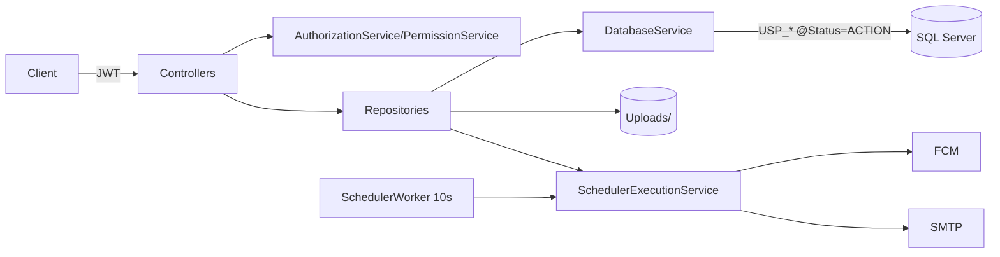

# brain.md: CRMWebServices Knowledge Base

> This is the main entry point for anyone (human or AI agent) working on this project.
> Last study: 2026-11-04, branch `feature/schedular`. The study was read-only.

## Before starting any future development task

1. Read `brain.md` first.
2. Read the relevant detailed documentation under `docs/`.
3. Inspect the actual source code related to the requested feature.
4. Verify existing database structures and business logic before making assumptions.
5. Preserve the existing project architecture and conventions.
6. Update relevant documentation after approved major changes.

Do not re-analyze the entire project when the existing documentation already answers the question. Always verify the actual source code (and the SP body in `../CRM_SQL_FILES/Live/`) when implementation details matter.

## Detailed documentation

| Document | Content |
|---|---|
| [docs/PROJECT_ARCHITECTURE.md](docs/PROJECT_ARCHITECTURE.md) | Layers, module map, SP per module, conventions, Mermaid diagrams |
| [docs/BUSINESS_WORKFLOWS.md](docs/BUSINESS_WORKFLOWS.md) | Step-by-step workflows with flowcharts and state diagrams |
| [docs/DATABASE_REFERENCE.md](docs/DATABASE_REFERENCE.md) | Tables, declared FKs, the 22 SPs, app↔DB mapping, script drift |
| [docs/API_AND_CODE_REFERENCE.md](docs/API_AND_CODE_REFERENCE.md) | Every endpoint → repository → SP `@Status`; services; uploads; critical files |
| [docs/AUTHENTICATION_AND_AUTHORIZATION.md](docs/AUTHENTICATION_AND_AUTHORIZATION.md) | Login, device binding, OTP, JWT, permission engine, protection matrix |
| [docs/PROJECT_DEPENDENCIES.md](docs/PROJECT_DEPENDENCIES.md) | Packages, external services, config keys, environments |
| [docs/PROJECT_STATUS.md](docs/PROJECT_STATUS.md) | Module status, confirmed defects, risks, open questions |
| [docs/CHANGELOG.md](docs/CHANGELOG.md) | Documentation and change history |

## Purpose

This is the backend REST API for the **Rajkamal Business Management Platform**. Its main consumers are Android/Flutter apps, plus a web front end in `../Frontend`.

- **CRM:** Lead → Opportunity → Quotation (freight and ODA approval) → Ticket, plus call logs, dashboards and reports.
- **HRMS:** Employees, Attendance (geo punch), Leave and leave policy, Probation, Shifts, Holidays, Announcements.
- **Platform:** JWT auth with one-device login, a role/permission engine, and a background scheduler that sends Firebase push and SMTP email.

## Technology stack

ASP.NET Core Web API **.NET 8** · SQL Server via **ADO.NET + stored procedures** (no EF at runtime) · JWT Bearer · BCrypt · FirebaseAdmin (FCM) · MailKit · Serilog · Swagger.

## Folder structure

```
Program.cs            DI, JWT, middleware, static /Uploads, hosted SchedulerWorker
Controllers/  (21)    thin HTTP layer + permission checks
Repository/   (23)    business glue: validation, JSON/TVP params, file saves, SP calls, notifications
Interfaces/           contracts (EmployeeRepository has none)
Services/             DatabaseService, EmailService, Firebase, SchedulerWorker/ExecutionService, templates, PermissionService
Models/               DTOs (no DataAnnotations)
Helpers/              JwtHelper, ApiResponse, GlobalExceptionMiddleware, ClaimsPrincipalExtension, RoleCodes
Data/DBConnection.cs  SqlConnection factory
Templates/Email/      HTML email templates (_Layout + 8)
Uploads/              runtime file store, publicly served at /Uploads
../CRM_SQL_FILES/     DB scripts (Live schema script = source of truth for SPs)
```

## Architecture summary



**The key pattern.** Each module has **one multiplexed stored procedure**, and the `@Status` parameter selects the operation (for example `USP_CRM_LeadManagement @Status='CREATE_LEAD'`).

- The SP returns a `Status`/`Message` row followed by data tables.
- The repository maps that result to `ApiResponse{Status,Message,Data}`.
- Most business rules live in the SPs.

## Module dependency overview

- **Lead → Opportunity** (convert won leads) **→ Quotation** (uses FreightPolicy slabs and ODA pin codes) and **→ Ticket** (per opportunity requirement).
- **CallLog** attaches to a Lead or an Opportunity.
- **Notifications.** Lead, Opportunity, Quotation, Ticket, Leave, Probation and Announcement all notify through `ISchedulerExecutionService`.
- **Manager lookup.** Leave and Ticket use `ILeadRepository.GetEmployeeManagerIdAsync` to find a manager.
- **Permission checks.** Lead, Opportunity, Quotation and Dashboard use `ICRMAuthorizationService`. The other modules rely on `[Authorize]` only.

## Main business workflows (details in BUSINESS_WORKFLOWS.md)

1. **Lead create.** Check for an existing customer (GST/PAN/name), then CREATE_LEAD with contacts, requirements and attachments.
   - If assigned: notify the assignee and their manager.
   - If unassigned: a scheduler LEAD job keeps reminding until someone is assigned.
2. **Lead lifecycle.** Assign/transfer, activities (geo, status change), follow-ups, expenses, requirements, close.
3. **Convert to opportunity.** Convert a won lead, then manage the opportunity's stages, requirements, activities, follow-ups and expenses, and finally close it.
4. **Quotation.**
   - **Raise:** freight slab is applied; if the pin code is ODA, an email goes to the approver, who decides.
   - **Follow-up actions:** customer response, negotiation rounds, management review, and versioned revisions.
5. **Ticket** against an opportunity requirement: create, then status and activity updates.
6. **Employee registration** (NewRegister) with education, bank, family and documents, plus shift, leave policy and probation.
7. **Attendance.** Manual geo punch, plus scoped reports.
8. **Leave.** Apply (pushes to the manager), then approve, reject or cancel. Policies are configured with a TVP.
9. **Probation.** Extend, confirm (PDF stored and email sent), fail or cancel. The scheduler sends expiry reminders.
10. **Announcement.** Create, target (company/region/state/office/department), then send by push and/or email.
11. **Scheduler.** Every 10 s it claims due items: LEAD (unassigned reminder), EMPLOYEE_PROBATION, EMPLOYEE_BIRTHDAY.

## Database overview

- **Database:** `Rkl_EnterpriseSuiteDB_Live` (also `_UAT` and `_Dev`), schema `dbo`.
- **Objects:** 128 tables, 22 SPs, 2 TVPs (`HolidayListType`, `ORG_LeavePolicyDetailType`), 163 FKs, and no views, functions or triggers.
- **Table prefixes:**

  | Prefix | Area |
  |---|---|
  | `CRM_` | CRM |
  | `ORG_` | Organisation / HR / security |
  | `MST_` | Masters |
  | `CUS_` | Customer |
  | `SYS_` | Audit |

- **Missing foreign keys.** `CRM_Opportunity` and several other tables have **no declared FKs**. Do not assume relationships; check `DATABASE_REFERENCE.md`.
- **Unhandled `@Status` codes.** Four codes sent by C# are missing from the Live SPs: `GET_HRMS_DASHBOARD_FULL`, `GET_IS_MANAGER`, `GET_TEAMS`, `LOG_NEGOTIATION_ROUND`.

## Authentication and authorization

- **Login.** `POST api/auth/login` checks the password with BCrypt.
  - One active device per user, enforced only when `DeviceId` is sent.
  - On success, issues a JWT (HS256, 24 h) with claims `EmployeeId`, `LoginId`, `EmployeeCode` and `RoleIds` (CSV).
  - No refresh token and no revocation.
- **OTP password reset.** forgot_password → verify_otp (max 5 attempts) → Reset_password (enforces a password policy).
- **Permissions.**
  - Codes have the form `{Resource}_{Action}`, for example `Lead_Edit` and `Opp_ViewAll`.
  - `ViewAll` grants everything; otherwise the user must be the creator or assignee.
  - Results are cached for 15 minutes.
- **Admin-only controllers.** PermissionManager and Scheduler require `RoleIds` to contain `1`.

## Critical business rules (as visible in C#)

- **Permissions.**
  - `{R}_ViewAll` overrides all checks.
  - Create needs only `{R}_Create`.
  - Assigning a lead to someone else also requires `{R}_Assign`.
  - Only the current assignee can Transfer.
  - A ticket assignee gets `Opp_View` on that opportunity.
- **Quotation list.** Users with `Opp_DecideReview` see pending reviews; everyone else sees only the quotations they raised.
- **Dashboard.** Without CanViewAll, a user sees only their own data.
- **Uploads.** Lead and Employee uploads allow only pdf/doc/docx/xls/xlsx/jpg/jpeg/png and at most 10 MB. Other upload paths are **not** restricted.
- **Leave policy.** Requires a name and company, no duplicate leave types, and no negative values.
- **Password policy.** At least 8 characters, with uppercase, lowercase, a digit and a special character.
- **SP-enforced rules.** Status transitions, leave balance, geo-fence and similar rules are enforced inside SPs. Read the SP before changing them.

## Important source files

`Program.cs`, `Services/DatabaseService.cs`, `Repository/AuthorizationService.cs`, `Services/PermissionService.cs`, `Services/SchedulerExecutionService.cs`, `Repository/LeadRepository.cs`, `Repository/OpportunityRepository.cs`, `Repository/OpportunityQuotationRepository.cs`, `Controllers/AuthController.cs`, `Helpers/JwtHelper.cs`, `Helpers/ClaimsPrincipalExtension.cs`, `../CRM_SQL_FILES/Live/Rkl_EnterpriseSuiteDB_Live.sql`.

## Conventions to preserve

- **New operations.** Add a new `@Status` branch to the module's SP and call it through `IDatabaseService`. Read result columns by name and tables by index.
- **Responses.** Return `ApiResponse`.
- **Identity.** Take the user identity from `User.EmployeeId()`.
- **Child collections.** Pass them to the SP as JSON (Newtonsoft) or as a TVP.
- **Files.** Accept files as Base64 and save them under `Uploads/<Folder>`.
- **Notifications.** Send them through `ISchedulerExecutionService`. Email templates live in `Templates/Email` and are mapped in `SchedulerEmailComposer`.
- **DI.** Register new repositories and services in `Program.cs`.

## Known limitations and unresolved questions

- **Confirmed defects.**
  - The attendance scope is always ALL (`AttendanceController.cs:51`).
  - Four `@Status` codes are not handled by the Live SPs.
  - The permission cache is never invalidated.
- **Security concerns.**
  - `AnnouncementController` and the Logout/ForceLogout endpoints are anonymous.
  - Several endpoints take the employee ID from the request body or query string instead of the token (IDOR).
  - Uploads are public, and some upload paths have no validation.
  - Secrets are in tracked config files.
  - Raw exception messages are returned to clients.
- **Unused features.** The resignation and notice-period tables exist but are unused.
- **Not analyzed.** SP internal rules (status transitions, leave rules and so on) and the `../Frontend` project.

Full list: [docs/PROJECT_STATUS.md](docs/PROJECT_STATUS.md).
