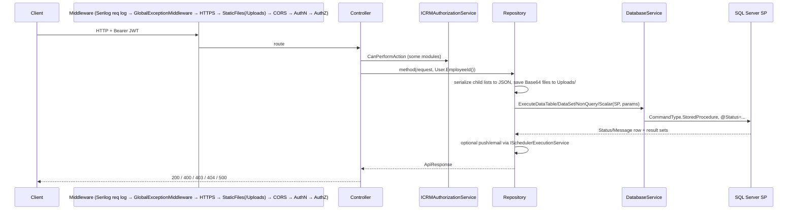

# API and Code Reference

## How to read this document

- **Data access.** Every endpoint reaches SQL Server through one stored procedure (SP) per module, called via `IDatabaseService`.
- **`@Status`.** The operation code is passed in the `@Status` parameter. It is *not* the response status.
- **Responses.** SPs usually return a first row with `Status` (1/0) and `Message`, followed by data tables.
- **Response envelope.** Repositories map that row to `Helpers/ApiResponse { Status, Message, Data }`.
- **Auth column.** In the endpoint tables, "Auth" means `[Authorize]` (JWT) unless noted otherwise. Permission checks are listed explicitly. See [AUTHENTICATION_AND_AUTHORIZATION.md](AUTHENTICATION_AND_AUTHORIZATION.md).

## 1. Request / response pipeline

`GlobalExceptionMiddleware` (`Helpers/GlobalExceptionMiddleware.cs`) converts unhandled exceptions into a 500 response with a generic message. Most repositories catch exceptions themselves and return `ex.Message` in the response.

### Data access layer (critical files)

| File | Role |
|---|---|
| `Data/DBConnection.cs` | Creates a new `SqlConnection` from `ConnectionStrings:DefaultConnection` |
| `Interfaces/IDatabaseService.cs`, `Services/DatabaseService.cs` | Four helpers: `ExecuteDataTableAsync`, `ExecuteNonQueryAsync`, `ExecuteScalarAsync`, `ExecuteDataSetAsync`. All of them use `CommandType.StoredProcedure`. No transactions are used. |
| `Helpers/DataTableExtensions.cs` | Helpers for mapping DataTable rows |
| `Helpers/ApiResponse.cs` | Response envelope |
| `Helpers/ClaimsPrincipalExtension.cs` | `User.EmployeeId()` and `HasRole()` |

## 2. Endpoints by controller

### Auth: `api/auth` (anonymous). SP `USP_ORG_Authentication`

| Verb | Route | @Status |
|---|---|---|
| POST | login | LOGIN, CHECK_ACTIVE_DEVICE, REGISTER_EMPLOYEE_DEVICE |
| POST | ForceLogout | FORCE_LOGOUT_DEVICE (+ FCM push) |
| POST | Logout | LOGOUT_DEVICE |
| POST | forgot_password | LOGIN, GENERATE_RESET_OTP (+ email) |
| POST | verify_otp | LOGIN, GET_RESET_OTP, INCREMENT_OTP_ATTEMPT, VERIFY_RESET_OTP |
| POST | Reset_password | GET_RESET_EMPLOYEE, RESET_PASSWORD |

### MasterData: `api/master` (GET only, no permission checks)

| SP | Routes (→ @Status) |
|---|---|
| `USP_ORG_EmployeeManagement` | companies (GET_COMPANIES), regions (GET_REGIONS_BY_COMPANY), states (GET_STATES_BY_REGION), designations, roles, permissions, teams, lead-statuses, countries, states-by-country, cities-by-state, lead-sources, employees (GET_EMPLOYEES_FOR_ASSIGNMENT, using the logged-in employee), categories, offerings, products, units, activity-types |
| `USP_ORG_NewEmployeeManagement` | offices, departments, qualification, banks, accountType, familyRelationships, documentTypes, managers (GET_MANAGERS_BY_OFFICE_DEPARTMENT), leave-policies |
| `USP_CRM_LeadManagement` | lead-close-statuses, followup-statuses, dashboard-statuses |

### Lead: `api/Lead`. SP `USP_CRM_LeadManagement`. Repository: `Repository/LeadRepository.cs`

| Verb | Route | Permission | @Status |
|---|---|---|---|
| POST | Register | Lead/Create + Assign if assigning to someone else | CREATE_LEAD |
| POST | Transfer | Lead/Transfer | TRANSFER_LEAD |
| POST | UpdateStatus | Lead/Edit | UPDATE_LEAD_STATUS |
| POST | CreateActivity | Lead/Activity | CREATE_ACTIVITY |
| POST | CreateFollowUp | Lead/FollowUp | CREATE_FOLLOWUP |
| POST | UpdateFollowUpStatus | Lead/FollowUpStatus | UPDATE_FOLLOWUP_STATUS |
| POST | CloseLead | Lead/Close | CLOSE_LEAD, GET_LEAD_NOTIFICATION_INFO |
| GET | Details?leadId | list: no check (SP scopes by LoggedInEmployeeId); single: Lead/View | GET_LEAD_LIST_FULL / GET_LEAD_FULL_DETAILS |
| POST | Assign | Lead/Assign | ASSIGN_LEAD |
| GET | check-customer-exists?gst&customerName&pan | none | CHECK_CUSTOMER_EXISTS |
| GET | search-customer?searchText | none | SEARCH_CUSTOMER |
| POST | AddActivityExpenses | Lead/Activity | CREATE_ACTIVITY_EXPENSE |
| GET | ActivityExpenseMasters | none | GET_EXPENSE_MASTER_DATA |
| POST | AddRequirement | Lead/Edit | ADD_LEAD_REQUIREMENT |
| POST | UpdateRequirement | Lead/Edit (looks up the lead id first) | GET_LEAD_ID_BY_REQUIREMENT, UPDATE_LEAD_REQUIREMENT |
| POST | DeleteRequirement | Lead/Edit | GET_LEAD_ID_BY_REQUIREMENT, DELETE_LEAD_REQUIREMENT |

Internal methods with no endpoint of their own:
- GET_ASSIGNED_EMPLOYEE
- GET_LEAD_ACCESS_INFO
- `GetEmployeeManagerIdAsync`, which calls `USP_ORG_NewEmployeeManagement` GET_EMPLOYEE_MANAGER. It is also used by the Leave and Ticket repositories.

### Opportunity: `api/Opportunity`. SP `USP_CRM_OpportunityManagement`

| Verb | Route | Permission | @Status |
|---|---|---|---|
| GET | wonleads?leadId&searchText | list: GetAccessFilter(Lead); single: Lead/View | GET_WON_LEADS_LIST_FULL / GET_WON_LEAD_FULL_DETAILS |
| GET | details/{opportunityId} | Opp/View | GET_OPPORTUNITY_DETAILS |
| GET | list | GetAccessFilter(Opp) | GET_OPPORTUNITY_LIST |
| GET | types / stages / priorities / closestages | none | GET_OPPORTUNITY_TYPES / _STAGES / _PRIORITIES / _CLOSE_STAGES |
| POST | convert | Lead/Convert | CONVERT_LEAD_TO_OPPORTUNITY |
| POST | Transfer | Opp check (exact action string not captured; Requires Verification) | TRANSFER_OPPORTUNITY |
| POST | add_requirement / update_requirement | Opp check | ADD_/UPDATE_OPPORTUNITY_REQUIREMENT |
| POST | delete-requirement | Opp/Edit | DELETE_OPPORTUNITY_REQUIREMENT |
| POST | add_activity | Opp/Activity | CREATE_OPPORTUNITY_ACTIVITY |
| POST | add_followup | Opp check | CREATE_OPPORTUNITY_FOLLOWUP |
| POST | Update-FollowUp-Status | Opp check | UPDATE_OPPORTUNITY_FOLLOWUP_STATUS |
| POST | close | Opp/Close | CLOSE_OPPORTUNITY |
| PUT | update | Opp check | UPDATE_OPPORTUNITY |
| DELETE | delete (JSON body) | Opp/Delete | DELETE_OPPORTUNITY |
| POST | ActivityExpenseMasters | Opp/Activity | ADD_ACTIVITY_EXPENSE. Despite the route name, this endpoint adds expenses. |

### Opportunity quotation: `api/OpportunityQuotation`. SP `USP_CRM_OpportunityQuotationManagement`

| Verb | Route | Permission | @Status |
|---|---|---|---|
| GET | raise-data/{opportunityId} | Opp/View | GET_RAISE_QUOTATION_DATA |
| GET | list | users with Opp/DecideReview see pending reviews; everyone else sees only their own quotations | GET_QUOTATION_LIST |
| GET | details/{id} | **none** | GET_QUOTATION_DETAILS |
| POST | raise | Opp/RaiseQuotation | RAISE_QUOTATION, then GET_ODA_APPROVAL_EMAIL_DATA (ODA email) |
| POST | customer-response | Opp/RespondCustomer | LOG_CUSTOMER_RESPONSE |
| POST | negotiation-round | Opp/LogNegotiation | LOG_NEGOTIATION_ROUND |
| POST | review-decision | **none** | DECIDE_MANAGEMENT_REVIEW |
| POST | revise | Opp/ReviseQuotation | REVISE_QUOTATION |
| GET | check-oda?deliveryPartnerId&pinCode | none | CHECK_ODA |
| GET | oda-approvals | none | GET_ODA_APPROVAL_LIST |
| GET | oda-approval/{quotationId} | none | GET_ODA_APPROVAL_DETAILS |
| POST | oda-approval/decision | none; validates DecisionCode is APPROVED or REJECTED | DECIDE_ODA_APPROVAL |

### FreightPolicy: `api/FreightPolicy`. SP `USP_CRM_FreightPolicyManagement` (no permission checks)

| Verb | Route | @Status |
|---|---|---|
| POST | CreatePolicy | CREATE_FREIGHT_POLICY |
| POST | UpdatePolicy | UPDATE_FREIGHT_POLICY |
| POST | DeactivatePolicy | DEACTIVATE_FREIGHT_POLICY |
| GET | GetPolicyList | GET_FREIGHT_POLICY_LIST |
| GET | GetPolicyDetails?freightPolicyId | GET_FREIGHT_POLICY_DETAILS |
| GET | GetApplicableFreight?orderValue | GET_APPLICABLE_FREIGHT |
| GET | GetActivePolicy | GET_ACTIVE_FREIGHT_POLICY |
| GET | delivery-partners | GET_FREIGHT_DELIVERY_PARTNERS |

### Ticket: `api/Ticket`. SP `USP_CRM_TicketManagement` (no permission checks)

| Verb | Route | @Status |
|---|---|---|
| POST | create | CREATE_TICKET |
| GET | my-tickets | GET_MY_TICKETS |
| GET | detail/{ticketId} | GET_TICKET_DETAIL |
| POST | UpdateStatus | UPDATE_TICKET_STATUS |
| POST | UpdateActivity | UPDATE_ACTIVITY |
| GET | statuses | GET_TICKET_STATUSES |

`AuthorizationService` also uses `CHECK_OPPORTUNITY_TICKET_ACCESS`.

### CallLog: `api/CallLog`. SP `USP_CRM_CallLogManagement`

| Verb | Route | @Status |
|---|---|---|
| POST | Create | CREATE_CALL_LOG |
| GET | Lead/{leadId} | GET_LEAD_CALL_LOGS |
| GET | Opportunity/{opportunityId} | GET_OPPORTUNITY_CALL_LOGS |

### Dashboard: `api/dashboard`. SP `USP_CRM_DashboardManagement`

| Verb | Route | Rule | @Status |
|---|---|---|---|
| GET | Details?employeeId&fromDate&toDate | Without CanViewAll(Dashboard), the user always gets their own data. With CanViewAll, sending no id or their own id returns everyone's data (employeeId is set to null). | GET_DASHBOARD_FULL |
| GET | my-dashboard | own data | GET_DASHBOARD_FULL |
| GET | employee-performance | 403 unless CanViewAll(Dashboard) | GET_EMPLOYEE_PERFORMANCE |
| GET | hrms-details | isAdmin = CanViewAll(HRMSDashboard) | GET_HRMS_DASHBOARD_FULL |

### Reports: `api/Reports`. SP `USP_CRM_Reports` (no checks, no try/catch)

| Verb | Route | @Status |
|---|---|---|
| POST | dashboard | CRM_REPORT_DASHBOARD |
| POST | journey | CRM_REPORT_JOURNEY |
| GET | filters | REPORT_FILTERS |

### Employee: `api/Employee`. `EmployeeRepository` (registered without an interface)

| Verb | Route | SP / @Status |
|---|---|---|
| POST | Register (legacy) | `USP_ORG_EmployeeManagement` REGISTER |
| POST | NewRegister | `USP_ORG_NewEmployeeManagement` REGISTER |
| GET | GetEmployeeMaster | GET_EMPLOYEE_MASTER |
| GET | GetEmployeeDetails/{employeeId} | GET_EMPLOYEE_DETAILS (5 tables) |
| POST | UpdateEmployee | `USP_ORG_UpdateEmployee` (no @Status) |
| GET | probation-status | GET_PROBATION_STATUS |
| GET | hr-managers?officeId | GET_HR_EXECUTIVES_BY_OFFICE |

### Attendance: `api/attendance`. SP `USP_ORG_Attendance`

| Verb | Route | @Status |
|---|---|---|
| POST | GetAttendance | GET (+@ViewScope) |
| POST | GetPunches | GET_PUNCHES |
| POST | ManualPunch | MANUAL_PUNCH |
| POST | GetDashboardCount | GET_DASHBOARD_COUNT |
| POST | GetReportEmployees | GET_REPORT_EMPLOYEES |
| POST | GetEmployeeReport | GET_EMPLOYEE_ATTENDANCE |

GET_IS_MANAGER is used internally for scope resolution.

### Leave: `api/leave`. SP `USP_ORG_LeaveManagement`

| Verb | Route | @Status |
|---|---|---|
| GET | GetLeaveBalance?employeeId | GET_LEAVE_BALANCE |
| GET | GetMyLeaves?employeeId | GET_MY_LEAVES |
| GET | GetApplyLeaveTypes?employeeId | GET_APPLY_LEAVE_TYPES |
| POST | ApplyLeave | APPLY_LEAVE (+ push to manager) |
| POST | CancelLeave | CANCEL_LEAVE |
| GET | GetTeamLeaves?employeeId | GET_TEAM_LEAVES |
| POST | ApproveLeave | APPROVE_LEAVE |
| POST | RejectLeave | REJECT_LEAVE |

### LeavePolicy: `api/LeavePolicy`. SP `USP_ORG_LeavePolicyManagement`

| Verb | Route | @Status |
|---|---|---|
| POST | SaveLeavePolicy | SAVE_LEAVE_POLICY, with TVP `dbo.ORG_LeavePolicyDetailType` |
| POST | UpdateLeavePolicy | UPDATE_LEAVE_POLICY, with the same TVP |
| GET | GetLeavePolicyList | GET_LEAVE_POLICY_LIST |
| GET | GetLeavePolicyDetails/{id} | GET_LEAVE_POLICY_DETAILS |
| GET | GetLeaveTypes | GET_LEAVE_TYPES |

### EmployeeProbation: `api/EmployeeProbation`. SP `USP_ORG_EmployeeProbationManagement`

| Verb | Route | @Status |
|---|---|---|
| GET | employees | GET_EMPLOYEES |
| GET | detail/{employeeId} | GET_EMPLOYEE_PROBATION |
| GET | history/{employeeId} | GET_PROBATION_HISTORY |
| POST | extend | EXTEND_PROBATION |
| POST | confirm | CONFIRM_PROBATION, then ADD_EMPLOYEE_DOCUMENT, then email |
| POST | fail | FAIL_PROBATION. The region is labelled "not used", but the endpoint is live. |
| POST | cancel | CANCEL_PROBATION |

### Shift: `api/shift`. SP `USP_ORG_SHIFTMANAGEMENT`

| Verb | Route | @Status |
|---|---|---|
| GET | GetShifts?activeOnly | GET_SHIFT |
| POST | AddShift | ADD_SHIFT |
| POST | UpdateShift | UPDATE_SHIFT |
| POST | delete/{shiftId} | DELETE_SHIFT |

### Holiday: `api/holiday`. SP `USP_ORG_HolidayManagement`

| Verb | Route | @Status |
|---|---|---|
| POST | SaveCalendar | SAVE_CALENDAR, with TVP `dbo.HolidayListType` |
| GET | GetCalendars | GET_CALENDARS |
| GET | GetHolidays/{holidayCalendarId} | GET_HOLIDAYS |

### Announcement: `api/Announcement` (**no `[Authorize]`**). SP `USP_ORG_AnnouncementManagement`

| Verb | Route | @Status |
|---|---|---|
| GET | (root) | GET_ANNOUNCEMENTS |
| GET | {id} | GET_ANNOUNCEMENT |
| POST | CreateAnnouncement | CREATE_ANNOUNCEMENT |
| PUT | (root) | UPDATE_ANNOUNCEMENT |
| POST | {id}/target?employeeId | ADD_ANNOUNCEMENT_TARGET |
| GET | {id}/targets | GET_ANNOUNCEMENT_TARGETS |
| GET | {id}/recipients | GET_ANNOUNCEMENT_RECIPIENTS |
| POST | {id}/send?employeeId | GET_ANNOUNCEMENT, GET_ANNOUNCEMENT_RECIPIENTS, push/email per recipient, then SEND_ANNOUNCEMENT |
| GET | offices/company/{companyId} | GET_OFFICES_BY_COMPANY |
| GET | departments/office/{officeId} | GET_DEPARTMENTS_BY_OFFICE |

### PermissionManager: `api/PermissionManager` (admin = RoleIds contains 1). SP `USP_CRM_PermissionManagement`

Routes:
- module/create, module/update, module/deactivate, modules
- permission/create, permission/update, permission/deactivate
- module/{id}/permissions
- role/{roleId}/permissions, role/permissions/save (SAVE_ROLE_ACCESS, which returns a `Success` column instead of `Status`)
- role/{roleId}/module-access, role/module-access/save
- super-modules, supermodule/{id}/modules, supermodule/mapping/save
- role/{roleId}/supermodule-access, role/supermodule-access/save

### Scheduler: `api/Scheduler` (admin). SP `USP_CRM_SchedulerManagement`

| Verb | Route | @Status |
|---|---|---|
| GET | entity-types | GET_SCHEDULER_ENTITY_TYPES |
| GET | scopes?entityType | GET_SCHEDULER_SCOPES |
| GET | jobsList | GET_JOBS |
| GET | jobDetails/{id} | GET_JOB |
| POST | job/create | CREATE_JOB |
| POST | job/update | UPDATE_JOB |
| POST | job/enable?schedulerJobId | ENABLE_JOB |
| POST | job/disable?schedulerJobId | DISABLE_JOB |

### EmailTest: `api/email-test`

| Verb | Route | Effect |
|---|---|---|
| POST | send | Sends arbitrary HTML through `IEmailService.SendAsync`. Any authenticated user can call it. |

## 3. Services and background components

| File | Responsibility |
|---|---|
| `Services/SchedulerWorker.cs` | `BackgroundService`. Every 10 s it creates a DI scope and calls `ProcessDueItemsAsync`. |
| `Services/SchedulerExecutionService.cs` | Runs GET_DUE_ITEMS, then CLAIM_JOB_ITEM, then dispatches LEAD / EMPLOYEE_PROBATION / EMPLOYEE_BIRTHDAY, then COMPLETE / RESCHEDULE / EXPIRE_JOB_ITEM. Also exposes `SendEmployeeNotificationAsync` (push) and `SendEmployeeEmailNotificationAsync` (email) and `NotifyUnassignedLeadAsync`. All modules use these. |
| `Services/EmailService.cs` | MailKit SMTP. Configuration comes from the DB (`USP_CRM_EmailConfiguration` GET_ACTIVE). Adds an inline logo. |
| `Services/FirebaseNotificationService.cs` | FCM single-token send (singleton) |
| `Services/EmailTemplateRenderer.cs` | Template syntax: `{{Key}}` (HTML-encoded), `{{{Key}}}` (raw), `{{#if}}`. Wraps output in `_Layout.html`. |
| `Services/SchedulerEmailComposer.cs` | Maps an action type to a template: PROBATION_EXPIRY→ProbationReminder, BIRTHDAY→EmployeeBirthday, UNASSIGNED→UnassignedLead, BIRTHDAY_WISH→BirthdayWish, PROBATION_CONFIRMED→ProbationConfirmed, ANNOUNCEMENT→Announcement, anything else→GenericNotification |
| `Services/PermissionService.cs`, `Repository/AuthorizationService.cs` | Permission engine. See the auth document. |

Notification SP statuses (`USP_CRM_SchedulerManagement`):
- GET_EMPLOYEE_DEVICES, GET_EMPLOYEE_EMAIL
- CREATE_NOTIFICATION, MARK_NOTIFICATION_SENT, MARK_NOTIFICATION_FAILED
- GET_LEAD_RECIPIENTS, CHECK_LEAD_STATUS
- GET_EMPLOYEE_PROBATION_RECIPIENTS, GET_TODAY_EMPLOYEE_BIRTHDAYS

## 4. File uploads

| Folder under `Uploads/` | Written by | Validation |
|---|---|---|
| LeadAttachments, LeadActivityAttachments | LeadRepository.SaveBase64Attachment | whitelist pdf/doc/docx/xls/xlsx/jpg/jpeg/png, 10 MB, sanitized name |
| EmployeeDocuments | EmployeeRepository (whitelist, 10 MB); EmployeeProbationRepository (**no whitelist or size limit**, `{Guid}_{fileName}`) | varies by writer |
| OpportunityActivityAttachments, OpportunityActivityExpenseAttachments | OpportunityRepository | **no whitelist or size limit** |
| OpportunityQuotationAttachments | OpportunityQuotationRepository | **no whitelist or size limit** |

Files are written **before** the SP call. They are served publicly at `/Uploads/...`.

## 5. Critical files (change impact)

| File | Why it is critical |
|---|---|
| `Program.cs` | All DI registrations, the JWT setup, the middleware order and static Uploads |
| `Services/DatabaseService.cs` | Every DB call goes through it |
| `Repository/AuthorizationService.cs`, `Services/PermissionService.cs` | Every Lead, Opportunity, Quotation and Dashboard permission decision |
| `Services/SchedulerExecutionService.cs` | Push and email for Lead, Leave, Probation, Announcement, Ticket and Opportunity, plus the background jobs |
| `Repository/LeadRepository.cs` | Largest CRM workflow. `GetEmployeeManagerIdAsync` is reused by the Leave and Ticket repositories. |
| `Repository/OpportunityRepository.cs`, `OpportunityQuotationRepository.cs` | Opportunity, quotation and ODA flows |
| `Helpers/ClaimsPrincipalExtension.cs`, `Helpers/JwtHelper.cs` | Identity claims used by every controller |
| `Templates/Email/*.html` | Email output for all notifications |

Changing an SP's `@Status` contract or its result-set ordering breaks the repository that consumes it. Repositories read columns by name and tables by index.
