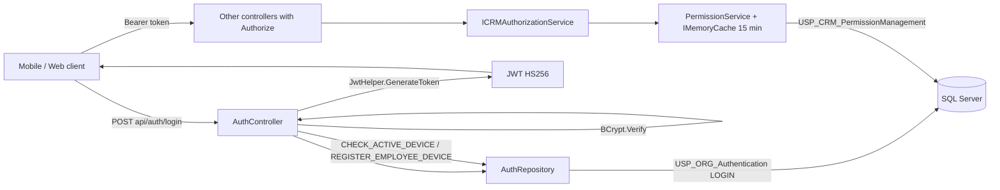
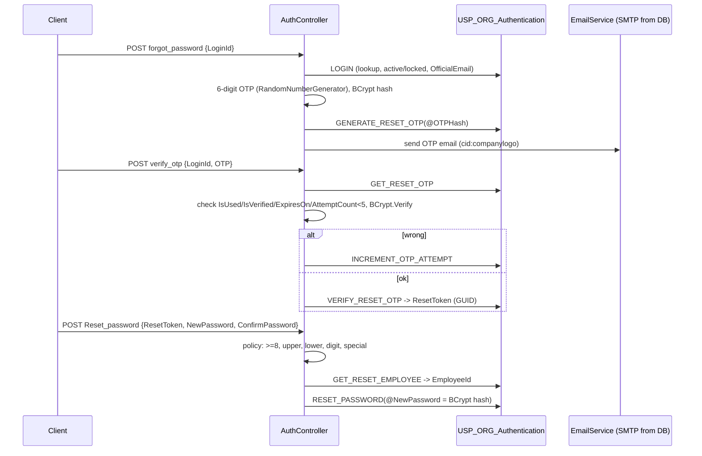
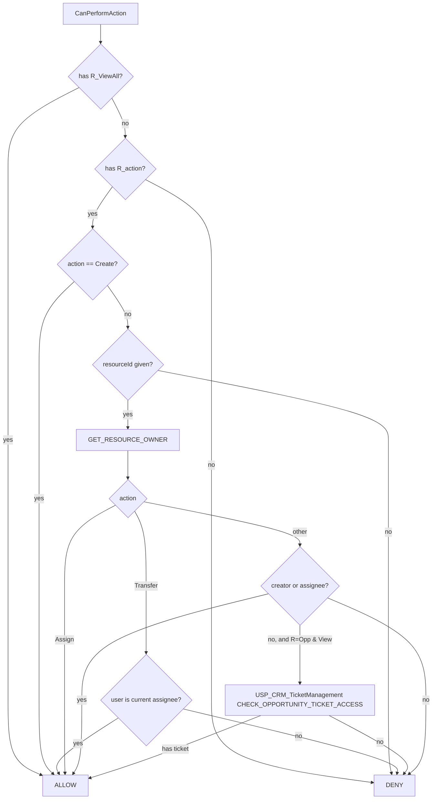

# Authentication and Authorization

> Source of truth: `Controllers/AuthController.cs`, `Repository/AuthRepository.cs`, `Helpers/JwtHelper.cs`, `Program.cs`, `Repository/AuthorizationService.cs`, `Services/PermissionService.cs`, `Repository/PermissionRepository.cs`.
> Items marked **Requires Verification** depend on stored-procedure bodies or on runtime behaviour.

## 1. Overview

The model has three layers:

1. **Authentication:** a JWT bearer token, checked by `[Authorize]`.
2. **Hard-coded admin gate:** the `RoleIds` claim must contain `1`. Used only by PermissionManager and Scheduler.
3. **Permission codes:** `{Resource}_{Action}` checked through `ICRMAuthorizationService`. Used by the Lead, Opportunity, OpportunityQuotation and Dashboard controllers.

## 2. Login: `POST api/auth/login` (anonymous)

Request model: `LoginRequest { LoginId, Password, DeviceId?, DeviceToken?, DeviceType?, AppVersion? }`. It has no DataAnnotations.

| Step | Code | SP `USP_ORG_Authentication` @Status |
|---|---|---|
| 1. Load the employee, the module tree and the super-module tree (DataSet with 4 tables) | `AuthRepository.GetEmployeeForLogin` | `LOGIN` |
| 2. Reject when there is no row, the account is inactive or the account is locked (400) | `AuthController.cs:~45-60` | – |
| 3. Check the password with `BCrypt.Net.BCrypt.Verify` against `PasswordHash` | `AuthController.cs:68` | – |
| 4. One-user-one-device check, only when `DeviceId` is supplied | `CheckActiveDevice` | `CHECK_ACTIVE_DEVICE` |
| 4a. If there is no active device or it is the same device, register or refresh it, but only when `DeviceToken` is present | `RegisterEmployeeDevice` | `REGISTER_EMPLOYEE_DEVICE` |
| 4b. If it is a different device, return **HTTP 200, `Status=false`, `Data.Code="ALREADY_LOGGED_IN"`** with no token | `AuthController.cs:146-160` | – |
| 5. Issue the JWT | `JwtHelper.GenerateToken` | – |

The response `Data` contains: Token, EmployeeId, EmployeeCode, FirstName, LastName, RoleId (CSV), RoleNames, DepartmentName, OfficeName, SuperModules (SuperModule → Modules → Permissions tree for the client UI).

**Not implemented:** failed-attempt counting and lockout (TODO at `AuthController.cs:70`), and refresh tokens.

### Token

- **Claims:** `EmployeeId`, `LoginId`, `EmployeeCode`, `RoleIds` (CSV). There are **no** `ClaimTypes.Role` claims.
- **Signing:** HS256 using `Jwt:Key`. Validation checks issuer, audience, lifetime and signing key (`Program.cs`).
- **Expiry:** `Jwt:ExpiryMinutes`, which is 1440 (24 hours) in `appsettings.json`.
- **Revocation:** tokens are never revoked. Logout only clears the device binding.
- **Helper:** `Helpers/ClaimsPrincipalExtension.cs` provides `User.EmployeeId()` (`int.Parse` of the claim; throws if the claim is missing) and `HasRole(...)`.

## 3. Device / session endpoints (anonymous)

| Endpoint | @Status | Behaviour |
|---|---|---|
| `POST api/auth/ForceLogout` | `FORCE_LOGOUT_DEVICE` | Unbinds the device. If a DeviceToken is returned, sends an FCM push "Session Expired" with data `{type: FORCE_LOGOUT}`. |
| `POST api/auth/Logout` | `LOGOUT_DEVICE` | Unbinds the device. The JWT is not revoked. |

## 4. Forgot password (OTP), all anonymous

- The email text says the OTP is valid for 10 minutes. The actual expiry is set inside the SP (**Requires Verification**).
- An unknown LoginId returns `200 Status=true "Login Id not found…"`.

## 5. Permission model

**Structure:** Super Module → Module → Permission, granted per Role. It is managed through `PermissionManagerController` (admin only) with SP `USP_CRM_PermissionManagement`:

- `SAVE_ROLE_ACCESS`
- `SAVE_ROLE_MODULE_ACCESS`
- `SAVE_ROLE_SUPERMODULE_ACCESS`
- `SAVE_SUPERMODULE_MAPPING`
- plus module and permission CRUD.

### Permission codes and `AuthorizationService.CanPerformAction(user, resource, action, resourceId?)`

Code format: `{Resource}_{Action}`. Resources in use: `Lead`, `Opp`, `Dashboard`, `HRMSDashboard`.

- **`CanPerformActionWithAssignment`:** assigning to someone other than yourself also requires `{R}_Assign`.
- **`GetAccessFilter`** returns one of these filter types for list endpoints:

  | FilterType | Granted by |
  |---|---|
  | `All` | `{R}_ViewAll` |
  | `CreatedAndAssigned` | View + Create |
  | `Assigned` | View only |
  | `None` | – |

- **`CanViewAll`** is used by the dashboards.
- **Caching:** `PermissionService` keeps results in `IMemoryCache` for 15 minutes, using keys `Permission_{emp}_{code}`, `UserPermissions_{emp}` and `UserPermissionsDict_{emp}`. It fails closed. `InvalidateCache` exists but is **never called**, so a permission change can take up to 15 minutes to apply.

### Permission SP statuses (`USP_CRM_PermissionManagement`)

- **Checks:** `GET_USER_PERMISSIONS`, `CHECK_PERMISSION`, `CHECK_MULTIPLE_PERMISSIONS`, `GET_RESOURCE_OWNER`, `GET_USER_ROLES_PERMISSIONS`, `GET_USER_MODULES`, `GET_ALL_PERMISSIONS`, `BATCH_PERMISSION_CHECK`.
- **Admin:** `CREATE_MODULE`, `UPDATE_MODULE`, `DEACTIVATE_MODULE`, `GET_MODULES`, `CREATE_PERMISSION`, `UPDATE_PERMISSION`, `DEACTIVATE_PERMISSION`, `GET_MODULE_PERMISSIONS`, `GET_ROLE_PERMISSIONS`, `SAVE_ROLE_ACCESS`, `GET_ROLE_MODULE_ACCESS`, `SAVE_ROLE_MODULE_ACCESS`, `GET_SUPER_MODULES`, `GET_SUPERMODULE_MODULES`, `SAVE_SUPERMODULE_MAPPING`, `GET_ROLE_SUPERMODULE_ACCESS`, `SAVE_ROLE_SUPERMODULE_ACCESS`.

### Attendance view scope (ALL / TEAM / SELF)

`AttendanceController.GetRoleScope()` combined with `AttendanceRepository.ResolveViewScope`: if the scope is not SELF it is used as-is; otherwise `GET_IS_MANAGER` decides TEAM or SELF.

**Confirmed defect:** at `AttendanceController.cs:51` a comment swallowed the `if`, so `GetRoleScope()` **always returns "ALL"**. `MAPPED` appears only in commented-out code.

## 6. Protection matrix per controller

| Controller | `[Authorize]` | Fine-grained check |
|---|---|---|
| AuthController | **No** (anonymous) | – |
| AnnouncementController | **No** (anonymous) | none |
| PermissionManagerController | Yes | IsAdmin (RoleIds contains 1) |
| SchedulerController | Yes | IsAdmin |
| LeadController | Yes | CanPerformAction / WithAssignment (Lead). No check on check-customer-exists, search-customer, ActivityExpenseMasters, or the Details list |
| OpportunityController | Yes | CanPerformAction / GetAccessFilter (Lead/Opp). Lookup endpoints are open |
| OpportunityQuotationController | Yes | Opp checks. **Open:** details/{id}, review-decision, all ODA endpoints |
| DashboardController | Yes | CanViewAll(Dashboard / HRMSDashboard) |
| FreightPolicy, Ticket, CallLog, Reports, MasterData, EmailTest | Yes | none |
| Employee, Attendance, Leave, LeavePolicy, EmployeeProbation, Shift, Holiday | Yes | none. Several take EmployeeId from the body or query instead of the token |

## 7. Static uploads

`/Uploads/*` is served by `UseStaticFiles` with a `PhysicalFileProvider`, registered **before** `UseAuthentication`. Uploaded files are therefore reachable without a token (inferred from middleware order; **Requires Verification** at runtime).

## 8. Known security observations

These are observations, not fixes. See [PROJECT_STATUS.md](PROJECT_STATUS.md).

- Anonymous ForceLogout and Logout.
- Anonymous Announcement endpoints.
- No JWT revocation.
- The device rule can be bypassed by omitting DeviceId.
- No login brute-force protection.
- Login ID enumeration through forgot-password.
- IDOR risk on HRMS, Ticket, CallLog and Reports endpoints.
- `ex.Message` is returned to clients.
- Secrets in tracked config files.
- The attendance scope defect.
