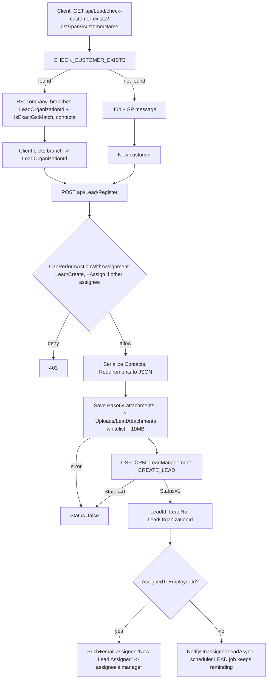
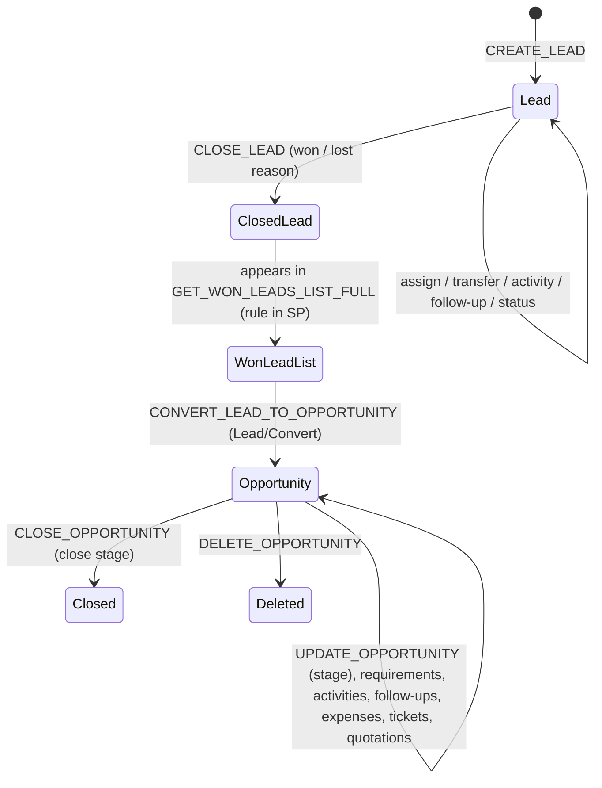
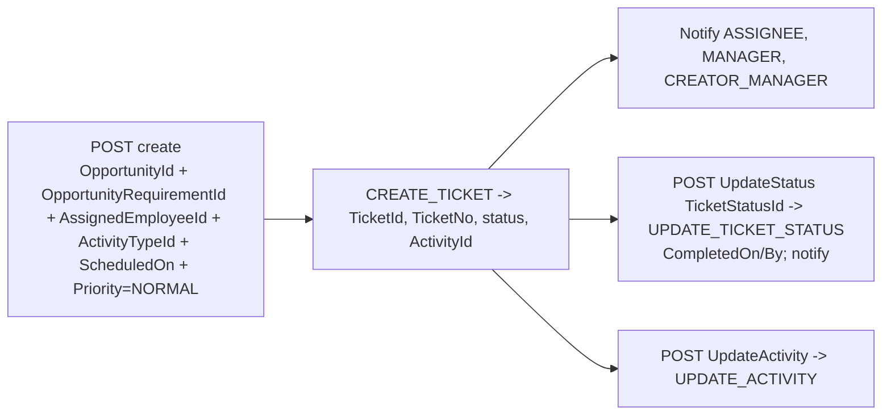
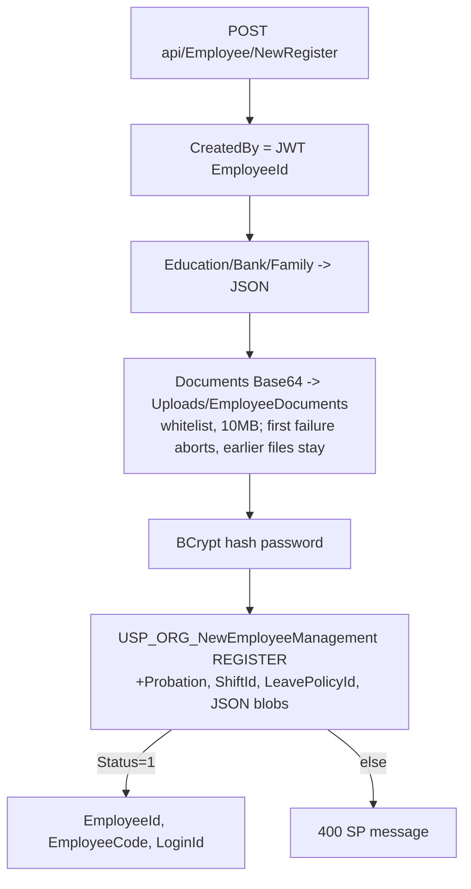
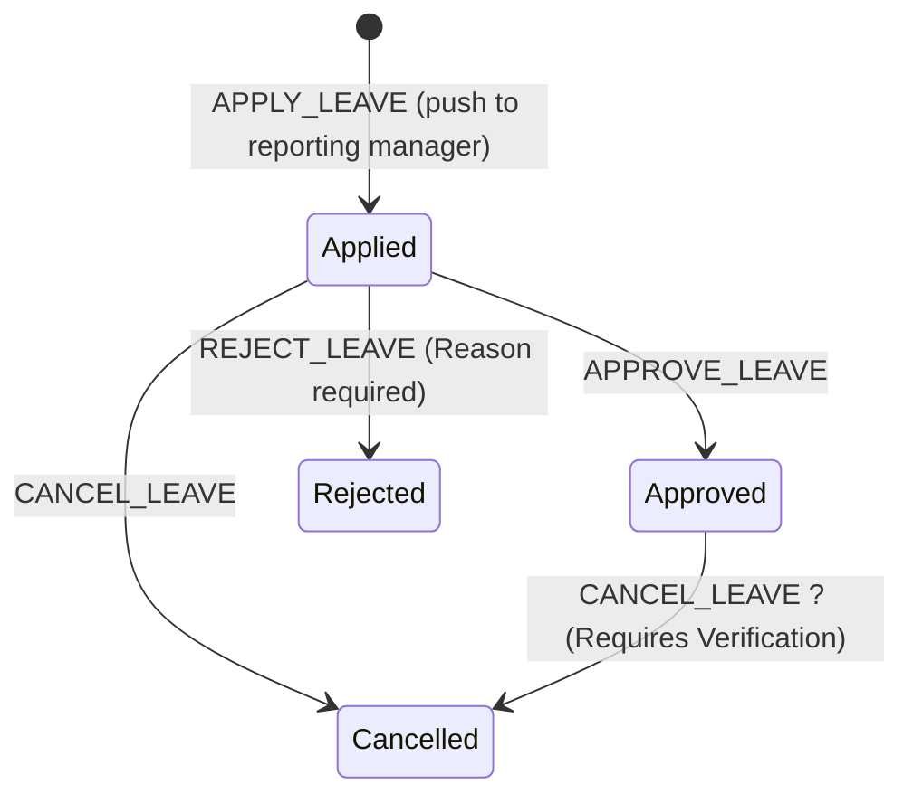
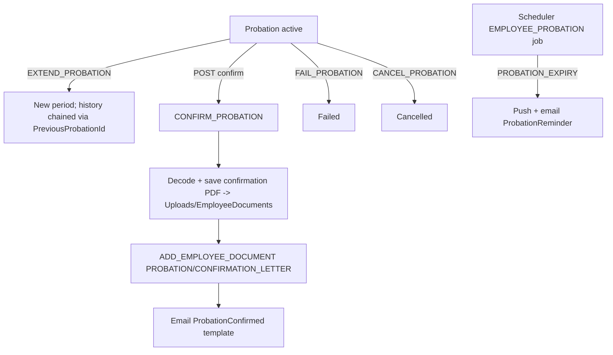
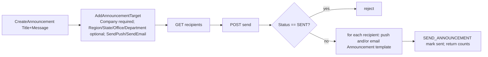
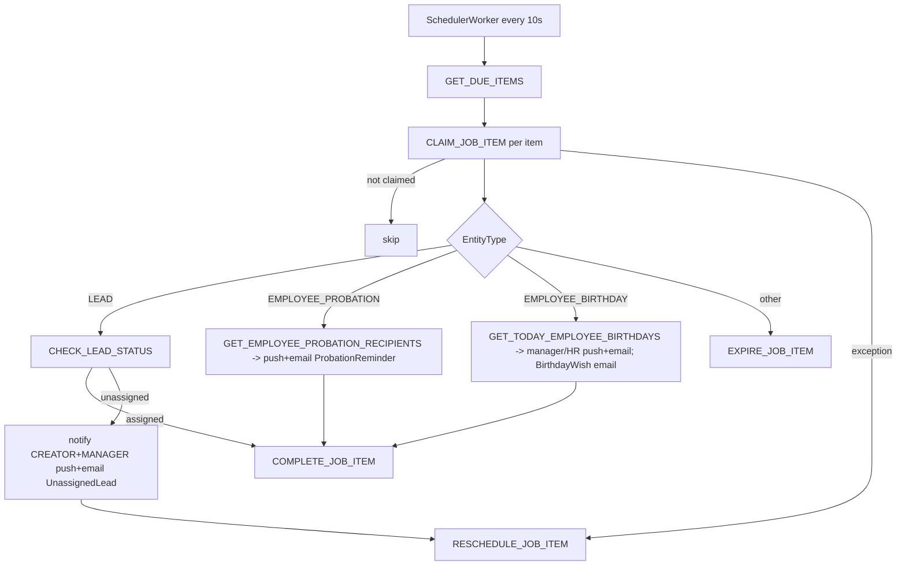

# Business Workflows

This document describes each workflow as it runs through the code: from the controller, to the repository, to the stored procedure (SP), and on to notifications.

- **Where the rules live.** Status values and transition rules are stored in the database (lookup IDs) and enforced inside SPs whose bodies were not analyzed in detail.
- **Unverified rules.** Any rule that is not visible in C# is marked **Requires Verification**.
- **Transactions.** No C# transactions are used anywhere. Atomicity depends entirely on the SPs.

---

## CRM

### 1. Lead creation (including existing-customer detection)



- **Customer matching.** The rules for matching on GST, PAN or name are inside the SP. **Requires Verification**.
- **Field normalization.** GST and PAN are trimmed, and blank values become NULL.
- **Notification failures.** These are only logged; they do not fail the request.

### 2. Lead lifecycle operations

| Action | Endpoint | Permission | SP @Status | Notes |
|---|---|---|---|---|
| Assign | Assign | Lead/Assign | ASSIGN_LEAD | Notifies the assignee, the managers and the lead creator |
| Transfer | Transfer | Lead/Transfer (only the current assignee may transfer) | TRANSFER_LEAD | Notifies the new assignee and the managers |
| Update status | UpdateStatus | Lead/Edit | UPDATE_LEAD_STATUS (Ref_LeadStatusId) | Status IDs come from the DB (`master/lead-statuses`) |
| Activity | CreateActivity | Lead/Activity | CREATE_ACTIVITY | Can also change the lead status through `Ref_NewLeadStatusId`. Records lat/long/location and attachments (`Uploads/LeadActivityAttachments`) |
| Follow-up | CreateFollowUp / UpdateFollowUpStatus | Lead/FollowUp / FollowUpStatus | CREATE_FOLLOWUP / UPDATE_FOLLOWUP_STATUS | Supports rescheduling through `NewScheduledOn` |
| Expense | AddActivityExpenses | Lead/Activity | CREATE_ACTIVITY_EXPENSE | C# checks: LeadId > 0, ActivityId > 0, at least one item, category > 0, amount > 0 |
| Requirements | Add/Update/DeleteRequirement | Lead/Edit | *_LEAD_REQUIREMENT | Update and delete resolve the lead ID first, for the permission check |
| Close | CloseLead | Lead/Close | CLOSE_LEAD (close status, lost reason, remark), then GET_LEAD_NOTIFICATION_INFO | Notifies the creator, the assignee and the managers |

Status transitions are DB-driven, and there are no status constants in C#. **Requires Verification**: the allowed transitions in the SP.

### 3. Lead → Opportunity → Close



- **Conversion.** The convert call returns OpportunityId and OpportunityNo. The assignee is notified only when the opportunity is not self-assigned; the managers are notified as well.
- **Closing.** CLOSE_OPPORTUNITY returns StageName and `CustomerId`. This suggests that a won opportunity creates or links a customer. **Requires Verification**.
- **Stages.** Won/Lost and the stage list come from the DB (`stages`, `closestages`).

### 4. Quotation lifecycle (including freight and ODA)

```mermaid
flowchart TD
    A[GET raise-data/{oppId}\nheader, items, freight slabs, category terms, raiser office] --> B[POST raise\nOpp/RaiseQuotation]
    B --> C[Save PDF -> Uploads/OpportunityQuotationAttachments]
    C --> D[RAISE_QUOTATION ItemsJson, DeliveryPartnerId, DeliveryPinCode, tax, validity]
    D --> E{ODAApprovalRequired?}
    E -->|yes| F[GET_ODA_APPROVAL_EMAIL_DATA -> email each approver\nTemplate OdaApproval, deep link rajkamalcrm://oda-approval]
    F --> G[Approver: POST oda-approval/decision APPROVED/REJECTED -> DECIDE_ODA_APPROVAL]
    E -->|no| H
    D --> H[Push 'Quotation Raised' to manager]
    H --> I[Customer response ACCEPTED/REJECTED -> LOG_CUSTOMER_RESPONSE]
    H --> J[Negotiation round -> LOG_NEGOTIATION_ROUND]
    H --> K[Management review APPROVED/REJECTED -> DECIDE_MANAGEMENT_REVIEW\npush to raiser]
    H --> L[Revise -> REVISE_QUOTATION new version\npush 'Quotation Revised']
    L --> I
```

- **List visibility.** Users with `Opp_DecideReview` see quotations pending review. Everyone else sees only the quotations they raised (latest revision).
- **Freight.** Quotation rows carry Ref_FreightPolicyId, Ref_FreightPolicySlabId, FreightPolicyVersion, FreightCharge and FreightPercent.
- **Code validation.** C# validates only the ODA `DecisionCode`. CustomerResponseCode and the review DecisionCode are not validated.
- **Requires Verification**:
  - what triggers a management review;
  - how versions are numbered;
  - whether a revision re-evaluates ODA;
  - how the ODA rule maps to pin codes.

### 5. Freight policy

1. **CreatePolicy.** C# requires a name and at least one slab. Each slab has min/max order value and freight amount, plus ODACharge and ODAMinOrderValue. → CREATE_FREIGHT_POLICY.
2. **UpdatePolicy.** Replaces the slabs. The returned FreightPolicyVersion suggests that the SP keeps versions. → UPDATE_FREIGHT_POLICY.
3. **DeactivatePolicy** marks the policy inactive. **GetActivePolicy** and **GetApplicableFreight?orderValue** are lookups.
4. **No C# checks.** There is no check for slab overlap or ordering, and no permission check.

### 6. Tickets



- **Status codes** come from GET_TICKET_STATUSES.
- **Access.** A ticket assignment grants `Opp_View` access through `CHECK_OPPORTUNITY_TICKET_ACCESS`.
- **Quotation link.** `TicketQuotationEligibility` suggests that ticket completion controls whether a quotation can be raised. **Requires Verification**.
- **Status column ignored.** CREATE_TICKET and UPDATE_TICKET_STATUS do not check the SP `Status` column.

### 7. Call logs

- **Create.** POST `CallLog/Create` (CREATE_CALL_LOG) records a call against a lead or an opportunity and a contact. The caller is taken from the JWT.
- **Fields.** Direction, status, outcome, times, duration, ExternalCallId and CallMatchStatus. This looks like device call-log sync. **Requires Verification**.
- **Reads.** Calls are listed per lead or per opportunity.

### 8. Dashboards and reports

These are read-only result sets; see the API reference for the scope rules.

- **Reports.** `USP_CRM_Reports` provides CRM_REPORT_DASHBOARD, CRM_REPORT_JOURNEY (lead → quotation journey) and REPORT_FILTERS.

---

## HRMS

### 9. Employee registration (NewRegister)



- **Legacy path.** `Register` → `USP_ORG_EmployeeManagement` REGISTER. It takes basic fields only.
- **Update.** `UpdateEmployee` → `USP_ORG_UpdateEmployee`. Documents that fail to save are skipped.
- **Inside the SP (Requires Verification).** The probation record, leave-balance initialization and login creation.

### 10. Attendance

1. **ManualPunch.** EmployeeId, PunchType, WorkMode, Latitude, Longitude, Remarks and CreatedBy are all taken from the request body. → MANUAL_PUNCH. The SP returns `DistanceKm`.
2. **Not checked in C#.** Geo-fence rules, IN/OUT sequencing and late or shift calculation are all in the SP. **Requires Verification**.
3. **Reads.** These pass `@ViewScope`. Because of the GetRoleScope defect, the effective scope is always ALL.

### 11. Leave



- **Leave types.** `GetApplyLeaveTypes` returns per-type rules: MaxDaysPerApplication, IsHalfDayAllowed, IsHourlyAllowed, IncludeWeekends, IncludeHolidays, SandwichRule and RequiresDocument.
- **ApplyLeave.** The client computes `TotalDays`. Balance, overlap and sandwich rules are applied in the SP. **Requires Verification**.
- **Manager notification.** The manager is resolved via `LeadRepository.GetEmployeeManagerIdAsync` and notified by push only.
- **Missing notifications.** There are no notifications on approve, reject or cancel, and the HR notification is a TODO.
- **Approver identity.** The approver ID comes from the request body, not the token.
- **Exact status names** are in the DB. **Requires Verification**.

### 12. Leave policy

- **Endpoints.** Save and Update send the policy details as TVP `dbo.ORG_LeavePolicyDetailType`.
- **C# validation:**
  - PolicyName is required.
  - Ref_CompanyId must be > 0.
  - No duplicate leave types are allowed.
  - AccrualType is required.
  - Numeric fields cannot be negative.

### 13. Probation



- **Confirm order.** Confirm commits to the DB first and validates the PDF afterwards.
- **No status check.** Extend, Fail and Cancel do not check the SP `Status` column.
- **Status codes** come from GET_PROBATION_STATUS. **Requires Verification**.

### 14. Shifts and holidays

- **Shifts.** CRUD through `USP_ORG_SHIFTMANAGEMENT`. There is no C# validation of times or codes.
- **Holiday calendars.**
  - SAVE_CALENDAR performs an insert when no `HolidayCalendarId` is given and an update otherwise.
  - Holidays are sent as TVP `dbo.HolidayListType`.
  - The office is optional.
  - How calendars link to employees and attendance is **Requires Verification**.

### 15. Announcements



- **Status values.** DRAFT, SCHEDULED, SENT and EXPIRED, taken from a code comment.
- **Scheduled sending.** No code sends announcements on `ScheduledOn`.
- **Synchronous sends.** All sends run inside the HTTP request.
- **Attachments.** The attachment field holds a path string only; there is no upload.

---

## Platform

### 16. Background scheduler



- **Job configuration.** Jobs are configured through `api/Scheduler`, with these fields:
  - FrequencyType and FrequencyValue
  - StartDate and EndDate
  - MaxAttempts and StopAfterMinutes
- **Where scheduling is computed.** NextRunOn, expiry, and how job items are created are all SP or DB logic. **Requires Verification**.

### 17. Login, one device per user, and password reset

See [AUTHENTICATION_AND_AUTHORIZATION.md](AUTHENTICATION_AND_AUTHORIZATION.md).
