# Database Reference

**Source:** `../CRM_SQL_FILES/Live/Rkl_EnterpriseSuiteDB_Live.sql`. This is an SSMS "Generate Scripts" output, schema only, dated 09-10-2026, with 31,217 lines.

**Not verified against a live server.** No database was connected, and `Rkl_EnterpriseSuiteDB_UAT.bak` was not opened.

**Relationship rule.** Only relationships declared as FOREIGN KEY constraints are listed as relationships. Links that are likely but not declared are labelled **Undeclared – Requires Verification**.

## 1. Overview

| Item | Value |
|---|---|
| Database (Live script) | `Rkl_EnterpriseSuiteDB_Live` |
| Other names seen | `Rkl_EnterpriseSuiteDB`, `_live`, `_Dev` (ad-hoc scripts); `_UAT` (.bak) |
| Schema | `dbo` only |
| Tables | 128 |
| Stored procedures | 22 |
| Views / functions / triggers | **0** |
| User-defined table types | `dbo.HolidayListType`, `dbo.ORG_LeavePolicyDetailType` |
| Declared FKs | 163 |
| Secondary indexes | none in the Live script, possibly because indexes were not scripted (**Requires Verification**) |
| Data | none, apart from one INSERT that sits inside an SP |
| Table prefixes | `CRM_` (CRM), `ORG_` (organisation / HR / security), `MST_` (masters), `CUS_` (customer), `SYS_` (audit) |
| Login | the script maps the SQL login `WmsSql` to a user and grants it `db_owner` |

## 2. Core ER view (declared FKs only)

```mermaid
erDiagram
    ORG_Employee ||--o{ ORG_EmployeeRole : has
    ORG_Role ||--o{ ORG_EmployeeRole : grants
    ORG_Role ||--o{ ORG_RolePermission : ""
    ORG_Permission ||--o{ ORG_RolePermission : ""
    ORG_Module ||--o{ ORG_Permission : ""
    ORG_SuperModule ||--o{ ORG_SuperModuleMapping : ""
    ORG_Module ||--o{ ORG_SuperModuleMapping : ""
    ORG_Employee ||--o{ ORG_EmployeeDevice : ""
    ORG_Employee ||--o{ ORG_PasswordResetOTP : ""
    ORG_Employee }o--|| ORG_Employee : "Ref_ReportingManagerId / Ref_ReportingHRManagerId"
    CRM_LeadCompany ||--o{ CRM_LeadOrganization : ""
    CRM_LeadOrganization ||--o{ CRM_LeadContact : ""
    CRM_LeadOrganization ||--o{ CRM_Lead : ""
    CRM_Lead ||--o{ CRM_LeadAssignment : ""
    CRM_Lead ||--o{ CRM_LeadActivity : ""
    CRM_Lead ||--o{ CRM_LeadFollowUp : ""
    CRM_Lead ||--o{ CRM_LeadRequirement : ""
    CRM_Lead ||--o{ CRM_LeadStatusHistory : ""
    CRM_LeadStatus ||--o{ CRM_Lead : ""
    CRM_Opportunity ||--o{ CRM_OpportunityRequirement : ""
    CRM_Opportunity ||--o{ CRM_OpportunityQuotation : ""
    CRM_OpportunityQuotation ||--o{ CRM_OpportunityQuotationItem : ""
    CRM_OpportunityQuotation ||--o{ CRM_OpportunityQuotationODAApproval : ""
    CRM_OpportunityQuotation ||--o{ CRM_OpportunityNegotiation : ""
    CRM_OpportunityQuotation |o--o| CRM_OpportunityQuotation : "Ref_PreviousQuotationId"
    CRM_FreightPolicy ||--o{ CRM_FreightPolicySlab : ""
    CRM_FreightPolicy ||--o{ CRM_OpportunityQuotation : ""
    CRM_Opportunity ||--o{ CRM_Ticket : ""
    CRM_OpportunityRequirement ||--o{ CRM_Ticket : ""
    CRM_SchedulerJob ||--o{ CRM_SchedulerJobItem : ""
    CRM_SchedulerJobItem ||--o{ CRM_SchedulerNotification : ""
```

Note: `CRM_Opportunity` has **no declared FKs at all**. In particular, there is no FK from Opportunity to Lead. That link exists only through the `Ref_LeadId` column (**Undeclared – Requires Verification**).

## 3. Tables by functional area

`*` = identity primary key. Audit columns (CreatedOn/By, UpdatedOn/By, IsActive) are omitted.

### Security / organisation

| Table | PK / UQ | Important columns | Declared FKs |
|---|---|---|---|
| ORG_Employee | EmployeeId*; UQ EmployeeCode, LoginId | names, OfficialEmail, Mobile, PasswordHash, DOB, DOJ, PAN/Aadhaar, Ref_CompanyId, ProbationRequired, FailedLoginAttempts, IsLocked | Designation, ProbationStatus, ReportingManager→Employee, ReportingHRManager→Employee |
| ORG_EmployeeDevice | EmployeeDeviceId* | DeviceId, DeviceToken (FCM), DeviceType, AppVersion, IsLoggedIn | Employee |
| ORG_PasswordResetOTP | * | OTPHash, ExpiresOn, IsUsed, IsVerified, AttemptCount, ResetToken | Employee |
| ORG_Company | CompanyId*; UQ code | GSTNo, PANNo | MST_Country |
| ORG_Region / ORG_RegionTerritory | * | – | Company; Region, Country, State |
| ORG_Office | OfficeId* | address, Lat/Long, Start/End time | Region, Country, State, City |
| ORG_Department / ORG_OfficeDepartment | * | – | (none) / Office, Department |
| ORG_EmployeeOffice / ORG_EmployeeDepartment | * | IsPrimaryOffice, EffectiveFrom/To | Employee, Office / Employee, Department, EmployeeOffice, OfficeDepartment |
| ORG_Designation | *; UQ code | – | – |
| ORG_Role, ORG_EmployeeRole | *; UQ (Emp, Role) | IsPrimaryRole | Employee, Role |
| ORG_Module, ORG_SuperModule, ORG_SuperModuleMapping | *; composite PK on mapping | – | mapping → SuperModule, Module |
| ORG_Permission | *; UQ PermissionCode | Ref_ModuleId, IsSchedulerSupported, SchedulerEntityType | Module |
| ORG_RolePermission / ORG_RoleModuleAccess / ORG_RoleSuperModuleAccess | UQ (Role, X) | IsAllowed / IsEnabled | Role + Permission / Module / SuperModule |
| `*_Backup_20260817` (4 tables) | no PK | backups | – |
| SYS_AuditLog | * | TableName, RecordId, OperationType, Old/New | Employee |

### Masters

| Table | Notes |
|---|---|
| MST_Country / MST_State / MST_City | Hierarchy: State → Country, City → State |
| MST_ProductCategory | UQ CategoryCode; TermsAndConditions NVARCHAR(MAX) |
| MST_Offering | The PK column is named **ProductId**. FK → ProductCategory |
| MST_Product | UQ ItemCode; FK `RefOfferingId` → MST_Offering.ProductId |
| MST_ProductUpload, MST_ProductChangeLog | Import staging and change log; no FKs |
| MST_Unit, MST_Priority | Lookups. Nothing has a declared FK to MST_Priority |
| MST_EmailConfiguration | SMTP settings (Host, Port, SSL, Email, Password, From). Read by `USP_CRM_EmailConfiguration` |
| ORG_BankMaster, ORG_AccountTypeMaster, ORG_Qualification, ORG_RelationshipMaster, ORG_DocumentType | HR lookups |

### Lead

| Table | Declared FKs / notes |
|---|---|
| CRM_LeadCompany | Customer company (CustomerName, Pan). No FKs |
| CRM_LeadOrganization | Branch (Address, Gst, Pan, PinCode) → LeadCompany, Country, State, City |
| CRM_LeadContact | → LeadOrganization, Designation |
| CRM_Lead | LeadNo, ExpectedValue, Probability → LeadOrganization, LeadSource, LeadStatus, CurrentAssignedEmployee. Ref_PriorityId and Ref_LostReasonId have no FK |
| CRM_LeadStatus | Flags: IsClosed, IsWon, IsLost |
| CRM_LeadStatusHistory | → Lead, LeadStatus (current and previous), Employee |
| CRM_LeadAssignment | AssignmentType, IsCurrent → Lead, From/To/AssignedBy Employee |
| CRM_LeadActivity, CRM_LeadActivityType, CRM_LeadActivityStatus | Activity → Lead, Assignment, Type, Employee, Status. Lat/Long |
| CRM_LeadActivityAttachment, CRM_LeadAttachment | → Activity / ActivityExpense; → Lead |
| CRM_LeadFollowUp, CRM_LeadFollowUpStatusHistory | → Lead, Activity, Employees, ActivityStatus |
| CRM_LeadRequirement | Soft delete (IsDeleted). → Lead, MST_Product, MST_Unit |
| CRM_LeadSource | Lookup |
| CRM_ActivityExpense, CRM_ActivityExpenseCategory, CRM_ActivityTransportMode | Expense → Lead **or** Opportunity, LeadActivity / OpportunityActivity, Category, TransportMode |

### Opportunity / quotation

| Table | Declared FKs / notes |
|---|---|
| CRM_Opportunity | OpportunityNo, Ref_LeadId, Ref_CustomerId, Stage, Type, Owner, Priority, ExpectedRevenue. **No FKs** |
| CRM_OpportunityType, CRM_OpportunityStage | Stage carries StageOrder, IsClosed, IsWon, IsLost. Nothing has a declared FK to Stage |
| CRM_OpportunityStatusHistory, CRM_OpportunityFollowUp | **No FKs** |
| CRM_OpportunityFollowUpStatusHistory | → OpportunityFollowUp |
| CRM_OpportunityAssignment | → Opportunity, From/To Employee |
| CRM_OpportunityActivity | Only FK is → CRM_Ticket. Has Ref_SourceLeadActivityId |
| CRM_OpportunityActivityAttachment | → OpportunityActivity |
| CRM_OpportunityRequirement | Soft delete. → Opportunity, Product, ProductCategory, Offering |
| CRM_OpportunityQuotation | VersionNumber, RevisionNumber, RootQuotationNo, IsCurrent, SubTotal, Tax, Freight, Total, CustomerResponseCode, DeliveryPinCode, IsODA, ODACharge, ODAIncluded. → Opportunity, PreviousQuotation (self), FreightPolicy, FreightPolicySlab |
| CRM_OpportunityQuotationItem | → Quotation, OpportunityRequirement |
| CRM_OpportunityQuotationAttachment | → Quotation |
| CRM_OpportunityQuotationODAApproval | DecisionCode, IncludeODAFreight → Quotation, AssignedTo / ReviewedBy Employee |
| CRM_OpportunityNegotiation | RoundNumber, OurOfferAmount, CustomerCounterAmount → Opportunity, Quotation |
| CRM_OpportunityManagementReview | Margin, DecisionCode → Opportunity, Quotation, Negotiation |
| CUS_Customer, CUS_CustomerContact | Customer master (Gst, Pan, Ref_LeadOrganizationId). **No FKs** |

### Freight / ODA

| Table | Notes |
|---|---|
| CRM_FreightPolicy | VersionNo, ODACharge, ODAMinOrderValue |
| CRM_FreightPolicySlab | Min/MaxOrderValue, FreightAmount → FreightPolicy |
| MST_FreightDeliveryPartner | UQ PartnerCode |
| MST_FreightPinCode | UQ (Partner, PinCode), IsODA → Partner |
| MST_FreightPinCodeImport / ImportDetail | Import staging. The Detail table has no FK to Import |

### Ticket and call log

| Table | Notes |
|---|---|
| CRM_Ticket | UQ TicketNo → Opportunity, OpportunityRequirement, TicketStatus. Ref_AssignedEmployeeId has no FK |
| CRM_TicketStatus, CRM_TicketNumberCounter | Lookup; daily counter keyed by TicketDate |
| CRM_CallLog | PK LeadCallLogId. CallDirection, Status, Outcome, Duration, ExternalCallId, CallMatchStatus → Lead, Opportunity, LeadContact |

### HR

| Area | Tables (declared FKs) |
|---|---|
| Employee profile | ORG_Employee_BankDetails (Employee, Bank, AccountType), ORG_Employee_Document (Employee, DocumentType), ORG_Employee_Education (Employee, Qualification), ORG_Employee_Experience (Employee), ORG_Employee_FamilyDetails (Employee, Relationship), ORG_Employee_AuditLog (none) |
| Probation | ORG_ProbationStatus; ORG_EmployeeProbation (Employee, Status, PreviousProbationId→self); ORG_EmployeeDocument (probation letters: Employee, EmployeeProbation) |
| Attendance | ORG_Attendance (UQ Emp+Date; FK Shift only), ORG_AttendancePunch (Attendance, Employee; Lat/Long, IP, PhotoPath), ORG_AttendanceStatus |
| Leave | ORG_LeaveType, ORG_LeaveYear, ORG_LeavePolicy, ORG_LeavePolicyDetail (Policy, LeaveType), ORG_Employee_LeavePolicy (Policy only), ORG_Employee_Leave (LeaveYear only), ORG_Employee_LeaveBalance (LeaveYear only), ORG_LeaveBalanceTransaction, ORG_LeaveApplicationDay |
| Shift | ORG_Shift (UQ code, grace minutes, IsNightShift), ORG_Employee_Shift (Employee, Shift) |
| Holiday | ORG_HolidayCalendar (no FKs), ORG_Holiday (Calendar) |
| Announcement | ORG_Announcement (CreatedBy / UpdatedBy → Employee), ORG_AnnouncementTarget (Announcement, Company, Region, State, Office, Department) |
| Resignation / notice | ORG_EmployeeResignation (no FKs) + Approval / History / NoticeAdjustment; ORG_ResignationReason; ORG_NoticePeriodPolicy + Detail. **No SP or C# code uses these tables** |

### Scheduler / email approval

| Table | Notes |
|---|---|
| CRM_SchedulerJob | JobCode, EntityType, ScopeCode, Frequency, Start/End, MaxAttempts, StopAfterMinutes, NextRunOn, IsRunning |
| CRM_SchedulerJobItem | EntityType, EntityId, Status, AttemptCount, LastError → Job |
| CRM_SchedulerNotification | Recipient, DeviceToken, Status, FirebaseMessageId, NextRetryOn → JobItem, Job |
| CRM_EmailApprovalType, CRM_EmailApprovalConfiguration | Approver configuration (used for ODA approver emails) → Type, Employee |

### Undeclared links (Requires Verification)

The following reference columns have no declared FK. They need verification against the actual database.

- **CRM_Opportunity:** Ref_LeadId, Ref_CustomerId, Stage, Type, Owner, Priority.
- **Opportunity Activity / FollowUp / StatusHistory:** Ref_OpportunityId.
- **Customer:** CUS_Customer.Ref_LeadOrganizationId; CUS_CustomerContact.Ref_CustomerId.
- **Leave:** the Employee and LeaveType columns in the leave tables.
- **Attendance:** ORG_Attendance.Ref_EmployeeId and the status column.
- **Ticket and call log:** CRM_Ticket.Ref_AssignedEmployeeId; CRM_CallLog.CalledByEmployeeId.
- **Quotation:** CRM_OpportunityQuotation.Ref_DeliveryPartnerId.
- **Holiday:** ORG_HolidayCalendar Company and Office columns.
- **Resignation:** ORG_EmployeeResignation employee and reason columns.
- **Scheduler:** CRM_SchedulerNotification.RecipientEmployeeId.

## 4. Stored procedures

Every procedure dispatches on `@Status`. All 22 procedures are called from C#. No procedure referenced by the code is missing from the Live script.

| SP | Main operations (@Status) | Main tables | Transactions |
|---|---|---|---|
| USP_ORG_Authentication | LOGIN, CHECK_ACTIVE_DEVICE, REGISTER_EMPLOYEE_DEVICE, LOGOUT_DEVICE, FORCE_LOGOUT_DEVICE, GENERATE_RESET_OTP, GET_RESET_OTP, GET_RESET_EMPLOYEE, INCREMENT_OTP_ATTEMPT, VERIFY_RESET_OTP, RESET_PASSWORD | Employee, EmployeeDevice, PasswordResetOTP, role/permission tables | none (THROW) |
| USP_CRM_PermissionManagement | permission checks, GET_RESOURCE_OWNER, module/permission CRUD, role/module/supermodule access saves; also legacy `_Old` branches | ORG_Role*, Module, Permission, SuperModule*, plus CRM_Lead and CRM_Opportunity for ownership | 5 TRAN; XACT_ABORT |
| USP_ORG_EmployeeManagement | REGISTER (legacy) + ~19 GET_* lookups | ORG / MST / CRM lookups | 1 TRAN |
| USP_ORG_NewEmployeeManagement | REGISTER, GET_EMPLOYEE_DETAILS / MASTER / MANAGER, GET_HR_EXECUTIVES / MANAGERS_BY_OFFICE, GET_MANAGERS_BY_OFFICE_DEPARTMENT, HR lookups | ~39 tables | 1 TRAN (4 ROLLBACK paths) |
| USP_ORG_UpdateEmployee | single action: full profile update, re-syncing role, office, department, shift, leave policy, balance and probation; writes Employee_AuditLog. Hard-codes LeaveTypeId 6 with gender 'F' logic | ~23 ORG tables | 1 TRAN |
| USP_CRM_LeadManagement | lead CRUD and lifecycle, activities, follow-ups, expenses, requirements, customer check / search, lookups; internally `EXEC USP_CRM_SchedulerManagement` (CREATE_JOB_ITEM / CANCEL_JOB_ITEMS_FOR_ENTITY) | all CRM_Lead*, ActivityExpense*, MST, ORG | 13 TRAN; XACT_ABORT |
| USP_CRM_OpportunityManagement | convert, update, delete, transfer, close; requirements, activities, follow-ups, expenses; lookups and access info | ~46 tables, including CUS_* | 10 TRAN |
| USP_CRM_OpportunityQuotationManagement | RAISE / REVISE_QUOTATION, LOG_CUSTOMER_RESPONSE, DECIDE_MANAGEMENT_REVIEW, CHECK_ODA, DECIDE_ODA_APPROVAL, ODA lists / details / email data, quotation list / details, raise data | Quotation*, Negotiation, Review, Freight*, PinCode, EmailApproval* | 6 TRAN |
| USP_CRM_FreightPolicyManagement | create / update / deactivate policy; active / applicable / list / details; delivery partners | FreightPolicy, Slab, DeliveryPartner | 2 TRAN |
| USP_CRM_TicketManagement | CREATE_TICKET, UPDATE_TICKET_STATUS, UPDATE_ACTIVITY, GET_MY_TICKETS, GET_TICKET_DETAIL, GET_TICKET_STATUSES, CHECK_OPPORTUNITY_TICKET_ACCESS | Ticket, Counter, Status, OpportunityActivity | 2 TRAN; XACT_ABORT |
| USP_CRM_CallLogManagement | CREATE_CALL_LOG, GET_LEAD / OPPORTUNITY_CALL_LOGS | CallLog | TRY only |
| USP_CRM_DashboardManagement | GET_DASHBOARD_FULL, GET_EMPLOYEE_PERFORMANCE | Lead*, Opportunity*, CUS_Customer | read-only |
| USP_CRM_Reports | CRM_REPORT_DASHBOARD, CRM_REPORT_JOURNEY, REPORT_FILTERS | ~35 tables | read-only |
| USP_CRM_SchedulerManagement | job CRUD / enable; item create / claim / complete / expire / reschedule / cancel; GET_DUE_ITEMS; notifications; recipients (lead, probation, birthdays); devices / email | CRM_Scheduler*, Employee, Device, Probation | 1 TRAN; XACT_ABORT |
| USP_CRM_EmailConfiguration | GET_ACTIVE | MST_EmailConfiguration | – |
| USP_ORG_Attendance | GET, GET_PUNCHES, MANUAL_PUNCH, GET_REPORT_EMPLOYEES, GET_EMPLOYEE_ATTENDANCE, GET_DASHBOARD_COUNT | Attendance, Punch, Status, Shift, Employee org tables | **none (writes without TRAN or TRY)** |
| USP_ORG_LeaveManagement | APPLY / APPROVE / REJECT / CANCEL_LEAVE, GET_APPLY_LEAVE_TYPES, GET_LEAVE_BALANCE, GET_MY_LEAVES, GET_TEAM_LEAVES | Employee_Leave, LeaveBalance, LeavePolicy*, LeaveType, LeaveYear | 1 TRAN |
| USP_ORG_LeavePolicyManagement | SAVE / UPDATE_LEAVE_POLICY (TVP), GET_LEAVE_POLICY_LIST / DETAILS, GET_LEAVE_TYPES | LeavePolicy, Detail, LeaveType | 3 TRAN |
| USP_ORG_EmployeeProbationManagement | CONFIRM / EXTEND / FAIL / CANCEL_PROBATION, ADD_EMPLOYEE_DOCUMENT, GET_EMPLOYEES, GET_EMPLOYEE_PROBATION, GET_PROBATION_HISTORY | EmployeeProbation, Status, EmployeeDocument | 6 TRAN |
| USP_ORG_SHIFTMANAGEMENT | ADD / UPDATE / DELETE_SHIFT, GET_SHIFT, GET_EMPLOYEE_SHIFT | Shift, Employee_Shift | **none** |
| USP_ORG_HolidayManagement | SAVE_CALENDAR (TVP), GET_CALENDARS, GET_HOLIDAYS | HolidayCalendar, Holiday | 1 TRAN |
| USP_ORG_AnnouncementManagement | CREATE / UPDATE / DELETE / SEND_ANNOUNCEMENT, ADD / DELETE_TARGET, GET_*, RECIPIENTS, offices / departments | Announcement, Target, org tables | none (THROW) |

### @Status codes sent by C# but not handled in the Live script (probable defects)

| Code | Sent from | Target SP | Note |
|---|---|---|---|
| `GET_HRMS_DASHBOARD_FULL` | `Repository/DashboardRepository.cs:113` | USP_CRM_DashboardManagement | appears only in ad-hoc `CRM_TBLS.sql` |
| `GET_IS_MANAGER` | `Repository/AttendanceRepository.cs:73` | USP_ORG_Attendance | in no script |
| `GET_TEAMS` | `Repository/MasterDataRepository.cs:94` | USP_ORG_EmployeeManagement | in no script |
| `LOG_NEGOTIATION_ROUND` | `Repository/OpportunityQuotationRepository.cs:707` | USP_CRM_OpportunityQuotationManagement | present only as a comment |

These may exist in a newer DEV or UAT database than the Live script. **Requires Verification.**

### Codes handled in the SPs but never sent as literals from C#

- Permission: `*_Old`, `GET_ROLE_PERMISSIONS_New(080926)`, `SAVE_ROLE_PERMISSIONS`, `CHECK_RESOURCE_ACCESS`
- Scheduler: `GET_NOTIFICATION_HISTORY`
- Lead: `GET_ACTIVITIES_BY_LEAD`, `GET_ACTIVITY_EXPENSES`, `DELETE_ACTIVITY_EXPENSE`
- Employee: `GET_HR_MANAGERS_BY_OFFICE`

## 5. Application → database mapping

| C# repository / service | SP |
|---|---|
| AuthRepository | USP_ORG_Authentication |
| PermissionRepository, PermissionManagerRepository | USP_CRM_PermissionManagement |
| AuthorizationService | USP_CRM_PermissionManagement (through PermissionService), USP_CRM_TicketManagement (CHECK_OPPORTUNITY_TICKET_ACCESS) |
| MasterDataRepository | USP_ORG_EmployeeManagement, USP_ORG_NewEmployeeManagement, USP_CRM_LeadManagement |
| EmployeeRepository | USP_ORG_EmployeeManagement, USP_ORG_NewEmployeeManagement, USP_ORG_UpdateEmployee |
| LeadRepository | USP_CRM_LeadManagement, USP_ORG_NewEmployeeManagement (GET_EMPLOYEE_MANAGER) |
| OpportunityRepository | USP_CRM_OpportunityManagement |
| OpportunityQuotationRepository | USP_CRM_OpportunityQuotationManagement |
| FreightPolicyRepository | USP_CRM_FreightPolicyManagement |
| TicketRepository | USP_CRM_TicketManagement |
| CallLogRepository | USP_CRM_CallLogManagement |
| DashboardRepository | USP_CRM_DashboardManagement |
| ReportsRepository | USP_CRM_Reports |
| AttendanceRepository | USP_ORG_Attendance |
| LeaveRepository | USP_ORG_LeaveManagement |
| LeavePolicyRepository | USP_ORG_LeavePolicyManagement |
| EmployeeProbationRepository | USP_ORG_EmployeeProbationManagement |
| ShiftRepository | USP_ORG_SHIFTMANAGEMENT |
| HolidayRepository | USP_ORG_HolidayManagement |
| AnnouncementRepository | USP_ORG_AnnouncementManagement |
| SchedulerRepository, SchedulerExecutionService | USP_CRM_SchedulerManagement |
| EmailConfigurationRepository | USP_CRM_EmailConfiguration |

## 6. Transaction handling

- **C#:** no transactions. Each call opens its own connection.
- **SQL:** most write SPs use `BEGIN TRAN` / `TRY…CATCH`, and some use `XACT_ABORT`.
- **No transaction:** `USP_ORG_Attendance` (MANUAL_PUNCH) and `USP_ORG_SHIFTMANAGEMENT`.
- **Uneven COMMIT / ROLLBACK counts** in the Holiday, NewEmployee, UpdateEmployee and Quotation SPs. These need review (**Requires Verification**).
- **Cross-step atomicity:** none. For example, a file is saved, then the SP runs, then the email is sent. These steps are not atomic.

## 7. Ad-hoc scripts in `../CRM_SQL_FILES`

| File | Content | Reflected in Live? |
|---|---|---|
| Call Log.sql | CRM_CallLog + FKs + 5 IX + filtered UX(ExternalCallId) | table yes; **indexes no** |
| CRM_TBLS.sql | developer scratchpad (SELECTs, commented ops) | n/a |
| **DELETE.sql** | **30 unguarded `DELETE FROM` statements wiping all CRM transactional data** | data-wipe script; dangerous |
| Email Approval Configuration.sql | Email approval tables + seed data | tables yes |
| Employee Document tbl.sql | ORG_EmployeeDocument | yes |
| Item_Master And Data.sql | MST_Product, Upload, ChangeLog | yes |
| Notice Period Tbls.sql | Notice period tables + seed data | tables yes (unused) |
| Permission New.sql, Role_Permission.sql, Role_Permission_Migrations.sql | permission data inserts / migrations | data (cannot verify) |
| Role_Permissions_Migrations.sql | ORG_Module, RoleModuleAccess, Permission.Ref_ModuleId | yes |
| Role_tble_backups.sql | backups + DROPs + UX indexes | the DROPs were **not** applied (backup tables are still in Live) |
| PIN_CODE Tables.sql | ODA columns + pin code / partner tables | yes |
| Quotation_Transaction.sql | 6 quotation / negotiation / review tables | yes |
| Resignation Tbls.sql | 5 resignation tables | tables yes (unused) |
| Scheduler_Job_Tbls.sql | scheduler tables + EmployeeDevice + IX / UX indexes | tables yes; **indexes no** |
| Terms And Condtions.sql | ProductCategory.TermsAndConditions | yes |
| Stock take.sql | queries against `Rkl_wms_live` (a different system) | unrelated |
