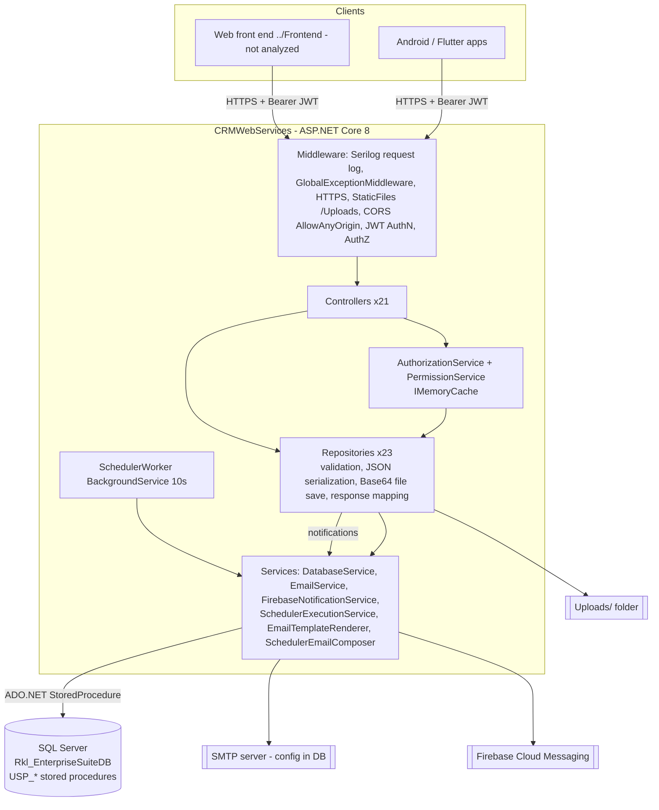
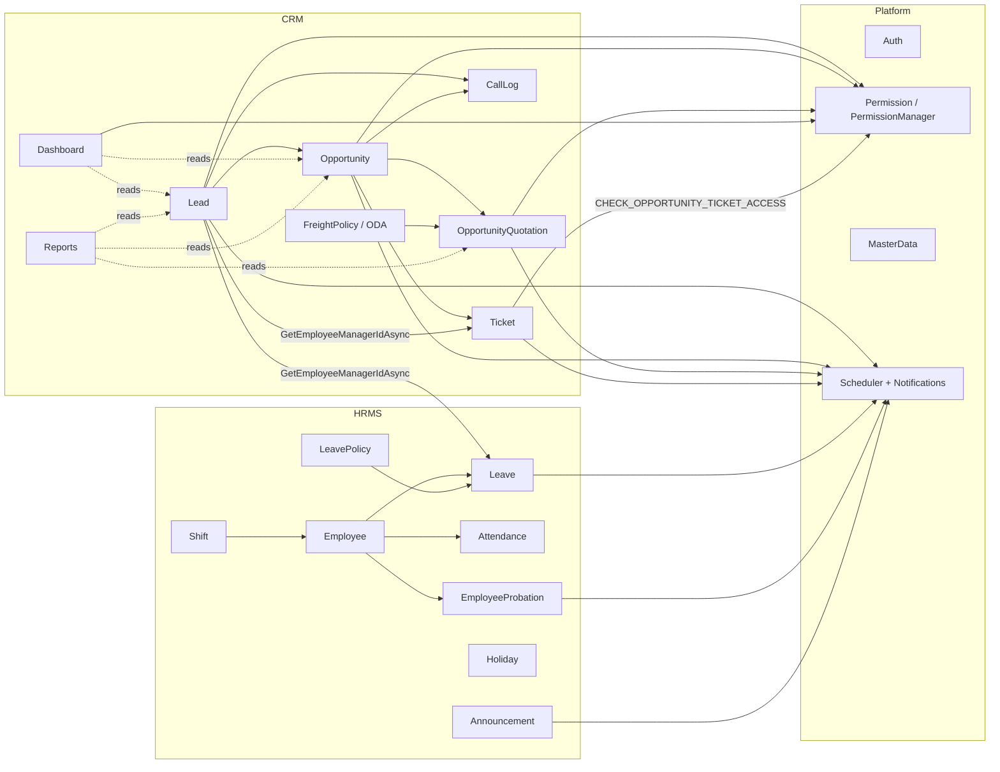

# Project Architecture

## 1. Summary

CRMWebServices is a single-project **ASP.NET Core 8 Web API**. It is the backend for the Rajkamal Business Management Platform, which combines a **CRM** (leads, opportunities, quotations, tickets) and an **HRMS** (employees, attendance, leave, probation, announcements).

Its main traits:

- **Database access.** It is stored-procedure-centric. Business rules mostly live in SQL Server SPs, which C# calls through a thin ADO.NET helper.
- **Not used for data access.** There is no Entity Framework DbContext and no domain or service layer for the business modules.
- **Background work.** A hosted service handles scheduled notifications.

## 2. Layers

### Folder responsibilities

| Folder | Content |
|---|---|
| `Controllers/` | 21 controllers. Thin: read claims, run permission checks, call a repository, map the result to an HTTP code. |
| `Repository/` | 23 classes holding most of the C# logic. Despite its location, `AuthorizationService.cs` is in the namespace `CRMWebServices.Services`. |
| `Interfaces/` | Repository and service interfaces. `EmployeeRepository` has none. |
| `Services/` | Infrastructure services: DB, email, Firebase, scheduler, templates, permissions. |
| `Models/` | Request and response DTOs. No DataAnnotations. There are subfolders, some with spaces in their names. |
| `Helpers/` | JwtHelper, ApiResponse, GlobalExceptionMiddleware, ClaimsPrincipalExtension, DataTableExtensions, RoleCodes. |
| `Data/` | DBConnection. |
| `Templates/Email/` | HTML email templates. |
| `Firebase/` | Service-account JSON, which is gitignored. |
| `Uploads/` | Runtime file store, served at `/Uploads`. |
| `Logs/` | Serilog rolling files. |
| `wwwroot/assets/` | Company logo. |

## 3. Module map and dependencies

- Each HRMS arrow (Emp→Leave and so on) is a data relationship through SP parameters: for example, `NewRegister` passes `ShiftId` and `LeavePolicyId`.
- The code-level dependencies are:
  - **Lead repository:** `LeaveRepository` and `TicketRepository` inject `ILeadRepository` to look up the manager.
  - **Notifications:** every notifying repository injects `ISchedulerExecutionService`.
  - **Quotation emails:** `OpportunityQuotationRepository` also injects `IEmailService` and `IEmailTemplateRenderer`.

## 4. Stored procedure per module

| Module | SP |
|---|---|
| Auth | `USP_ORG_Authentication` |
| Permission engine + manager | `USP_CRM_PermissionManagement` |
| Master data | `USP_ORG_EmployeeManagement`, `USP_ORG_NewEmployeeManagement`, `USP_CRM_LeadManagement` |
| Lead | `USP_CRM_LeadManagement` |
| Opportunity | `USP_CRM_OpportunityManagement` |
| Quotation / ODA | `USP_CRM_OpportunityQuotationManagement` |
| Freight | `USP_CRM_FreightPolicyManagement` |
| Ticket | `USP_CRM_TicketManagement` |
| Call log | `USP_CRM_CallLogManagement` |
| Dashboard | `USP_CRM_DashboardManagement` |
| Reports | `USP_CRM_Reports` |
| Employee | `USP_ORG_EmployeeManagement` (legacy), `USP_ORG_NewEmployeeManagement`, `USP_ORG_UpdateEmployee` |
| Attendance | `USP_ORG_Attendance` |
| Leave | `USP_ORG_LeaveManagement` |
| Leave policy | `USP_ORG_LeavePolicyManagement` |
| Probation | `USP_ORG_EmployeeProbationManagement` |
| Shift | `USP_ORG_SHIFTMANAGEMENT` |
| Holiday | `USP_ORG_HolidayManagement` |
| Announcement | `USP_ORG_AnnouncementManagement` |
| Scheduler / notifications | `USP_CRM_SchedulerManagement` |
| Email config | `USP_CRM_EmailConfiguration` |

Each SP acts as a multiplexer: the `@Status` parameter selects the operation. See [DATABASE_REFERENCE.md](DATABASE_REFERENCE.md) for what is present in the scripts.

## 5. Conventions observed

- **DI.** Everything is `AddScoped`, except Firebase, the template renderer and the email composer, which are singletons. `ICRMAuthorizationService` is registered twice, which is harmless.
- **Identity.** `User.EmployeeId()` reads the JWT claim. Several HRMS endpoints take the employee ID from the body or query string instead.
- **Child collections.** These are passed to SPs as JSON strings (Newtonsoft) or as table-valued parameters (Leave policy, Holiday).
- **Result parsing.** Columns are read by name and tables by index. `Status` is read as int (1) or bool. `SAVE_ROLE_ACCESS` uses a `Success` column instead.
- **Files.** Files arrive as Base64 in JSON, are saved under `Uploads/<Folder>`, and their relative path is stored in the DB. URLs are built as `/Uploads/...`.
- **HTTP codes.** These are inconsistent across controllers: some return 200 with `Status=false`, others 400. Clients should check `Status`.
- **Route naming.** Mixed styles are used: PascalCase, kebab-case and snake_case.
- **Logging.** `ILogger` with Serilog, writing to the console and to `Logs/crm-log-YYYYMMDD.txt`, which rotates daily with 30 files kept.

## 6. Deployment and runtime

- **Environments.** Development, InternalNetwork and OutsideNetwork. Each non-development environment overrides only the connection string. Swagger is enabled in all three.
- **Publishing.** Folder-publish profiles target local disk, likely followed by an IIS deployment. **Requires Verification**.
- **Required files at runtime:**
  - `Firebase/firebase-service-account.json`
  - `Templates/Email/*.html`
  - `wwwroot/assets/companylogo.jpg`
  - a writable `Uploads/` folder
  - a writable `Logs/` folder
- **Multiple instances.** `CLAIM_JOB_ITEM` is designed to prevent double processing when several instances run. Whether the claim is atomic is **Requires Verification**.
